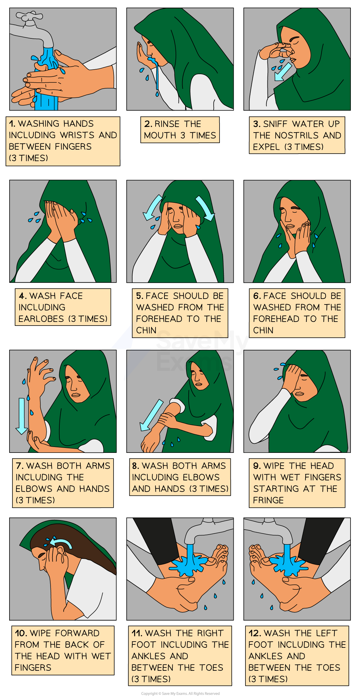
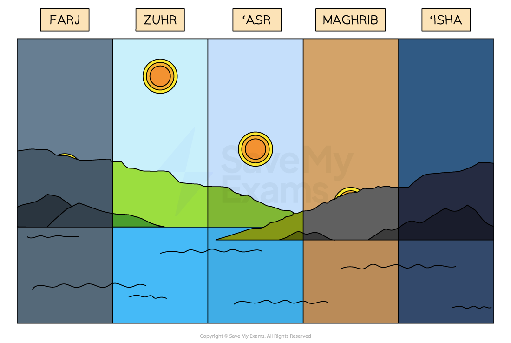
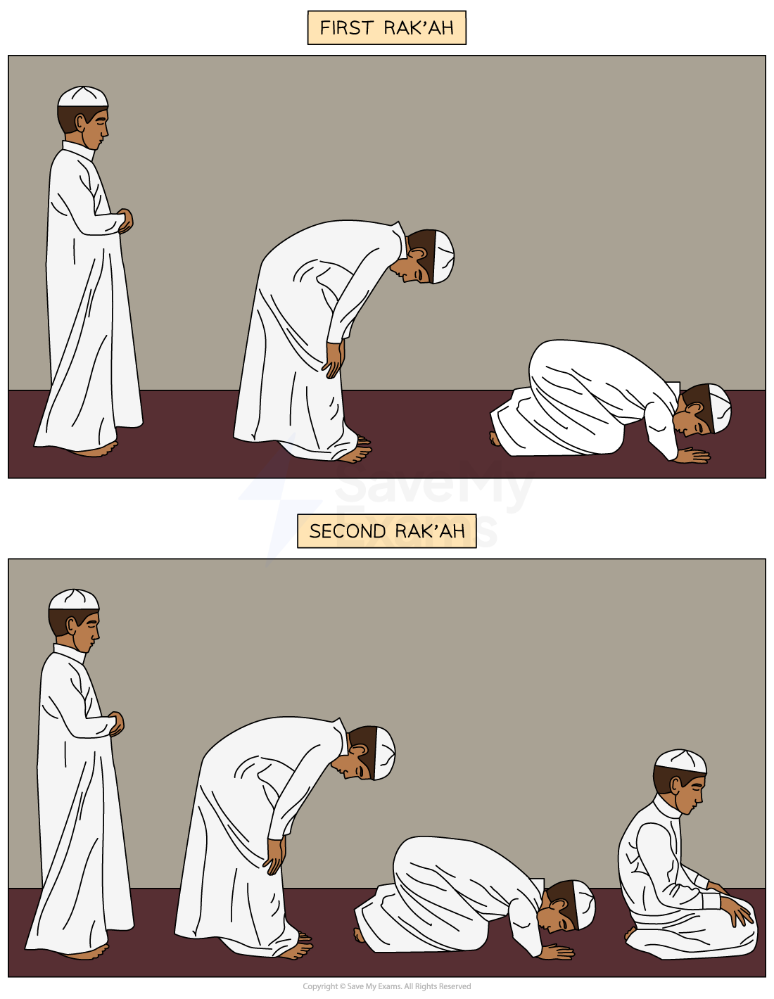

# Public & Private Worship in Muslim Communities

## What is the adhan?

> **Spec point** — `spcpt_2X6p8WVBp52ymTHM`

## What is the adhan?

- **Adhan** literally means “**announcement**” in Arabic
- The adhan is the **Islamic call to prayer**

  - In some countries, this takes place five times a day

> **blockquote**
> “Believers! When the call to prayer is made on the day of congregation, hurry towards the reminder of God and leave off your trading” (Qur’an 62:9)

- The **muezzin** is the official who calls the people to prayer, sometimes from a ***minaret*** at the mosque

## The performance of wudu and its significance

> **Spec point** — `spcpt_PPqKmrwfHchw776b`

## The performance of wudu and its significance

- **Muslims** must **prepare** themselves for prayer by spending a few moments **reflecting** on their ***niyyah*** (intentions)
- They must also **spiritually cleanse** themselves before prayer
- This is achieved by a **ritual washing** called **wudu, **following special instructions so they do it in the right order

  - The ritual involves **washing** faces, hands and feet under **running water**
  - **Mosques** have **special rooms** for this
  - In the **desert**, a dry wash of sand and dust can be used
  
    - This is called **tayammum**
  - It allows Muslims to fully **concentrate **on prayer

***Ritual washing — wudu***

## Salah and frequency of prayer

> **Spec point** — `spcpt_PcdfNZ4ZzgrYjxmY`

## Salah and frequency of prayer

- **Salah** (prayer) is the **second pillar** of Islam for **Sunni Muslims** and one of the **Ten Obligatory Acts** for **Shi’a Muslims**

  - It is considered to be the most important way of **worshipping God**
  - It occurs **five times** daily: just after **dawn**, just after** midday**, late **afternoon**, just after** sunset **and after **dark**
- The different prayers are given different names:

  - **Fajr** — just before sunrise
  - **Zuhr** — just after midday
  - **Asr** — late afternoon
  - **Maghrib** — just after sunset
  - **Isha** — between sunset and midnight

***The five times of prayer***

## The times and sequence of the rak'ahs

> **Spec point** — `spcpt_PDQPvcDpshSSTM8R`

## The times and sequence of the rak'ahs

- All Muslims pray towards **Makkah** and perform **rak’ah**, a set sequence of movements, during the prayers
- The actions that form the **rak’ah** during **Muslim prayer **are**:**

- While **standing**, Muslims recite the **first chapter** from the **Qur’an**
- While **bowing**, Muslims say in Arabic, “**Glory be to my Lord who is the greatest**” three times. This bowing position shows they believe **God** to be **great**
- Returning to an **upright position**, they make a **recitation praising God**
- They **kneel** with their forehead, nose, hands, knees and toes touching the floor
- This is called **prostration** and shows **complete obedience** to God
- They **recite**,** **“**How perfect is my Lord the most high**”
- Muslims then **sit, reciting “God is greatest”,** and after pausing for a few seconds, they repeat “God is greatest”

***Positions of prayer — rak’ah***

## Jum'ah prayer & its significance

> **Spec point** — `spcpt_xzdfhpwYZSdKPWQf`

## Jum'ah prayer & its significance

- **Jum’ah** is the **midday communal prayers** held on **Friday**; these are considered special
- There are various **hadiths** regarding the importance of Friday as a day of worship

> **blockquote**
> “The best day on which the sun has risen is Friday; on it, Adam was created. On it, he was made to enter Paradise, on it, he was expelled from it. And the last hour will take place on no day other than Friday” (Kitab al-Salat 4:1857)

- The 62nd chapter of the** Qur’an i**s named “**al-Jumuʿah**”** **because it mentions the **Friday prayer**

> **blockquote**
> “Allah Almighty says in this chapter, ‘O you who believe! When the call is proclaimed to prayer on Friday, hasten earnestly to the Remembrance of Allah, and leave off business: That is best for you if you but knew!’” (Qur’an 62:9)

- To **prepare** for **prayers**, Muslims** bathe**, apply **perfume** and **brush their teeth** to make their appearance pleasant to their fellow worshippers
- The worshippers getting together aims to develop the feeling of** unity **among the Muslim community
- All **male Muslims** are expected to attend unless they are ill or too old

  - **Women **can, too, but they are also able to pray at home
- Muslims read the **Surah Al Kahf **from the Qur’an on Fridays

  - They believe that the one who reads it will find their entire week **enlightened** until the next Friday
- Once the prayer is completed, the **imam** will deliver a **sermon** to remind Muslims of their **obligation to God**

  - The sermon is in two parts, with time in between for** personal prayer (du’a)**
- A series of rak’ahs is performed
- **Salutations** are sent on the **Prophet Muhammad **(pbuh) during the Friday service

  - The Prophet Muhammad (pbuh) said:

> **blockquote**
> “Whoever sends Salah upon me once, Allah would send Salah upon him tenfold, erase ten sins from him and raise him ten degrees in rank”

## Du'a prayer

> **Spec point** — `spcpt_tNgBnCzm9W6xrSkT`

## Du'a prayer

- The word **du'a** in Arabic means “**calling**”** **

  - **Du’a** is a **personal prayer** where Muslims can** call upon Allah**
- Muslims are encouraged to call upon Allah to ask for **help**, **express thanks** or ask for** forgiveness**, **guidance** and **strength** at any time throughout the day
- Du’a is in addition to the daily prayers of Salah
- Muslims can make these personal prayers in their **own words**, in any language

  - However, there are also recommended **examples **in the **Qur’an **and **Sunnah** to help them if they need help finding the words
- Du’a **calls Allah to mind** throughout the day for a Muslim, which **strengthens **their **faith** and **connection** to him

## Dhikr prayer & its significance

> **Spec point** — `spcpt_3hTjrTBYzx22gw3V`

## Dhikr prayer & its significance

- Dhikr means “**remembrance**”
- Dhikr prayer is a type of **spiritual reflection**, **calling Allah to mind** and** remembering **his many qualities, as the Qur’an instructs:

> **blockquote**
> “O you who believe! Remember God with much remembrance.” (Qur’an 33:41)

- Dhikr usually includes **reciting** the **99 beautiful names of Allah**, using ***Misbahah*** to help

  - Alternatively, a believer might count the names using their fingers
- During dhikr, Muslims focus on their **relationship with Allah**
- Dhikr may be performed **alone **or with a collective **group**

## Different views about the use and importance of the Qur'an

> **Spec point** — `spcpt_WYRnQyyvVtWtcNmh`

## Different views about the use and importance of the Qur'an

### Use and importance of the Qur’an in public worship

- The Qur’an is **central** to public worship, especially during **Friday (Jum’ah) prayers** in the mosque

  - It is recited in **Arabic** during **Salah (daily prayers)** and other religious services
- The **imam** often reads the Qur’an and explains verses during **sermons** to teach and guide the community
- During **Ramadan**, the **entire Qur’an** is often recited over the course of the month
- Listening to the Qur’an being recited during worship helps Muslims feel **spiritually connected** and reminds them of **Allah’s teachings**

### Use & importance of the Qur’an in private prayer and study

- Muslims are encouraged to **read** the Qur’an **daily**, especially in the early morning
- Many Muslims learn to **recite** the Qur’an in** Arabic**, even if it is not their first language

  - Others **learn Arabic** so that they can study it in greater detail
- Some Muslims aim to become **Hafiz** (one who has memorised the whole Qur’an), which is seen as a great honour
- Muslims may read the Qur’an:

  - For** guidance** when facing personal or moral decisions
  - As an act of** worship **and **devotion**, even if they do not understand every word
  - In **study**, to try to understand its full meanings

### Different views about the use and importance of the Qur’an

- **All Muslims** see the Qur’an as the **literal word of God** (Allah), as revealed to the Prophet Muhammad (pbuh)
- **Sunni and Shi’a Muslims** agree on its **sacred status**

  - However, they differ slightly in how they use or interpret it, especially alongside other sources of authority, for example, the*** Hadith***
- Some Muslims emphasise the **spiritual power** of the recitation of the Qur’an
- Others may place more focus on **studying** the Qur’an intellectually and applying its teachings to **social justice** and **daily life**

> **Worked Example**
> **State two practices involved in Salah **
> 
> **[2 marks]**
> 
> **Final answer:** **Answer:**
> 
> Muslims perform wudu, or ritual washing, in preparation for Salah **[1 mark]**
> 
> They face the Ka’aba in Makkah while praying **[1 mark]**

> **Exam Hint**
> There are many key terms about Muslim worship in this section. One good practice is to make your own glossary of the most important vocabulary so that you can use it accurately in your exam answers. Flashcards containing the term on one side and the definition on the other are a good way to test yourself.
