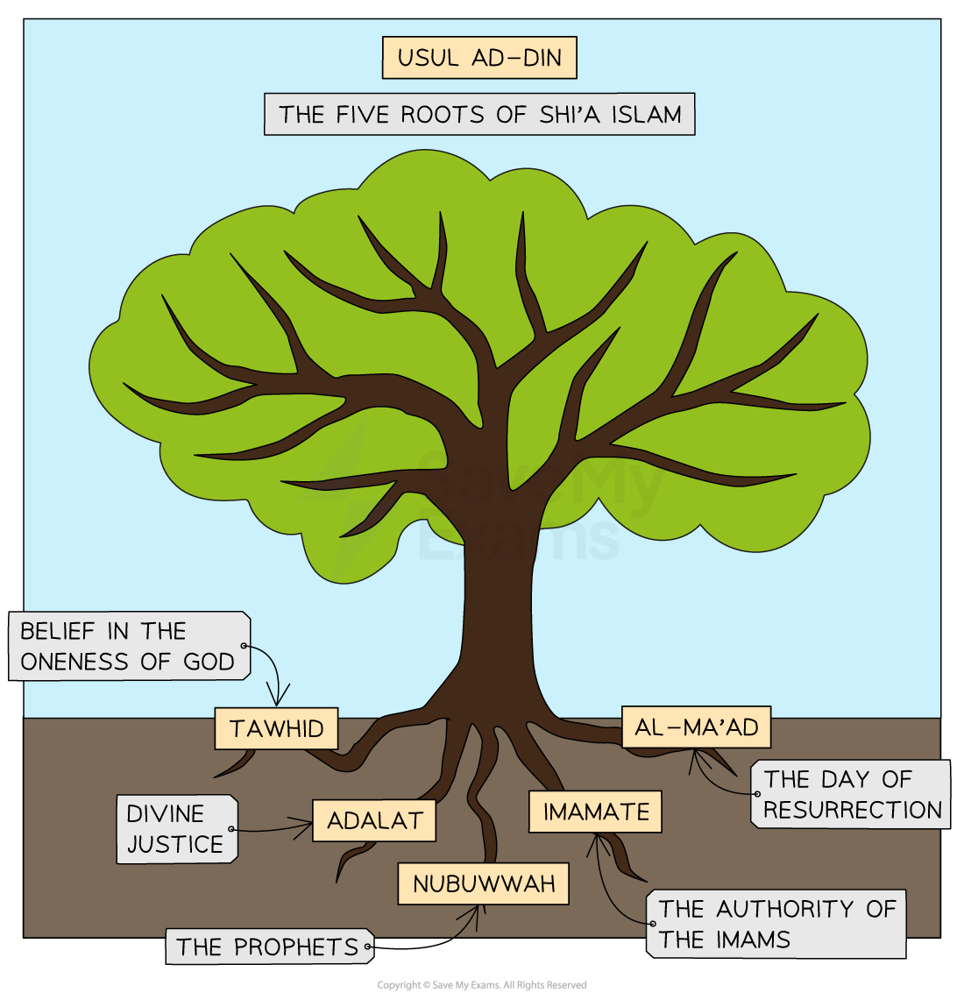

# The Five Roots of Usul ad-Din

## Tawhid as one of the five roots

> **Spec point** — `spcpt_9VyBN2pzTyzQ66jd`

## Tawhid as one of the five roots

### The five roots of Usul ad-Din

- ***Shi’a*** is the other major branch of Islam, aside from ***Sunni***
- Shi’a Muslims believe in the ***six articles of faith*** but also accept the **five roots of Usul ad-Din**, which are based on the teachings of the **Qur’an**, the ***Hadith*** and the agreement of early **Shi’a scholars** and **leaders**

### What are the five roots of Usul ad-Din?

- The five roots of Usul ad-Din are** five key principles of the faith** that are sometimes called the “**roots of religion**”
- Every Shi’a Muslim must make themselves aware of these key principles or truths

***The five roots of Shi’a Islam***

### Tawhid

- **Tawhid** is the **belief in one God, Allah**
- Muslims believe that Allah is the **Supreme Being**, **creator of the universe**
- Allah is **One God**,** indivisible** and** absolute**; nothing comes close to Him as the ultimate source of **power** and** creation**

> **blockquote**
> “He is Allah, the One, Allah is eternal and absolute. None is born of Him, He is unborn. There is none like unto him” (Qur’an 112:1–4)

- **Allah** has **99 names **or **characteristics** that make it clear that there is **one true God**; these include:

  - **Al-Ahad **(the one and only)
  - **All Wahid** (the one)
- According to a ***Hadith****,* the Prophet **Muhammad** (pbuh) said that Muslims should mention Tawhid first when telling non-Muslims about Islam

> **blockquote**
> “Let the first thing to which you will invite them, be the Tauhid (Tawhid) of Allah” (Sahih al-Bukhari 93:469)

- This means that:

  - **Tawhid** is the **most important belief** for Muslims
  - Islam is a* ****monotheistic*** religion

- This is the same as the equivalent in the six articles of faith

## ‘Adl (divine justice)

> **Spec point** — `spcpt_4B9zbkgmCy3vPvdM`

## ‘Adl (divine justice)

## ‘Adl as one of the five roots of Usul ad-Din

- ‘**Adl** or **Adalat **means belief in** divine justice**
- This is the belief that **Allah is fair **and will **treat everything** and **everyone justly**

  - He will **hold humans accountable **for their actions
- Muslims need to be aware that there is good and evil in everything, but Allah commands them to **do good**

> **blockquote**
> “Indeed Allah commands them to do justice” (Qur’an 16:19)

- Allah acts with a **purpose** that humans cannot understand

  - Sometimes justice can be hard to see, but Shi’a Muslims should try to understand as much as they can
- The first **imam**, Ali, stated in his will to his son:

> **blockquote**
> “I advise you to be wary of your duty to Allah in wealth and poverty … and [I advise you] of being just towards both friend and foe”
> 
> (Tuhaf al-Uqul)

## Risalah (prophets) as one of the five roots

> **Spec point** — `spcpt_WFkPZ72KCsZSKF5J`

## Risalah (prophets) as one of the five roots

- **Risalah** is Arabic for “**message**”** **and refers to “**prophethood**”** **
- Risalah is the belief that **Allah** chose special people to **communicate** his word to **humanity **and to **teach** and **guide people** along the right path

  - These people are known as **prophets**
- Prophets receive **revelation** from Allah through his **angels**

  - Muslims believe that Allah has chosen **many prophets** to bring the message of Islam to people
- There are **25** key prophets of Allah identified in the Qur’an, including **Adam**, **Ibrahim** (Abraham),** Musa **(Moses), **Isa** (Jesus) and **Muhammad** (pbuh)
- Muslims believe that there were **124,000 prophets** who developed the religion over time
- The Prophet** Muhammad** (pbuh), the **last of the prophets**, is known as** **“**The Seal**”

- This is the same as the equivalent in the six articles of faith

## Imamah (authority of the imams)

> **Spec point** — `spcpt_r2rY4NKHsMKVbhXd`

## Imamah (authority of the imams)

## Imamah as one of the five roots of Usul ad-Din

- **Imamah** is the belief in the God-given** authority of the imams**

  - This refers to the Prophet **Muhammad's** (pbuh)** successors**
- Shi’a Muslims believe that **Allah appointed** certain** imams **or** leaders** to guide humanity with authority and wisdom

  - This group of people includes not only the Prophet **Muhammad** (pbuh) but also his daughter Fatimah and a line of imams starting with Ali
- This group is known as the **Ahl al-Bayt**, or **People of the Prophet’s House**

  - The Ahl al-Bayt are believed to be **pure** and **infallible** (unable to make mistakes)
  - They are known as “**lights**” in some Shi’a writings, meaning that they were sent to show people the path out of darkness and sin and lead them towards Allah

> **blockquote**
> “God wishes to keep uncleanness away from you, people of the [Prophet’s] House, and to purify you thoroughly” (Qur’an, Surah 33:33)

- Most Shi’a Muslims believe there were **12 imams** after the death of the Prophet Muhammad (pbuh), known as **Twelvers**

  - Shi’a Muslims think that dedicating themselves to these 12 imams is essential to their faith
- Other Shi’a Muslims are known as **Seveners** because they believe there was a different line of imams, numbering seven in total

## Mi'ad (Day of Resurrection)

> **Spec point** — `spcpt_2Vg8vW7xc5GNTHy5`

## Mi'ad (Day of Resurrection)

## Mi’ad as one of the five roots of Usul ad-Din

- Mi’ad is the belief in the **Day of Judgement** and **Resurrection**
- This is the belief that there will be a day of judgement and resurrection when all humans will be **judged by Allah**, who decides whether they go to **heaven** or **hell** based on their deeds
- Everyone must answer for themselves and accept the consequences of their thoughts and actions on earth
- Human life acts as a** test for the eternal life** that will come after it
- This is the same as the equivalent belief, **Risalah**, in the six articles of faith

> **blockquote**
> “All praise belongs to Him in this world and the next; His is the Judgement; and to Him you shall be returned” (Qur’an, Surah 28:70)

> **Worked Example**
> Name two of the five roots of Usul ad-Din
> 
> **[2 marks]**
> 
> **Final answer:** **Answer:**
> 
> One of the five roots of Usul ad-Din is Tawhid **[1 mark]**
> 
> Another is the belief in Imamah **[1 mark]**

> **Exam Hint**
> The five roots of Usul ad-Din are central to Shi’a Islam. The later section of these revision notes, titled The Development of Islam, explains the difference between Sunni and Shi’a Islam in greater detail.
> 
> It may help you to think of each of these five roots as forming the foundation of a Muslim’s faith, just as roots do for a tree.
