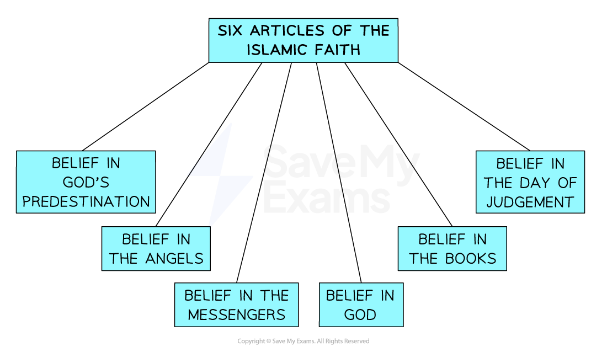
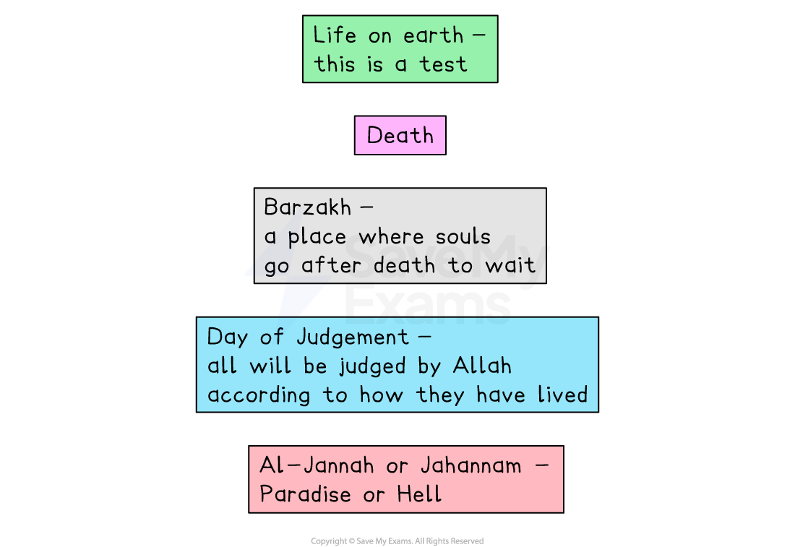
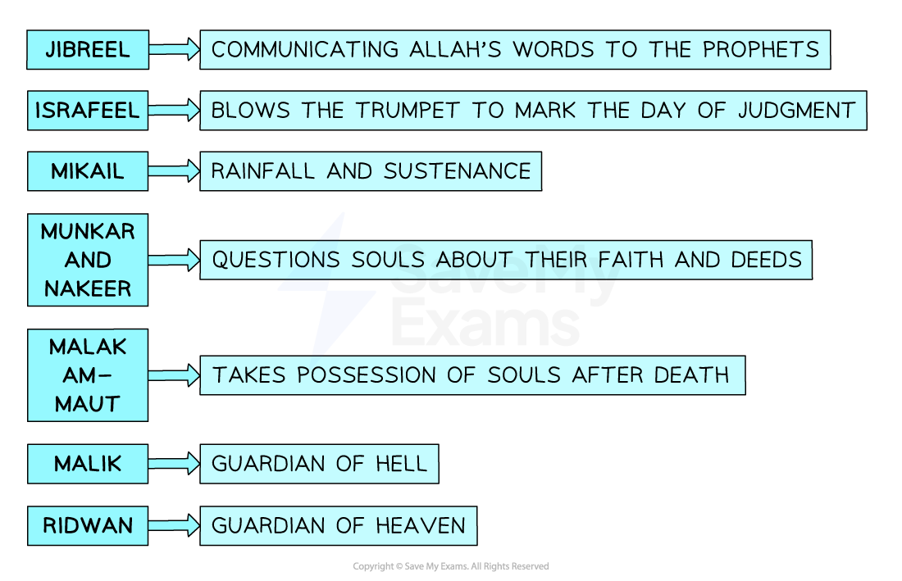
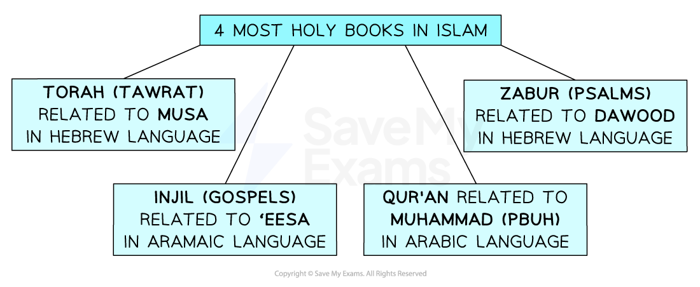

# The Six Articles of Faith

## Tawhid as one of the six articles of faith

> **Spec point** — `spcpt_D59FrPvCgmfdyPpD`

## Tawhid as one of the six articles of faith

### The six articles of faith

- The **six articles of faith**, or six beliefs, are known as **Iman al-Mufassal**
- They are based on the **Qur’an** and the **Hadith of Gabriel** contained in the **Kitab al-iman** or **Book of Faith**
- The six articles of faith are central to the faith of all Muslims

***The six beliefs (articles) of Islamic faith***

### What is tawhid?

- **Tawhid** is the **belief in one God, Allah**
- Muslims believe that Allah is the **Supreme Being**, the **creator of the universe**
- Allah is **One God**,** indivisible** and** absolute**; nothing comes close to Him as the ultimate source of **power** and** creation**

> **blockquote**
> “He is Allah, the One; Allah is eternal and absolute. None is born of Him; He is unborn. There is none like unto him” (Qur’an 112:1–4)

- **Allah** has **99 names **or **characteristics**, which make it clear that there is **one true God**. These include:

  - **Al-Ahad **(the one and only)
  - **Al Wahid** (the one)
- According to a ***Hadith***, the Prophet **Muhammad** (pbuh) said that Muslims should mention Tawhid first when telling non-Muslims about Islam

> **blockquote**
> “Let the first thing to which you will invite them, be the Tauhid (Tawhid) of Allah” (Sahih al-Bukhari 93:469)

- This means that:

  - **Tawhid** is the **most important belief** for Muslims
  - Islam is a ***monotheistic*** religion

## Risalah (prophets) as one of the six articles of faith

> **Spec point** — `spcpt_qDSD4qq4XTYbbs4J`

## Risalah (prophets) as one of the six articles of faith

- **Risalah** is Arabic for “**message**”** **and refers to “**prophethood**”** **

  - Risalah is the belief that **Allah** chose special people to **communicate** his word to **humanity **and to **teach** and **guide people** along the right path
- These people are known as **prophets**
- Prophets receive **revelations** from Allah through His **angels**

  - Muslims believe that Allah has chosen **many prophets** to bring the message of Islam to people
- There are **25** key prophets of Allah identified in the Qur’an, including:

  - **Adam**
  - **Ibrahim** (Abraham)
  - **Musa **(Moses)
  - **Isa** (Jesus)
  - **Muhammad** (pbuh)
- Muslims believe that there were **124,000 prophets** who developed the religion over time
- **Muhammad** (pbuh), the **last of the prophets**, is known as** **“**The Seal**”

## Akhirah (life after death)

> **Spec point** — `spcpt_K9NB8wxj6qQ5QdXF`

## Akhirah (life after death)

- **Akhirah**, or the **afterlife**, is a **key belief in Islam **and one of the six articles of faith
- Muslims believe **death** is **not the end** of life

  - After death, there will be a **resurrection** and an **afterlife**, known as **Akhirah**
- All human life has a **purpose**

  - Each person is **responsible** for their **actions** on this earth, and where a person will go in the afterlife is determined by the **choices** they make in this life
  - Thus, this life is seen as **preparation** for the **next life**
- As humans, we have been given **free will**, so we are able to make **choices** about what to believe and how to treat others

  - Our choices during this mortal life are a **test**, and we will be **judged** according to how we have lived and held accountable for our actions
- When a person dies, they are taken by **Iz’rail (the angel of death)** to **Barzakh**

  - This is the stage between a person’s **death **and when they face **judgement**

***Stages of Akhirah***

## The Mala’ikah (angels)

> **Spec point** — `spcpt_mKHj6VtZMXDNmb26`

## The Mala’ikah (angels)

### The Mala’ikah as one of the six articles of faith

- Muslims accept the existence of **angels **(called **Malai’kah** in Arabic)
- Muslims believe in angels because they are mentioned in the **Qur’an**
- Angels are heavenly beings who were created by Allah, are obedient to Him and are called by Him to perform various tasks, including:

- **Communicating with humans** to **deliver Allah’s messages** via the **prophets**
- **Praising Allah** and guarding his throne
- **Governing the universe** and the **laws of nature**
- Recording people’s good and bad deeds for the **Day of Judgement **— this is the responsibility of the **kiraman katibin (noble scribes)**
- **Welcoming** humans into paradise

- Some of the most significant angels in the Qur’an are:

- **Jibril **(known as Gabriel in Christianity and Judaism), the **Angel of Revelation**, who revealed the whole Qur’an to Muhammad (pbuh)
- **Izra’il**, the **Angel of Death**, who signals the coming of the Day of Judgement and takes souls to Allah when they die
- **Mika’il** (known as Michael in Christianity and Judaism), the **Angel of Mercy**, who oversees life on earth and rewards those who have led a good life

***The role of angels in Islam***

## Qadar (predestination)

> **Spec point** — `spcpt_gHbJfXKk6DYJxVXD`

## Qadar (predestination)

### Qadar as one of the six articles of faith

- Muslims believe in **Qadar** or **predestination**
- This is the idea that Allah is **omnipotent (all-powerful)** and **omniscient (all-knowing)**

> **blockquote**
> “He knows what is within the heavens and earth and knows what you conceal and what you declare. And God is Knowing of that within the breasts” (Qur’an, Surah 64:4)

- This teaching from the Qur’an means that Allah is so omniscient that he even knows the **secrets** within our hearts
- As the creator of everything, Allah has put **predetermined** and **unchangeable **rules in place that govern the universe

  - These include the **rules of science**; for example, how the planets orbit the sun
- Therefore, Allah **knows everything that will happen**

  - The Qur’an teaches:

> **blockquote**
> “He is the All-Knowing Creator: when He wills something to be, His way is to say ‘Be’ and it is!” (Qur’an Surah 36:81-82)

- Although Allah has given humans** free will,** **nothing happens** unless it is the **will of Allah **
- Muslims often use the phrase “**insha’Allah**”, meaning “if Allah is willing” or “**if Allah allows it**”** **about everyday events to express this belief
- Sometimes, people’s **choices** are in **harmony **with **Allah’s will**, and this is part of Qadar, helping to bring about God’s plan for the world

## Kutub (holy books)

> **Spec point** — `spcpt_PwV4Y4zqBr5nQzMr`

## Kutub (holy books)

### Kutub as one of the six articles of faith

- Muslims believe in the authority of the** holy books, **or **kutub**, as one of the six articles of faith
- Muslims believe that **Allah’s messages** are contained within the** kutub** (or **kutubullah**),** **meaning** books of Allah. **There are** five **“**revealed**”** kutub:**

  - **Tawrat**
  - **Sahifah**
  - **Zabur**
  - **Injil**
  - **Qur’an**
- The most important of these is the** Qur’an**, which has complete authority and is seen as the **perfect word of God** as **revealed to Muhammad (pbuh)**

***The holy books of Islam***

- The** Tawrat (Torah) **contains the revelations given to **Musa (Moses)** by Allah on Mount Sinai

  - It contains the **Ten Commandments**
  - The **Qur’an** says that it contains the** “judgement of Allah”** (Quran 5:43)
- The **Zabur (Psalms)** of **Dawud** (David), a collection of prayers to Allah (some refer to them as poems)

  - They contain lessons of **guidance** for the people
- The **Injil** **(Gospels)** contain the messages **Allah** revealed to **Isa (Jesus) **

  - Muslims believe that the Injil *foretells* the coming of the **Prophet Muhammad (pbuh)**
- Although all of these religious texts are considered as having been revealed by Allah — and are held as sacred by Judaism, Christianity or both — Muslims do not hold them in the same regard as the Qur’an

  - These holy books are believed to contain some **errors **and therefore are **not the direct word of Allah **
  - Thus, they do not have the same authority as the **Qur’an**

> **Worked Example**
> Name two of the six articles of faith in Islam
> 
> **[2 marks]**
> 
> **Final answer:** **Answer:**
> 
> Tawhid is one of the articles of faith **[1 mark]**
> 
> Another is the belief in Risalah **[1 mark]**

> **Exam Hint**
> The Qur’an is of such central importance that it will be covered in greater detail later in these revision notes. When revising kutub as one of the six articles of faith, remember that the Qur’an is one of the kutub, but other religious texts also hold some authority as “revealed” books.
