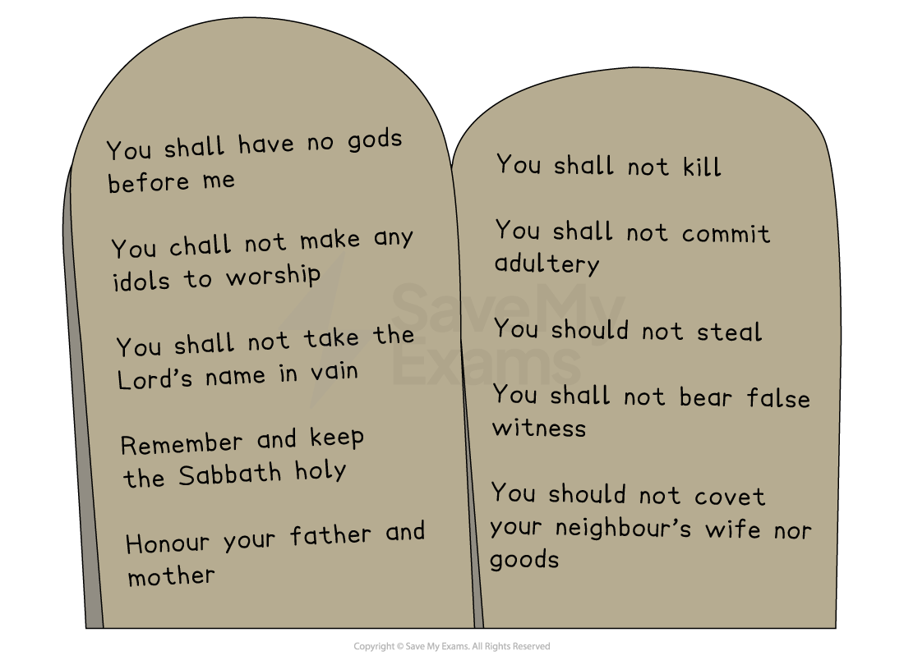

# Covenants with the Jewish People

## The covenant of circumcision with Abraham

> **Spec point** — `spcpt_7sdnpn9yxY3yK2SV`

## What is a covenant?

- A **covenant **is an **agreement **between two or more people
- It can be thought of as a deal in which both sides have **responsibilities** or **duties **that **must be upheld** if the covenant is to be considered binding
- In religion, a covenant is a **commitment of love** and creates a relationship that is different from that of a contract
- Covenants in Judaism can only be established and sealed by an** oath**
- The oath is so important in a covenant that the word “oath” is sometimes used instead of the word “covenant”
- The covenant with G-d is described as “**an everlasting covenant**” (**Brit Olam**) and describes the view that **G-d will never break his covenant** with the Jewish people

  - The covenant means that Jews believe they have a **special relationship** with G-d, as well as a relationship with one another
  - The relationship **contributes to the Jewish identity** and encourages them to examine who they are in relation to G-d
  - It means that** everyone** in the community** is a member of the covenant** and important to G-d, and therefore, all Jews should be important to each other
  - It also helps Jews to focus on their **obligation** to live according to tradition and how G-d wants people to live: generously, compassionately and with concern for justice and the welfare of others

### What is the covenant of circumcision with Abraham?

- For Jews, **Abraham** is known as the founder or **first** **patriarch of Judaism**, and Jewish people strive to follow his example
- He was the first Jewish prophet who received the **first covenant** from G-d and took **G-d’s message **to the people
- It was through Abraham that the idea of the** Promised Land**, a homeland for Jewish people, was created
- There are **three main parts** of the covenant between G-d and Abraham

  - G-d called Abraham and his family to the new land of **Canaan**, often referred to as the Promised Land
  - G-d promised Abraham he would make a great nation for him
  - G-d promised to bless Abraham and his family
- The story of G-d giving Abraham the covenant is important within Judaism

  - Abraham was born in the** city of Ur** (located in the country now called** Iraq**) at a time when worshipping *idols *was common
  - The **Book of Genesis** explains how G-d spoke to Abraham in a** vision**

> **blockquote**
> “Go forth from your native land and from your father’s house to the land that I will show you. I will make of you a great nation, And I will bless you” (Genesis 12:1–2)

- G-d instructed Abraham to leave his home and** travel to Canaan**, the Promised Land, which is today known as **Israel**
- G-d asked Abraham to** follow his rules** and be a good example to others
- In return, G-d promised to give Abraham and his wife **Sarah **the child they both longed for and to name their *descendants* as his chosen people
- Abraham agreed that he and his descendants would obey and worship G-d and lead by example
- As part of the covenant, G-d commanded that the covenant was sealed through Abraham’s** circumcision**

> **blockquote**
> “[Circumcision] shall be the mark of the covenant between Me and you … Throughout all generations, every male shall be circumcised when he is eight days old … The uncircumcised male … shall have his soul cut off from his people; he has broken My covenant” (Genesis 17:11–14)

- Abraham kept this covenant and his wife, **Sarah, gave birth to their son, Isaac**
- G-d chose Isaac to **inherit the covenant **directly from his father, and Isaac handed it on to his own son, **Jacob**
- Therefore, Abraham, Isaac and Jacob are known as **Israel’s patriarchs**
- As a sign of this continuing covenant, Jewish people perform the rite of circumcision of **male babies** eight days after they are born in a ceremony called **Brit Milah**

## The covenant of law with Moses

> **Spec point** — `spcpt_t5DCZWDBBfjRhJQf`

## What is the covenant of law with Moses?

- **Moses** is regarded as the greatest **prophet** in Judaism

  - Jews believe that he, too, made **an important covenant with G-d**
  - It is believed that Moses is the only person to have ever **witnessed God face-to-face**
  - Moses **delivered the words of G-d **and **received miracles** sent by God
  - Jews believe that **G-d acted through Moses**
- The story of Moses is important for Jewish belief and practices, especially the story where he **led the Israelites out of slavery** to the** Promised Land**

  - This journey is remembered and celebrated at the festivals of **Succoth **and **Pesach**
  - G-d promised to be with Moses in his role

> **blockquote**
> “‘Who am I to go to the pharaoh?’ said Moses to G-d. ‘And how can I possibly get the Israelites out of Egypt?’ ‘Because I will be with you,’ replied G-d” (Exodus 3:11–15)

### What is the Covenant at Sinai?

- Jews believe that:

  - After Moses had led the Israelites out of Egypt, he took them through the **desert **and disappeared up a mountain** (Mount Sinai)**
  - This is when **G-d revealed to Moses the 613 commandments** that Jews are expected to follow, including the **Ten Commandments**
  - G-d spoke to Moses through a **burning bush**
  - **Many Jews (mainly Orthodox Jews**) also believe that Moses was given the **oral Torah**, which was passed down by **word of mouth** to help people interpret the written Torah

- Moses was also given the Ten Commandments to teach the **children of Israel** about **the most important rules** to live by
- Moses formed a **covenant with G-d **that, as G-d’s **chosen people**, the **Israelites would keep the commandments**

### The Promised Land

- The **Tanakh **repeatedly refers to G-d’s offer of a Promised Land for Abraham and his descendants

  - G-d promised Abraham and his wife Sarah many descendants

> **blockquote**
> “Who would make you into nations and who would be kings with whom G-d would keep an eternal covenant” (Genesis 17:6–7)

- Today, many Jews believe that the land now known as** Israel** belongs to Jews in **fulfilment of G-d’s covenant** with **Abraham** to give the Jewish people a Promised Land

  - This has often led to conflict both within and outside the religion
  - In 1948, despite opposition from Arab countries in the Middle East, the** State of Israel **was created
  - Since then, there have been many disputes, and even wars, over the land

## The importance of the two covenants for Jewish people

> **Spec point** — `spcpt_8x2WXxNXZXXJWXcK`

## Why is the covenant with Abraham important to the Jewish people?

- The covenant with Abraham is very important to Jewish faith and practice for many reasons:

  - The covenant is viewed as the **foundation of the Jewish faith**
  - It is also the **first formal agreement between G-d** and the **Jewish people**
  - It marks the **beginning** of the Jewish people’s **special relationship with G-d**
  - It is also the first time that there is the promise of the **Promised Land**
  
    - G-d promised Abraham: “To your descendants I give this land” (Genesis 15:18)
    - This forms the basis for the Jewish connection to the **Land of Israel**
  - It is the promise of the Jews as a **great nation**
  
    - G-d said: “I will make you into a great nation” (Genesis 12:2)
    - Abraham would become the** father of the Jewish people,** and Jews see themselves as his spiritual **descendants**
  - It is also important because of the responsibilities of the covenant
  
    - Abraham promised to worship only one G-d (**monotheism**), and in return, **G-d promised protection** and** blessing**
    - **Brit Milah (circumcision)** was given as a **sign of the covenant** and is still practised today

### Why is the covenant with Moses important to the Jewish people?

- For Jews, the** covenant with Moses **is seen as the **foundation of Jewish Law**

  - G-d gave the **Torah (including the Ten Commandments)** to Moses on Mount Sinai
  - These laws form the **basis of Jewish life**,** worship** and **morality**
- The covenant includes **613 commandments** that guide all areas of life

  - **Orthodox Jews **follow them **strictly**, and they are also important to **Reform Jews **
- The Ten Commandments were placed in the **Ark of the Covenant** and kept in the **Tabernacle** and later the Temple

  - This symbolises** G-d’s presence** among the people
- The covenant reaffirms the identity of Jews as** G-d’s chosen people**

  - G-d tells Moses that the Jews will be a “kingdom of priests and a holy nation” (Exodus 19:6)
  - This reinforces their **special relationship with G-d** and their duty to be a moral example
- The covenant remains relevant today and continues to shape Jewish life

  - It is celebrated at festivals like** Shavuot,** which commemorates the giving of the **Torah**

## Different views on the importance of the covenants

> **Spec point** — `spcpt_kTS27Ys4XV5gc3vj`

## What are the different views on the importance of covenants within Judaism?

- There are different views amongst Jews about the importance of the covenants of Abraham and Moses

  - Within **Orthodox Judaism**, the covenant with Abraham is seen as the **foundation of the Jewish faith**
  
    - It marks Jews as **G-d’s chosen people**
    - The commandment of circumcision (**Brit Milah**) is still **strictly followed **as a sign of this covenant
  - The covenant with Moses is considered more detailed and central to daily life
  
    - It contains the 613** mitzvot**, including the Ten Commandments, which must be fully observed
    - This is viewed as the **basis of the Torah** and **Jewish law**
  - Within **Reform** and **Liberal Judaism**, the covenant with Abraham is still highly respected for its **symbolism of faith**,** identity** and **connection to G-d**
  
    - However, **Brit Milah** may be** optional **or reinterpreted in some liberal communities
  - The covenant with Moses is viewed as important, but** not all laws are seen as binding**
  
    - The focus is more on **ethical principles** than ritual law
    - Some** commandments may be adapted** to fit modern values and equality

## Impact of the beliefs about the covenants on Jews’ daily life

> **Spec point** — `spcpt_fmZXZZ4S4z6qdSjY`

## How does the covenant of Abraham impact Jewish daily life?

- The covenant with **Abraham** impacts Jews in relation to their **sense of identity **and **commitment to the faith**

  - For example, for most Jews,** Brit Milah (Circumcision)** is** still performed **on 8-day-old boys as a sign of the covenant
  
    - This symbolises **belonging** to the Jewish people and **commitment to G-d**
  - The covenant also gives Jews a **sense of chosenness**
  
    - Jews see themselves as G-d’s chosen people with a **special mission to live by his values**
  - Many Jews also feel a **connection to the Land of Israel**
  
    - The promise of land affects Jewish prayers and* Zionist** *beliefs
- The covenant with Moses impacts Jews more in relation to law and practice

  - The 613 mitzvot guide many aspects of daily life (Orthodox Jews especially), including:
  
    - Keeping *kosher*
    - Observing *Shabbat*
    - Praying regularly
    - Wearing *tefillin *and a *tallit*
  - The covenant also influences the relationship Jews have with others
  
    - Laws about justice, kindness and charity are followed to reflect G-d’s will
  - Studying the **Torah **is a **lifelong duty** to **understand **and **follow G-d’s laws**

> **Worked Example**
> Name two people with whom Jews believe G-d made covenants
> 
> **[2 marks]**
> 
> **Final answer:** **Answer:**
> 
> Abraham and Moses

> **Exam Hint**
> Remember that these covenants are not just ancient agreements; they shape how Jews live, worship and relate to G-d every day
> 
> For example, the covenant with Abraham affects daily life through circumcision, which marks Jewish boys as part of G-d’s chosen people
> 
> The covenant with Moses affects daily life through mitzvot, such as keeping kosher and observing Shabbat
> 
> Be prepared to explain the difference between Orthodox and Reform/Liberal interpretations of the covenant
