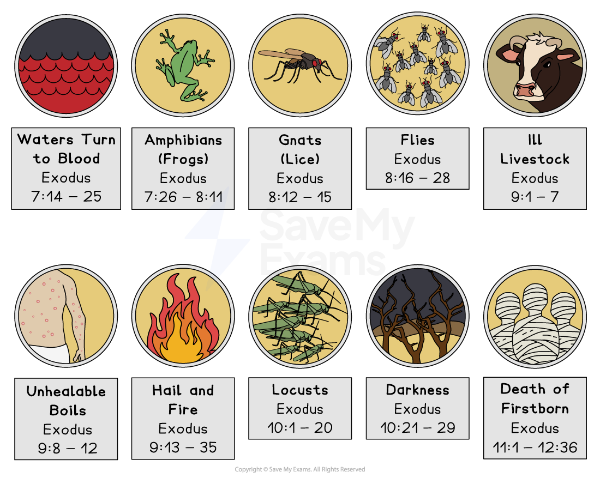

# Peasch (Passover)

## Pesach as a celebration of G-d’s deliverance of the Israelites

> **Spec point** — `spcpt_7GrF6TsKRrpXW3yZ`

## What is the festival of Pesach?

- **Pesach** celebrates the **release of the Jewish people from slavery** in Egypt and is also known as **Passover**
- The story of Passover is found in the **book of Exodus **(chapter 12) in the Torah

  - **G-d commanded** that Jews celebrate this festival every year as a mark of freedom:

> **blockquote**
> “This day must be one that you will remember. You must keep it as a festival to G-d for all generations. It is a law for all time that you must celebrate it” (Exodus 12:14)

- It is sometimes referred to as the **Festival of Freedom**, with **prayers** said each year for **those who are not free**
- Jews remember how the **Israelites **left slavery when **Moses** led them out of Egypt more than 3,000 years ago
- Moses went to ask the Pharaoh to release the Israelites many times, but each time, he refused
- Moses warned the Pharaoh that G-d would send **ten plagues** to Egypt if he did not let them go

  - The ten plagues were:
  
    - Water turning to blood
    - Frogs
    - Gnats
    - Flies
    - Ill livestock
    - Unhealable boils
    - Hail and fire
    - Locusts
    - Darkness
    - Death of firstborn children

***The Ten Plague***

- During the **final plague**, G-d is said to have told Moses to tell the Israelites to paint **lambs’ blood **on their** doorposts**

  - This would ensure that the **angel of death** knew that Jewish people lived in those houses
  - The angel of death would then **pass over those houses **and **not kill the firstborn child**
  - This is where the name Passover comes from
  - During the last plague, even the **Pharaoh’s son was killed**
- The Pharaoh summoned Moses and told him to take the Israelites out of Egypt immediately

  - After more than 200 years of enslavement, the Jewish people were free

## What is the Seder?

> **Spec point** — `spcpt_9zW28YtRv7CRfJDW`

## What is the significance of the Seder?

- During Pesach, rituals and practices are performed to **celebrate the release of Jews **from slavery and to remember the hardship they endured
- In preparation for Pesach, Jews **remove all grain products** (called **chametz**) from their houses

  - Grain is **not allowed** to be eaten during the festival
  - **Leavened goods** (containing yeast), such as bread and beer, **are also removed** from the house
  
    - Jews thoroughly clean their homes to remove any trace of these items
  - This is done to remember that the Israelites did not have time to allow their bread to rise before they left Egypt
- **Candles are lit** to welcome Pesach
- The family goes to the **synagogue**, where **special prayers** are recited and **passages from the Torah** are read
- A special meal called the **Seder meal** is held

### The Seder meal

- There are many symbolic foods on the table for the Seder meal:

  - A** lamb bone**, which symbolises the lamb that was sacrificed
  - A **boiled egg**, which is a symbol of new life
  - A **green vegetable** dipped in salt water to symbolise the tears of the Jews in slavery
  - **Bitter herbs**,** **symbolising the bitterness of slavery
  - **Charoset**, a paste of apples, walnuts and wine, which represents the mortar the slaves used when being forced to build
  - **Unleavened bread **(**matzah**), as a reminder that the Israelites did not even have time to allow their bread to rise
- **Four glasses of wine **are drunk to **symbolise joy**, and one glass of wine is left for the **Prophet Elijah**, who will return to announce the coming of the **Messiah**

  - Wine is also a symbol of the lambs’ blood painted onto the doorposts to save Jewish children from the final plague
- The foods on the Seder plate each symbolise a part of the Exodus story, which is retold during the meal using a ritual book called the **Haggadah**

## The religious reasons for observing Pesach

> **Spec point** — `spcpt_sBHSnr7qhBSXn7Kd`

## The religious reasons for observing Pesach

- There are many religious reasons why Jews observe Pesach
- The festival remembers the **Exodus of Jews **

  - Jews observe Pesach to remember how G-d **delivered them from slavery**
  - The Torah commands Jews to teach each generation about this event

> **blockquote**
> “You shall tell your son on that day, ‘It is because of what the Lord did for me when I came out of Egypt’” (Exodus 13:8)

- Pesach is also a way of **thanking G-d** for **saving the Israelites**

  - It reminds Jews of G-d’s **power, mercy** and **faithfulness **to his *covenant*
- Pesach is an opportunity to follow **G-d’s commandments**

  - The Torah commands Jews to observe Pesach with specific rituals (for example, eating **matzah **and **avoiding chametz**)
  
    - Observing the festival shows obedience to G-d’s law

> **blockquote**
> “For seven days you are to eat bread made without yeast” (Exodus 12:15)

- The **Seder meal** and storytelling allow Jews to connect to their history

  - It reinforces a **shared identity** as **G-d’s chosen people** who are part of his **covenant**
- The Pesach Seder helps teach the next generation about Jewish beliefs, history and values

  - The **Haggadah** guides the Seder meal with stories, prayers and symbolic foods

## The social reasons for observing Pesach

> **Spec point** — `spcpt_pZ6qD4vbznsnrSrW`

## The social reasons for observing Pesach

- Pesach also has important social and community aspects

  - These help **strengthen family**, **community** and **Jewish identity**
- Some of the social reasons for observing Pesach include:

  - Participating in a **family-centred ritual **through the Seder meal, which often includes extended family and guests
  - Encouraging **family bonding** and the passing down of traditions and stories
  - **Educating the next generation**
  
    - The Seder is designed to **teach children** about the **Exodus**
    - This also includes asking the *Four Questions* (Mah Nishtanah) and child-friendly storytelling

> **blockquote**
> “You shall tell your child…” (Exodus 13:8)

- This creates a shared social and **religious identity**

- Reinforcing **community identity** for Jewish people

  - Celebrating Pesach helps Jews feel part of a **global community**, where everyone observes the same rituals

- There are also **communal traditions **in the preparation of the event

  - The clearing out of **chametz** (leavened products) is often a communal or family activity
- Many communities host **group Seders**, especially for those who are alone or in need

  - Jews are encouraged to **welcome guests** to their Seder, especially those who are poor or lonely
  - The event promotes hospitality, generosity and inclusiveness

## Different ways Pesach is observed within Judaism

> **Spec point** — `spcpt_rZsPZZ9T2xwgkP4r`

## Different ways Pesach is observed within Judaism

- All Jewish traditions **commemorate the Exodus**, but the method of observance reflects different interpretations of Jewish law and modern values

### Orthodox Judaism and Pesach

- Within Orthodox Judaism, the **Torah **and **Halakhah** (Jewish law) are strictly followed

  - During Pesach, all **chametz **(leavened food) are avoided completely
  - Rituals also include cleaning the home thoroughly and changing kitchenware
  - **Matzah **(leavened bread) is eaten for all eight days (seven in Israel)
  - The Seder meal is traditional and detailed, including all of the symbolic foods and readings from the full **Haggadah**
  - Men often wear a **kippah **and **tallit**, and services are conducted mostly in **Hebrew**
  - Orthodox Jews have **two Seder meals** on the first two nights of the holiday

### Reform Judaism and Pesach

- Within Reform Judaism, there is more flexibility in observance, with the focus on meaning rather than strict ritual

  - Reform Jews still **avoid chametz**, but some families may be less strict, allowing certain products if they are not obviously leavened
  - They often have only **one Seder instead of two**, even outside Israel
  - The Seder may include **modern readings**, **gender-inclusive language** and a **focus on social justice**
  - A** kippah** and** tallit **may be **worn by both genders**, but this is usually optional
  - Services are often in **English with Hebrew included**, and prayers may be shortened

> **Worked Example**
> Give two reasons why Jews observe Pesach
> 
> **[2 marks]**
> 
> **Final answer:** **Answer:**
> 
> To remember how G-d delivered Jews from slavery **[1]**
> 
> It is an opportunity to follow G-d’s commandments **[1]**

> **Exam Hint**
> For this section, try to link every element of the Seder meal to its symbolic meaning. For example:
> 
> **Matzah**: “bread of affliction” — a reminder of the haste to leave Egypt
> 
> **Maror **(bitter herbs): bitterness of slavery
> 
> **Wine**: joy and celebration of freedom
> 
> **Four Questions**: encourage children to learn about the Exodus
> 
> Learn the important terms and concepts for this section so you can skillfully include them within your responses
> 
> Use terms such as Exodus, freedom, slavery, Haggadah, chametz, matzah, symbolism, remembrance, covenant
