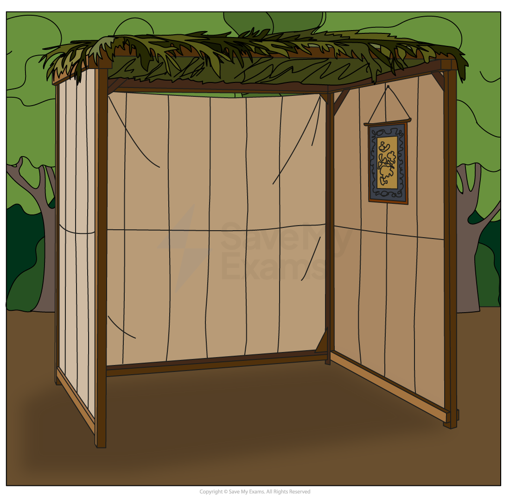
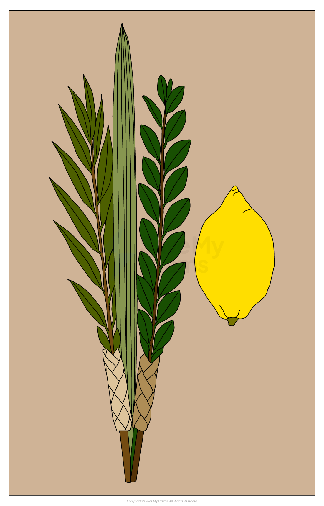

# Sukkot

## Sukkot as a celebration

> **Spec point** — `spcpt_vYkJXZVPtCYrhxnW`

## What is the festival of Sukkot?

- Sukkot (also known as the **Festival of Tabernacles** or **Booths**) is a festival celebrated by Jewish people around the world
- The festival:

  - Reminds Jews to be thankful for the things they have
  - Lasts for seven days in Israel and eight days outside Israel
  - Is a **harvest festival**
  - Is a time to remember the Israelites’ time in the **wilderness** after the **Exodus**,** **when Moses led them out of slavery in Egypt
- People celebrate Sukkot at **home **and at a **synagogue** with family and friends
- There is a large meal at the end
- Sukkot involves many religious practices that contain symbolic meaning
- The festival ends with a **special service** at the synagogue

  - During the service, people pray and hit the ground with **sticks of willow leaves five times** to get rid of any bad luck or sin
- The service is followed by a celebratory meal for family and friends

## The significance of building & using a sukkah

> **Spec point** — `spcpt_drNZZ3D5rdwhQbKw`

## The significance of building & using a sukkah

- Many people celebrate Sukkot by **building **a **sukkah **
- A sukkah is a temporary **hut **that has a **roof **made of **plants** and **leaves**

- **Families **spend time in the sukkah during the Sukkot **festival**

  - The sukkah reminds **Jewish **people of the **temporary homes **made by **Moses **and the Israelites during their **40 years** of wandering in the **desert **after the Exodus from Egypt
  - Spending time in the sukkah is also a way for Jews to **honour **their **ancestors**
  - The sukkah** **must be **unstable **enough to remind people of the **fragility **of **life **and **dependence **on **G-d**
  - During the festival, families** eat meals** inside the **sukkah **
  - Some people choose to **sleep **in it as well

## What is the significance of waving the lulav?

> **Spec point** — `spcpt_bJjyJM5xwBgkmfTJ`

## What are the Four Species?

- Sukkot also involves the **Four Species **(**Arba Minim**)
- The Four Species are a **citrus fruit** called an** etrog **(which is a bit like a lemon) and a **lulav**
- The lulav is a palm branch, but during Sukkot, it refers to a bundle of three plants:

  - **Palm branch **(lulav)
  - **Myrtle **(hadass)
  - **Willow** (aravah)
- The Four Species are **waved each day** of Sukkot (except **Shabbat**)

### Why are the Four Species waved?

- The lulav is a reminder of **G-d’s presence** everywhere

  - The lulav is waved in six directions: north, south, east, west, up and down
  - This symbolises that G-d is present all around and rules over the whole world
- The lulav also demonstrates the **unity of the Jewish people**, as each plant represents different aspects of the Jewish people:

  - **Etrog** (taste and smell): Jews who study the Torah and do good deeds
  - **Lulav** (taste only): those with learning but not deeds
  - **Hadass** (smell only): those who do good but do not study
  - **Aravah** (neither): those who lack both

*The Lulav*

- Waving the lulav also represents the Jewish people giving thanks for the **autumn harvest**

  - It is a form of praise and prayer to G-d for **providing food** and **sustenance**

## The religious reasons for observing Sukkot

> **Spec point** — `spcpt_vzM3tZJFx4Mbj89D`

## The religious reasons for observing Sukkot

- There are many religious reasons why Jews observe Sukkot
- Waving the Four Species is fulfilling a **Mitzvah** (commandment) from the **Torah**

> **blockquote**
> “And you shall take ... the fruit of beautiful trees, branches of palm trees, boughs of leafy trees, and willows ... and rejoice before the Lord your G-d” (Leviticus 23:40)

- Sukkot also **remembers **the **wilderness journey** of the **Israelites **

  - During this time, they lived in **temporary shelters**, **protected **by **G-d**

> **blockquote**
> “You shall live in booths for seven days … so your generations may know that I made the Israelites live in booths when I brought them out of the land of Egypt” (Leviticus 23:42–43)

- It is a time to thank G-d for the **harvest**
- Sukkot is also a time when Jewish people **demonstrate trust in G-d**

  - Living in a fragile sukkah reminds Jews to rely on G-d for protection, not material things

## The social reasons for observing Sukkot

> **Spec point** — `spcpt_t4Jj337vg8bCNVFb`

## The social reasons for observing Sukkot

- Sukkot also has social significance. It can strengthen family bonds, community life and a sense of shared identity
- During the festival, families build, decorate and eat meals together in the **sukkah**

  - Many families invite friends and guests, creating a joyful and welcoming atmosphere
  - This helps to strengthen family traditions and memories across generations
- Welcoming other people into the sukkah is a **mitzvah **(good deed)
- This includes **symbolically welcoming** the **seven biblical guests** who are regarded as the leaders of the Jewish people:

  - Abraham
  - Isaac
  - Jacob
  - Moses
  - Aaron
  - Joseph
  - David
- Sukkot can **strengthen community ties**

  - Synagogues and Jewish communities hold **communal meals, events** and **services**
  - Everyone shares in the celebration, which **builds unity **and **belonging**
- The event helps to educate children about Jewish history and traditions

  - Children help with building and decorating the sukkah
  - The experience teaches **Jewish values** and **practices **in an enjoyable and sociable way
- It also helps Jews to celebrate a **shared identity**

  - Jews around the world celebrate **Sukkot at the same time**, in similar ways
  - This helps to reinforce a **global sense of community** and continuity of tradition

## Different ways Sukkot is observed within Judaism

> **Spec point** — `spcpt_CXQPw6DQZHyjR3cy`

## Different ways Sukkot is observed within Judaism

- All Jews celebrate Sukkot, but there may be some differences in the ways in which it is celebrated between denominations

### Orthodox Judaism and Sukkot

- Orthodox Jews follow** halakhah **(Jewish law) very strictly and so show complete obedience to the **Torah laws** and traditional practices

  - This involves building a **kosher sukkah** at home or in the community and **eating all meals **there
  - Some also **sleep in the sukkah** (weather permitting)
  - During Sukkot, they **use all Four Species** (lulav, etrog, hadass, aravah) daily (except Shabbat)
  - Prayers are mostly in **Hebrew**, with full synagogue services throughout the week

### Reform Judaism and Sukkot

- Reform Jews still observe Sukkot but often with more flexibility

  - They **may build a sukkah** and eat meals in it, but **not everyone will sleep there**
  - Some **may use the Four Species**, while others may focus more on the symbolism
  - Services may be shorter and include **more English than Hebrew**
  - There may be a greater focus on the **ethical themes **of the festival, such as **gratitude** and **protection**

> **Worked Example**
> Give two reasons why Jews observe Sukkot
> 
> **[2 marks]**
> 
> **Final answer:** **Answer:**
> 
> To give thanks to G-d for providing food and protection **[1]**
> 
> To remember the 40 years that the Jews spent in the wilderness **[1]**

> **Exam Hint**
> **Understand the key concepts**: Master the historical background, symbolism and ritual practices associated with Sukkot
> 
> **Use evidence**: Refer to specific examples from the Torah, the Hebrew Bible or Jewish traditions to support your answers
> 
> **Organise your answer**: Structure your answer logically, using headings and subheadings to present your points clearly
> 
> **Practice**: Review past exam questions and practice answering them to familiarise yourself with the exam format and style
