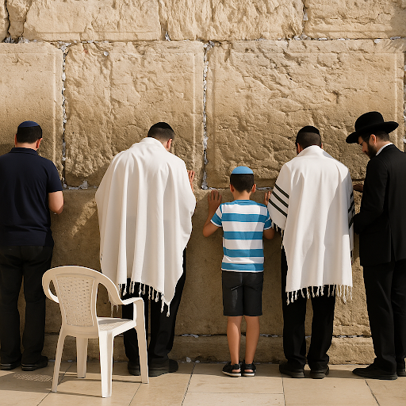

# The Importance of Pilgrimage in Judaism

## The spiritual and physical goals of pilgrimage in Judaism

> **Spec point** — `spcpt_wGFVn2nSjJZBSZsz`

## What is pilgrimage in Judaism?

- A **pilgrimage **is a** journey** to a place closely associated with a person’s religion
- In biblical times, Jews were commanded to make pilgrimages to** Jerusalem** for three major festivals:

  - **Pesach** (Passover)
  - **Shavuot **(Weeks)
  - **Sukkot** (Tabernacles)
- During the pilgrimages, they visited **the Temple** to offer *sacrifices* and **worship G-d**
- In modern times, there are various important pilgrimage sites visited by Jews

  - **Jerusalem** is the most important pilgrimage site
  
    - During the pilgrimage, Jews will visit the **Western Wall**, which is the last part of the ancient Temple
    - Pilgrims will pray, reflect and **place written prayers** in the** wall's cracks**

- **Yad Vashem** is a ***Holocaust *****memorial** in **Jerusalem**

  - The event helps **Jews **reflect on their **history**,** identity** and the importance of **remembrance**
- **Hebron **is the site of the **Cave of the Patriarchs**, believed to be the **burial **place of **Abraham**,** Isaac**,** Jacob** and their **wives**

### What are the spiritual goals of pilgrimage in Judaism?

- There are many **spiritual goals **associated with pilgrimage in Judaism

  - Pilgrimage** strengthens the spiritual bond** between the individual and G-d
  
    - Praying at holy sites (for example, the Western Wall) helps Jews feel closer to the **Divine Presence (Shekhinah)**
  - It is also an opportunity for reflection and personal growth for the pilgrim
  
    - It can be a time for **repentance**, **self-improvement** and **spiritual renewal**
    - It can also encourage Jews to reflect on their faith and values
  - Pilgrimage also continues the tradition of fulfilling a spiritual duty by visiting the sacred sites

### What are the physical goals of pilgrimage in Judaism?

- There are many physical goals associated with pilgrimage in Judaism

  - Pilgrimage allows believers to **visit sacred places** that are very important to the Jewish faith
  - Pilgrimage sometimes takes place to **mark an important life event**
  
    - Pilgrimage may be part of **Bar/Bat Mitzvah celebrations** or major festivals, such as **Passover**
    - It can also be a way to** celebrate survival** and **freedom**, especially when visiting Holocaust memorials such as Yad Vashem
  - Pilgrimage gives Jews a **sense of community** and identity by bringing Jewish people together
  
    - Walking in the footsteps of Jewish ancestors deepens their connection to Jewish history and culture

## The spiritual and physical challenges of pilgrimage in Judaism

> **Spec point** — `spcpt_4wsgPrPHGNjWz8sT`

## What are the spiritual challenges of pilgrimage in Judaism?

- There are spiritual challenges associated with pilgrimage in Judaism

  - Visiting some of the sites can be **emotionally intense **for pilgrims
  
    - Visiting places such as the Western Wall or Yad Vashem can stir deep emotions, including **grief**, **reflection** or **awe**
    - It may also involve **processing feelings of historical trauma** (for example, Holocaust remembrance), which can be **overwhelming**
  - For some people, there may be a **difference between their expectation **of the event and the **reality** of the pilgrimage
  
    - Some people may expect a profound spiritual experience, and then feel disappointed if it does not happen
    - **Maintaining religious focus** during busy or tourist-filled visits can be difficult
  - Pilgrimage may require **deep self-examination**, which can be spiritually challenging
  
    - People may feel **unworthy** or **struggle **with their **connection to G-d** or their **Jewish identity**

### What are the physical challenges of pilgrimage in Judaism?

- Travelling to pilgrimage sites as far away as** Israel **can be **expensive **and **physically demanding**, especially for **elderly people** or **people with disabilities**

  - They may involve** long flights**, **heat**, **long walks** and **crowds**, which may create discomfort
- Sometimes there may be **security concerns** associated with the pilgrimage destination

  - Visiting politically sensitive areas, such as **Jerusalem **or** Hebron**, can come with **safety risks**
  - **Conflict **in the region may make travel stressful or uncertain
- It may also be difficult to maintain **religious observance** while on pilgrimage

  - Keeping** kosher**, **observing Shabbat** and** maintaining prayer routines** while travelling can be difficult

> **Worked Example**
> Give two spiritual goals Jews might have when they go on a pilgrimage
> 
> **[2 marks]**
> 
> **Final answer:** **Answer:**
> 
> They might want to become closer to G-d and strengthen their relationship (1)
> 
> They may see it as an opportunity for reflection and personal growth (1)

> **Exam Hint**
> Try to use key terms in your responses: Western Wall, Yad Vashem, repentance, Shekhinah, pilgrimage
> 
> Remember to learn how challenges affect both the body and the spirit
> 
> Use examples where possible to explain your responses (for example, standing for hours at the Western Wall and feeling overwhelmed at Holocaust memorials)
