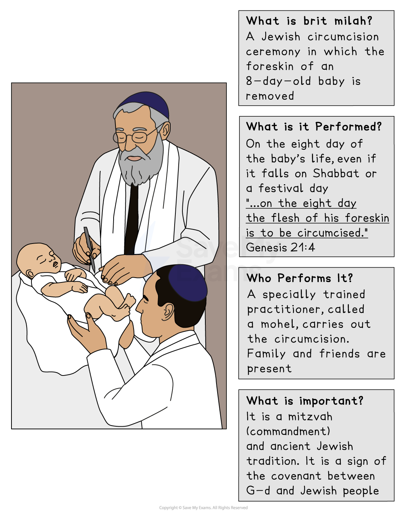

# Jewish Birth Rites

## The rituals of brit milah

> **Spec point** — `spcpt_KTYdgYj8FqMG8Q8c`

## What is brit milah?

- Jews observe many rituals throughout their lives, marking key events, including:

  - **Brit milah**
  - *Bar Mitzvah*
  - *Bat Mitzvah*
  - Marriage
  - Mourning rituals
- Brit milah is the **Hebrew** term used to describe the** religious circumcision **of boys when they are eight days old or of older males converting to Judaism:

  - It is carried out by a **mohel **(male) or, in some Reform communities, a** mohelet **(female)
  - Circumcision involves the** removal of the foreskin** and is a traditional Jewish practice
  - Circumcision dates back to the **book of Genesis**, when G-d commands **Abraham** to circumcise himself and his offspring as a **sign of the covenant **between Jews and G-d

### What are the rituals of brit milah?

- There are certain practices that are common during the **Brit Milah **ceremony

  - During the ceremony, a male or female friend or relative will act as a **messenger**, or a **kvatter**
  - The female kvatter will hand the baby to the male kvatter, who will be wearing a *tallit*
  - He will carry the boy into a room where the **males of the family** are gathered
  - The child is placed on the lap of the **sandek**:
  
    - A sandek is someone chosen by the parents as a great honour and is often the** grandfather**
  - The mohel **recites a blessing **before the baby is circumcised:

> **blockquote**
> “Blessed art Thou, O Lord our G-d, King of the universe, who hast sanctified us with Thy command­ments, and hast given us the command con­cerning circumcision”

- As soon as the mohel begins the circumcision, the father (or, in some cases, both parents) recites:

> **blockquote**
> “Blessed art Thou, O Lord our G-d, King of the universe, who hast sanctified us with Thy commandments, and hast commanded us to make our sons enter the covenant of Abraham our father”

- All people present then respond:

> **blockquote**
> “Even as this child has entered into the covenant, so may he enter into the Torah, the nuptial canopy, and into good deeds”

- The mohel then **blesses a cup of wine** and **announces the baby’s name** in **Hebrew **and **English**
- A **drop of wine** is placed on the **baby’s tongue**
- The circumcision is performed in front of a *minyan*
- The baby is placed on a cushion on an empty chair that is known as **Elijah’s chair:**

  - This represents an ancient belief that the spirit of Elijah visits every circumcision
- After the circumcision, the **father receives a blessing**
- During the Brit Milah, a prayer is said that shows the importance of the ceremony for a child’s relationship with G-d:

> **blockquote**
> “That as this child has entered into the covenant, so may he enter into the Torah, the marriage canopy and into good deeds”

## Naming ceremonies in Judaism

> **Spec point** — `spcpt_6Zthvj3xvdpfrw6M`

## What are Jewish naming ceremonies, and why are they important?

- Jewish naming ceremonies are important** rites of passage** that **welcome a new baby** into the Jewish community and give them their **Hebrew name**

  - A child’s Hebrew name is formally announced and given (according to traditional custom,** for the first time**) during the *brit milah* or *brit bat *ceremony
  - There are different ceremonies for baby boys and baby girls
- Baby boys have a **brit milah** (Covenant of Circumcision)

  - This takes place on the eighth day after birth, even if it falls on **Shabbat **or a festival day
  
    - The circumcision is performed by a **mohel** (a trained Jewish practitioner)
    - The baby is given their Hebrew name during the ceremony
    - The ceremony marks the **sign of the covenant (brit)** between G-d and the Jewish people
    - Naming marks the child’s entrance into the covenant
    - The family and friends gather for the celebration
- For baby girls, the ceremony is called **simchat bat** (joy of a daughter) in most Orthodox traditions

  - Usually, this takes place within the first month after birth, but there is no fixed date, and the timing can vary depending on family or synagogue custom
  
    - The ceremony may take place at home or in a synagogue
    - A baby girl is given her Hebrew name
    - **Prayers, blessings** and sometimes **readings** or **songs** are included
    - In some communities, the naming happens during a Torah reading in a synagogue
    - The ceremony welcomes the girl into the Jewish community
    - It celebrates the **gift of life** and **G-d’s blessings**
- The ceremony for baby girls in Reform or Liberal Judaism is known as** Brit Bat **(Covenant of a Daughter)

  - The difference between brit bat and simchat bat is that brit bat places more emphasis on the baby girl’s entrance into the** covenant with G-d**
  
    - Brit bat is likely to be more** ritualised** than simchat bat
    - It is designed to** parallel Brit Milah** for boys, highlighting **gender equality** and **inclusion** in the covenant
    - It may also include symbolic rituals, such as **wrapping the baby girl** in a **tallit**

> **Worked Example**
> Give two reasons why the ceremony of Brit Milah takes place
> 
> **[2 marks]**
> 
> **Final answer:** **Answer:**
> 
> So that the baby can be given his Hebrew name **[1 mark]**
> 
> The ceremony represents the covenant (brit) between G-d and the Jewish people
> 
> and marks the child’s entrance into the covenant **[1 mark]**

> **Exam Hint**
> For this section, there are certain things to be aware of that will help to support the preparation for this topic:
> 
> | **Tip** | **Why it helps** |
> |---|---|
> | Use key terms | Shows strong subject knowledge |
> | Explain the significance | Not just what happens but why it matters |
> | Compare ceremonies | Shows depth of understanding |
> | Refer to beliefs/Scripture | Supports evaluation and higher-level analysis |
> | Practise exam formats | Builds confidence and accuracy |
