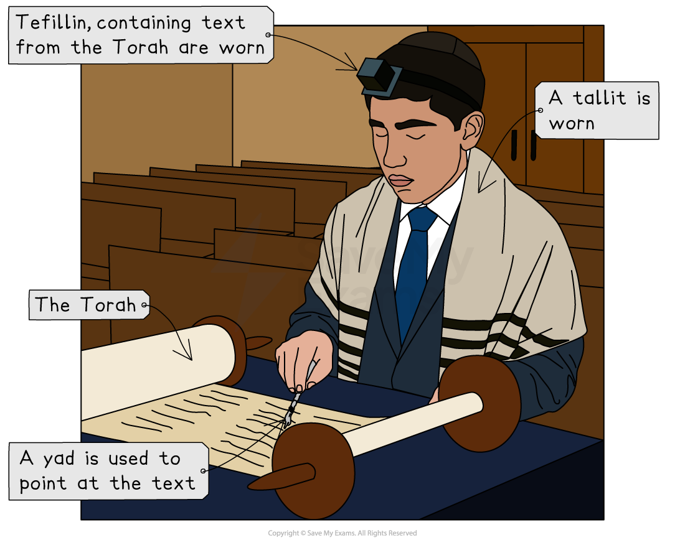

# Jewish Coming of Age Ceremonies

## Bar mitzvah lessons and synagogue service

> **Spec point** — `spcpt_vw87vZ4j4MzDYt7s`

## What is a bar mitzvah?

- The term** bar mitzvah** literally means “**Son of the Commandments**”
- Bar and **bat mitzvah** ceremonies mark the** transition into adulthood** for young Jews
- At age 13, a boy becomes bar mitzvah, and at age 12, a girl becomes bat mitzvah
- After these ceremonies, Jewish boys or girls become **responsible** for **living according to Jewish Law **and **obeying the***** mitzvot***** **in the **Torah**

  - At this point, each young person has to accept the law and its obligations, **participate fully in synagogue services** and set a good example for others
  - After the ceremony, a Jewish boy can be counted as part of a **minyan**, and in Reform synagogues, girls who are bat mitzvah can also be counted
- Traditionally, a boy’s bar mitzvah takes place on **Saturday (Shabbat)**,** **but many bar mitzvah services are also held on weekday mornings

### What happens during the bar mitzvah service?

- During the ceremony, the **rabbi **gives a talk, speaking to both the boy and his family and to the rest of the community:

  - The boy is called to the **Torah (called an aliyah) **for the first time
  - He reads a portion of the Torah and sometimes the **Haftarah** (a reading from the prophets), usually in **Hebrew**
  - In Orthodox Judaism, the boy begins to wear** tefillin **(small leather boxes with verses from the Torah) during weekday morning prayers
  - He recites the **blessings before** and **after reading the Torah**
  - The** father **recites** a blessing thanking G-d **for freeing him from responsibility for the child’s actions
  - The boy might also give a talk to the people gathered
  - It is traditional for the boy to **receive gifts**
  - Usually, a boy’s bar mitzvah service is held at a synagogue, though some may choose to hold it in a private venue
- Following the bar mitzvah service, there is typically a **celebration** or **reception**

## Bat mitzvah lessons & synagogue service

> **Spec point** — `spcpt_Dfqg2ZFz6sfRgwsj`

## What is a bat mitzvah?

- Unlike the bar mitzvah, the **Bat Mitzvah **is **not mentioned** in the **Hebrew Bible**

  - The ceremony of bar mitzvah dates back to the sixth century, but the observance of bat mitzvah was only introduced in **1922 in the United States**
- The bat mitzvah is **only practised** by **Reform **and **Liberal Jewish communities**, not Orthodox
- Traditionally, within Judaism, males and females are not thought to have the same responsibilities:

  - As a result, in some Jewish communities, some rules (such as the requirement to read from the Torah) are less strict for girls than they are for boys
- The ceremony follows a similar pattern to the bar mitzvah and happens around a girl’s 12th birthday
- Although a bat mitzvah ceremony is not required by Jewish law, it is used to **recognise a Jewish girl as a woman **and to define her as such in her community
- Reform and Liberal Jews today consider the bat mitzvah in much the same light as the bar mitzvah

### What happens at a bat mitzvah service?

- The bat mitzvah service varies depending on the Jewish tradition

  - In Reform and Liberal Judaism, **the girl may lead parts of the service**, read from the Torah or deliver a** D’var Torah** (speech explaining a Torah passage)
  
    - She may also** lead prayers in Hebrew** and **English**
- After the service, there is often a **celebration or meal **with family and friends
- As with a bar mitzvah, the bat mitzvah girl may give a speech reflecting on her role and responsibility as a Jewish woman

## Bat Chayil

> **Spec point** — `spcpt_nwmRqy5jzzGrThJs`

## What is a bat chayil?

- **Bat Chayil** means “**Daughter of Worth**” in Hebrew

  - It is a coming-of-age celebration for **Orthodox Jewish girls**, often used instead of a bat mitzvah
  - It is celebrated when a girl reaches the age of 12
  - In Orthodox Judaism, girls usually do not lead synagogue services or read from the Torah publicly
- Bat Chayil offers a way to **celebrate spiritual maturity **in a way that fits Orthodox beliefs about modesty and gender roles

### What happens at a Bat Chayil ceremony?

- The Bat Chayil ceremony is often **held at home **or in a** school hall** or **community centre**

  - The** girl gives a speech **on a Jewish topic or a woman from Jewish history
  - Family and friends attend, and it often includes **songs, poems** or **presentations**
- The ceremony marks the girl’s new responsibilities under Jewish law

  - The girl becomes **responsible for mitzvot** (commandments), such as** lighting Shabbat candles**, **tzedakah (charity)** and **modest behaviour**
  - She is now considered a spiritually mature member of the Jewish community

> **Worked Example**
> Give two reasons why the bar mitzvah ceremony takes place
> 
> **[2 marks]**
> 
> **Final answer:** **Answer:**
> 
> It marks the time when a Jewish boy turns into a Jewish man **[1 mark]**
> 
> After this time, a Jewish boy can be fully involved in all of the duties performed in the synagogue **[1 mark]**

> **Exam Hint**
> For this section, be aware of the significance of the ceremony in Jewish belief and practice. It marks the transition from childhood to man/womanhood, and after the ceremony, children are treated like adults
> 
> To demonstrate understanding, try to include words such as:
> 
> mitzvot, tefillin, aliyah, minyan, D’var Torah, synagogue, responsibility, spiritual maturity
> 
> Be aware of the differences between different Jewish traditions, particularly when comparing bat mitzvah rituals and meanings
