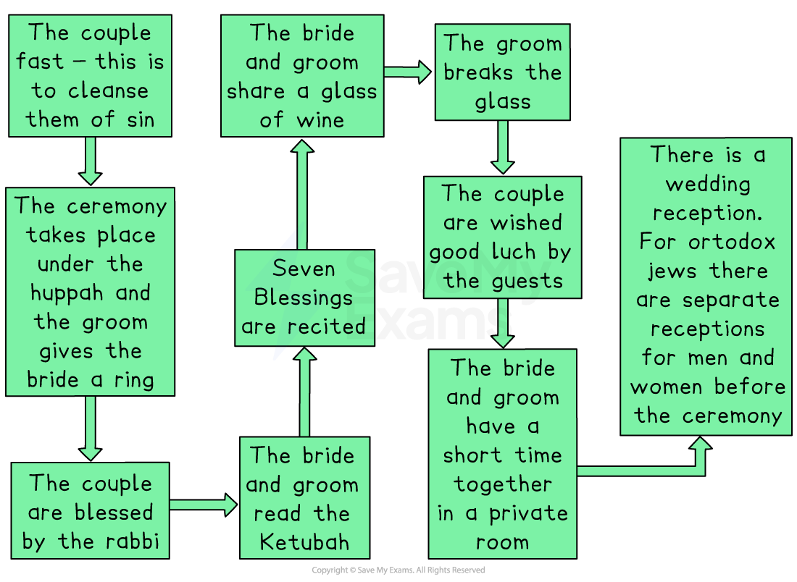

# Jewish Marriage Ceremonies

## Kiddushin: First stage of the marriage ceremony

> **Spec point** — `spcpt_dXgKmj4ynJd2BgC9`

## What is kiddushin?

- According to Torah law, marriage is a two-step process

  - The first step is called **kiddushin**
  - The second step is known as **nisu'in**
- Betrothal, or kiddushin, is usually an **engagement period** before a wedding

  - Kiddushin means “**holy**”** or **“**sanctified**”, indicating the importance of this period before the marriage
  - Kiddushin marks a time when a couple becomes **legally bound** under **Halakhah** (Jewish law)
  - Traditionally, a ceremony would be held** a year before **the wedding to mark the betrothal
  - Today, kiddushin and nisu'in (the second stage)** are often performed together in one wedding ceremony**

### What happens in a kiddushin ceremony?

- There are certain rituals and practices that take place during a kiddushin ceremony

  - The** groom gives the bride a ring** and says:

> **blockquote**
> “Behold, you are consecrated to me with this ring according to the law of Moses and Israel”

- This is the moment of kiddushin when the couple is** formally betrothed**

- A **ketubah** (marriage contract) is signed, which is a legal document outlining the **husband's responsibilities**, such as:

- **Providing for his wife**
- **Faithfulness**
- **Support in times of need**

- There are also **seven blessings** (**sheva brachot**) that are **recited over wine**, praising G-d and celebrating marriage
- A **glass is broken **at the end of the ceremony to **remember the destruction** of the **Temple in Jerusalem **

  - A reminder that even though there is joy, it is important to remember historical events

## The Jewish marriage ceremony significance and rituals

> **Spec point** — `spcpt_Ryqn92MBy5CWq2v6`

## What happens during the Jewish marriage ceremony?

- A Jewish wedding can happen on any day other than **Shabbat** or one of the Jewish festivals
- In all forms of Judaism, it is allowed for weddings to be commemorated either in a synagogue or in a non-religious venue, such as a hotel
- There are several stages to the wedding ceremony:

*Stages of the Jewish Marriage Ceremony*

- The **seven blessings** that take place praise G-d** **for **creating **the **human race** & bringing **happiness **to the **couple**:

> **blockquote**
> “We bless you, G-d, who brings bride & groom together to rejoice in each other”

- During the ceremony, the groom will make a vow:

> **blockquote**
> “Behold, you are sanctified to me with this ring according to the law of Moses & Israel”

- The groom places a ring on the bride’s index finger as a symbol of eternity and declares:

> **blockquote**
> “Behold, you are consecrated to me by means of this ring according to the rituals of Moses and Israel”

- The** second part **of the service is called **nisu'in**

  - **Seven further blessings** are said to **finalise **the **marriage**
  
    - This is done in a **separate room** with the **couple alone** together
  - Guests will greet the married couple with the phrase “**mazel tov**”, which is a Hebrew phrase for “**good luck**” or “**congratulations**”
  - At the reception, the couple will take part in a wedding dance called the **Hora**

### What is the significance of Jewish marriage?

- Marriage is seen as a **spiritual bonding** between two people and as the **fulfilment of G-d's commandment**

  - In Judaism, marriage shows holiness in everyday life and fulfils the commandment to be “fruitful and multiply” (Genesis 1:22)
- Many Jews believe that sexual relationships should be enjoyed only within marriage

> **blockquote**
> “Hence a man leaves his father and mother and clings to his wife, so that they become one flesh” (Genesis 2:24)

- ***Maimonides**** *stated that whereas the mating of animals is a purely physical and temporary act, through the **sanctification of marriage**, husband and wife become the **closest of relatives**

  - The Rabbis in **Sifrei Bemidar** interpreted Ruth 3:13 as instructing Jews not to engage in any possible intimacy before marriage
- Both the** Torah** and the **Talmud **view a man without a wife, or a woman without a husband, as **incomplete**
- This is demonstrated in several passages:

> **blockquote**
> “A man who does not marry is not a complete person” (Leviticus 34a)
> 
> “Any man who has no wife lives without the joy, without blessing, and without goodness” (Yevamot 62b)

- Many Jews believe that each marriage ceremony is a** re-enactment of the marriage between G-d and the Jewish people** that took place at **Mount Sinai**

  - The wedding day is a **personal Yom Kippur**, or the holiest and most *auspicious* day of someone's life
- Marriage is also a** legal transaction** in which the bride and groom enter a mutually binding commitment
- The wedding ceremony contains several *symbolic* acts that are of great significance to Jews

  - The** Chuppah** is a cloth canopy supported by **four poles** where the bride and groom** stand underneath **and get married
  
    - It symbolises the **new home **and is **open at all sides to welcome guests**
  - On reaching the Chuppah, the** bride walks around the groom seven times**, or sometimes three times
  
    - It corresponds with the** seven wedding blessings** and demonstrates that the **groom is the centre of the brides’ life** and the **seven days** it took G-d to **create the world**
  - The** ring **that is given by the groom to the bride in Orthodox services
  
    - The complete circle of the ring symbolises the** endless bond **between husband and wife

> **Worked Example**
> Outline what happens during a Jewish wedding ceremony
> 
> **[4 marks]**
> 
> **Final answer:** **Answer:**
> 
> There are seven blessings that take place to praise G-d for creating the human race & bringing happiness to the couple.
> 
> A further seven blessings are said to finalise the marriage in a separate room with the couple alone together.
> 
> In Orthodox services, the ring that the groom gives to the bride symbolises the endless bond between husband and wife.
> 
> At the reception, the couple will take part in a wedding dance called the Hora.

> **Exam Hint**
> Remember to understand some of the different reasons why marriage is important in Judaism:
> 
> - It is a mitzvah — commanded by G-d
> - Helps fulfil the commandment to “be fruitful and multiply” (Genesis 1:28)
> - Creates a faithful partnership to build a Jewish home
> - Reinforces community values, family life and tradition
