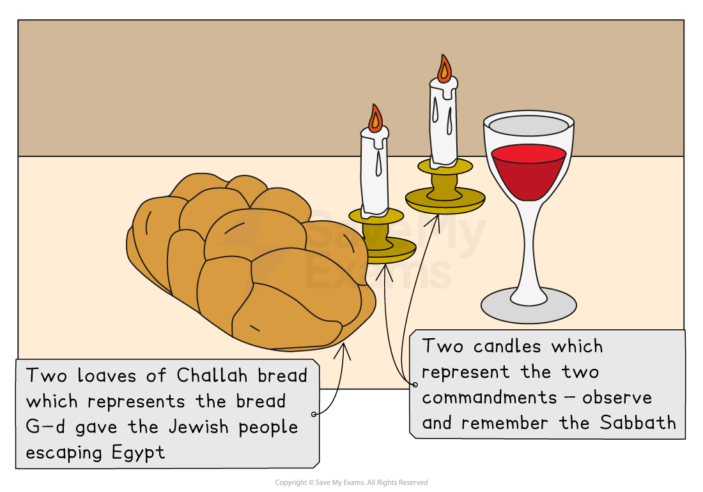
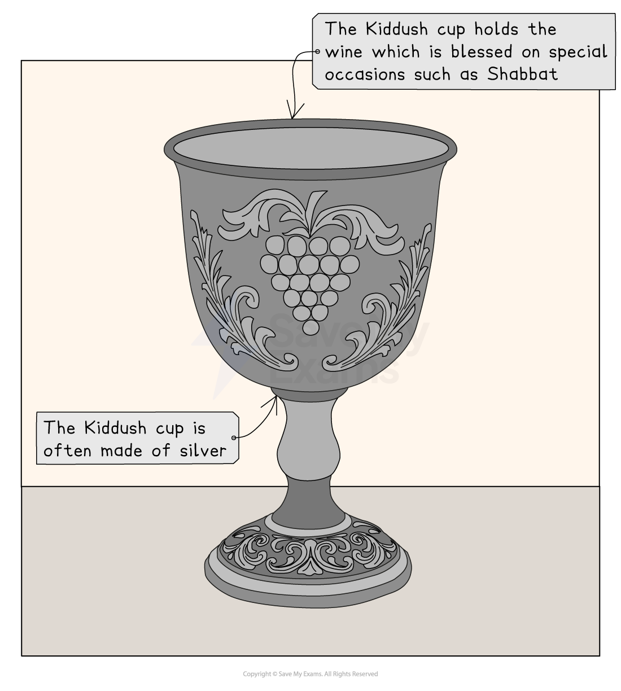
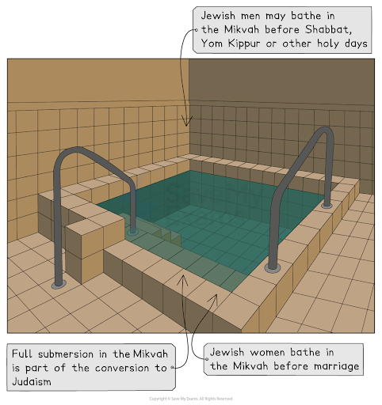

# Artefacts used in Jewish Worship

## Copies of the Sefer Torah

> **Spec point** — `spcpt_Hybsxb4b6SBS3Vs8`

## What are the copies of the Sefer Torah?

- Every **synagogue **has a **Sefer Torah**

  - The** **Sefer Torah is the **Torah scroll**
  - It is **handwritten **onto ***vellum ***by a specially trained **scribe **
- The Torah** **is the most **sacred text** in **Judaism**

  - It includes the first **five books** of the **Hebrew Bible**:
  
    - Genesis
    - Exodus
    - Leviticus
    - Numbers
    - Deuteronomy

### What is the significance of the Sefer Torah?

- The Sefer Torah is believed to be the **word of G-d**, given to **Moses **on **Mount Sinai**

- It is central to **Jewish worship, law **and **tradition**

- Due to its importance, the Sefer Torah** **is treated with the utmost **respect**

  - It is an **honour **to be asked to read from it at a **service **in the **synagogue**
  - It is dressed in **decorations **such as a **mantle **(cover), **breastplate** and **crown**
  - It is stored in the **Aron HaKodesh** (the Holy Ark in the synagogue)
  - **Nobody **is allowed to **touch **it with their **bare hands**
  - A **pointer **called a **yad** must be used instead
  
    - The yad is used to **follow **the **handwritten words** of the Torah** **while reading from the **scroll**

## Meaning of the Shabbat candles

> **Spec point** — `spcpt_Xd8Q5tSwHJJCQwsW`

## What is Shabbat?

- Observing **Shabbat **is one of the **Ten Commandments**

  - Jews observe a **day of rest **to **commemorate** G-d** **resting on the **seventh day** after he **made **the **world**
- **Shabbat **begins on **Friday **at **sunset **and lasts until **sunset **on **Saturday**

  - It is a time for **family **and **community**
  - During Shabbat, services at the synagogue** **are **well attended**

***Preparations for Shabbat***

### What are the Shabbat candles?

- **Shabbat candles** are **special candles **lit by Jews** **every **Friday **evening to welcome the **Sabbath **(Shabbat), the weekly **day of rest**

  - Usually, **two candles** are lit, though some families might light a **candle **for each **family member**
  - The **candles **are traditionally lit by a **female member** (often the mother) of the household
  - The **candles **are lit **18 minutes **before **sunset **on **Friday**
  - The person lighting the candles **covers **their **eyes **and says a **blessing**:

> **blockquote**
> “**Blessed are You, Lord our God... who has commanded us to light the Shabbat candles**”

- After the **blessing**, Shabbat** **officially begins

### What is the significance of the Shabbat candles?

- The candles** **have a **spiritual purpose** — they **symbolise **bringing **peace **and **light** into the home
- They also have a **practical purpose** — they mark the **start **of **Shabbat**, a time of **rest, holiness **and **reflection**
- The candles represent** two key commandments**:

  - **“Remember the Sabbath”** (Zachor)
  - **“Observe the Sabbath”** (Shamor)
- The candles** **help to create a** sacred space** for Sabbath to take place

  - The **light **helps create a **calm, sacred atmosphere** for **prayer**, **meals** and** family time**

- The **practice **is a **tradition **that **unifies Jews** all over the world, which can help to **strengthen Jewish identity **and **continuity**

## Meaning of the challah

> **Spec point** — `spcpt_KbW2Nng4znMxZKsB`

## What is the challah?

- The **challah **is a special **braided bread** eaten by Jews on Shabbat** **(the Sabbath) and during **festivals**

  - It is typically **white**, slightly **sweet** and made with eggs, flour, water, yeast and sugar
- In **Jewish homes**, a number of **preparations **are made before Shabbat

  - The house is **tidied**, **food **is **prepared **and **two candles** are placed on the **dining table**
  - **Two loaves** of challah bread are also placed on the table
  - Before **eating**, a blessing called the **Hamotzi **is said:

> **blockquote**
> “**Blessed are You, Lord our God… who brings forth bread from the earth**”

### What is the significance of the challah bread?

- The **challah bread **represents the **food **G-d** **provided for the Jews** **when they were walking through the **desert **while fleeing **Egypt**
- The **preparation **of the **bread **is **significant**

  - **Traditional Jewish law** requires **separating **a small piece of **dough **before **baking**, in **remembrance **of **Temple offerings **(also called challah)
- The **two loaves** represent the **double portion **of **manna** that **God **gave the **Israelites **on **Fridays **while they were in the **desert **(Exodus 16) so they would have food for Shabbat

  - This teaches **trust in God**,** **that He will **provide**
- Challah is part of the Shabbat meal,** **a time for **family, rest **and **spiritual reflection**

  - **Sharing challah** symbolises **hospitality**, **togetherness** and **gratitude**
  
    - To demonstrate this, the **bread **is often **passed around** the table after being sliced or torn

## The use of the Kiddush cup

> **Spec point** — `spcpt_DbGycqqxtYBbStq8`

## What is the Kiddush cup?

- **Kiddush **is a **blessing **recited over **wine **or **grape juice** to ***sanctify*** **Shabbat**,** Jewish festivals** and** ceremonies**:

  - The word Kiddush comes from the **Hebrew **word **kadosh**, meaning **holy**
  - It marks the beginning of **sacred time**, such as Shabbat or festival days
- A **Kiddush cup** is a **special cup** or **goblet **used in **Jewish homes** and **synagogues **to hold wine
- The **cup **is often made of **silver**, but any clean, respectable cup can be used
- The **Kiddush cup** is used on certain **special occasions**:

  - Shabbat (Friday evening and Saturday in the day)
  - Jewish festivals (for example, Passover, Rosh Hashanah)
  - **Ceremonies**,** **such as **weddings **or** brit milah** (circumcision)

***Kiddush cup***

### What is the significance of the Kiddush cup?

- The Kiddush is recited over the wine in the Kiddush cup to mark the** holiness **of Shabbat or a festival

  - It reminds Jews** **that **G-d rested **on the **seventh day** and made that day **holy**

- **Wine** is a **symbol **of **joy**, **blessing** and **spirituality** in **Judaism**

  - The Kiddush sets the tone for a **peaceful **and **holy celebration**
- The Kiddush** **is a** family tradition** often led by the **head of the family**, bringing everyone together** **before the meal

  - It links the present to **generations **of **tradition**

## The use of the mikvah

> **Spec point** — `spcpt_ttNZNbZRrX5RD7Gq`

## What is the mikvah?

- The **mikvah **is a** large bath** where **Jewish purification rituals** take place and may be found in a synagogue** **

  - The **water** in it must be** non-flowing **and from a **natural source**, such as a **lake**, **sea **or **rain water**
  - **Jewish women** are required to **bathe **in the mikvah** **before **marriage**
  - For many **Jewish communities**, being fully **submerged **in the mikvah** **is an important part of **converting **to **Judaism**
  - Some **men **use the mikvah before **Shabbat**,** Yom Kippur **or other **holy days**

***The mikvah***

### What is the significance of the mikvah?

- **Immersion **in a mikvah** **is not about **physical cleanliness** but about **spiritual renewal** and **purity**

  - It represents a **transition **from **one state** to **another**, from **impurity **to **purity** or **separation **to **holiness**

- The **Torah **commands **purification **in certain situations

  - The mikvah** **allows **Jews **to follow these **commandments**

## The importance of mezuzah

> **Spec point** — `spcpt_3FxBbhgcr7J6HyCX`

## What is the mezuzah?

- The **mezuzah **is a piece of **parchment scroll **with the **Shema prayer** inscribed on it, which is kept in a small case:

  - The Shema prayer is important** **because in it G-d asks Jews** **to remember his **commandments **in both their **heads **and **hearts**
  - Jews will often **touch **the mezuzah as they go through the **door**
  - The **instruction **to do this comes from the **Torah**:

> **blockquote**
> “Love the Lord your God with all your heart and with all your soul and with all your strength. These commandments that I give you today are to be on your hearts. Impress them on your children. Talk about them when you sit at home and when you walk along the road, when you lie down and when you get up. Tie them as symbols on your hands and bind them on your foreheads. Write them on the doorframes of your houses and on your gates” (Deuteronomy 6: 5–9)

- The **mezuzah **can be found on the **doorframes **of many **Jewish homes**

  - It is placed at a slight angle on the **right-hand side** of every **doorframe** in the **house**
  - The **bathroom door** is the only doorframe in the house that the mezuzah is **not** placed on
- The **words **are written by a **sofer**: a person who is trained to **write **the Torah
- The **parchment **that it is written on must be from the skin of a ***kosher *****animal**

### Why is the mezuzah important?

- The mezuzah reminds Jews** **of **G-d’s presence** and their **commitment to His commandments** every time they enter or leave their home
- The mezuzah also fulfills the **mitzvah **(commandment) as instructed in the Torah** **and so is a way of **obeying G-d’s law**
- Having a mezuzah** **on the door is a **public expression** of **Jewish faith **and **identity**, and it **unites** Jews** **across the world through a **shared tradition**
- Many Jews** **believe the** mezuzah **brings **blessing and protection** to the **home**

> **Worked Example**
> Name two artefacts used in Jewish worship
> 
> **[3 marks]**
> 
> **Final answer:** **Answer:**
> 
> - The Kiddush cup is used during festivals
> - Challah bread is shared during Shabbat

> **Exam Hint**
> Creating flash cards for each artefact is a great way to revise for this section.
> 
> On the front, include an image and the artefact’s name.
> 
> On the back, write its use, symbolic meaning, relevant scripture and any Orthodox vs Reform differences.
