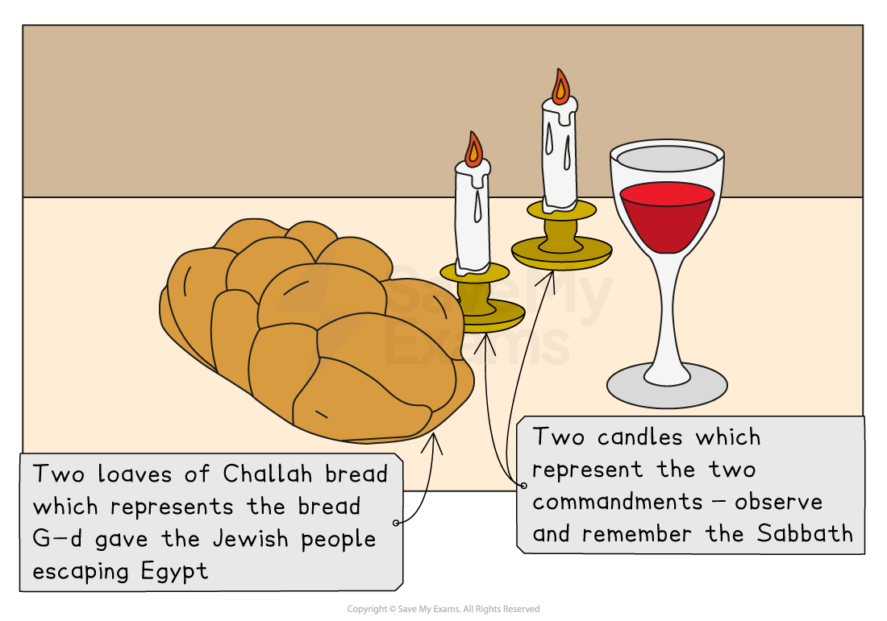

# Celebration of Shabbat

## Synagogue services for Shabbat

> **Spec point** — `spcpt_SRbDX5B34Ysz2JhX`

## What is Shabbat?

- **Shabbat **is a **day of rest **for **Jews**
- It originates from the **creation story**, as told in **Genesis**, which says that** G-d **rested on the **seventh day** after **creating **the **world**

  - This idea is also repeated in the book of **Exodus**:

> **blockquote**
> “It is a sign forever that in a six day period, G-d made heaven and Earth, and on the seventh day, he rested” (Exodus 31:17)

- The day also **connects Jews **to their **ancestors**, who were **enslaved**

  - Not working on **Shabbat **is a sign of **freedom **for **Jews**
- During **Shabbat**, **Jews **are expected to **rest **and spend time with their **family**

  - They are **forbidden **by **Jewish law **from taking part in several categories of **work**:
  
    - These include creating or **extinguishing fire**, **writing and repairing things**
  - Many **Jews **will also avoid all **other kinds of work**

### What synagogue services are there for Shabbat?

- During **Shabbat**, **three **main **services **take place in the **synagogue**,** **which most **Jews **attend

  - On **Friday evening**, **Shabbat **is **welcomed **with special **prayers**, **hymns **and **psalms**
  - On **Saturday morning**,** **there are **readings **from the **Torah **and the **Nevi’im**
  
    - This is considered to be the **main service** of the week
    - This service is called** Shacharit Shabbat**
    - These services vary between **synagogues** but share a similar overall **structure**
  - On **Saturday evening**, there are more **prayers **and** readings **from the **Torah **
  
    - The** Havdalah ceremony** marks the **end **of **Shabbat**

## Friday evening meal preparation

> **Spec point** — `spcpt_QXzR6QNCtnjHwZGQ`

## What happens during the Friday evening meal preparation?

- On **Friday evening**, the focus of **Shabbat **is a **meal **that brings the **family **together
- All of the food for the** Friday night meal **(and usually Saturday meals) is prepared in **advance**, as **cooking **is **not allowed** during **Shabbat**

  - A **festive table** is set with a** white tablecloth, candles, wine or grape juice** and ***challah ***covered with a **decorative cloth**
  - The **day of rest** is welcomed with the **lighting **of the **two candles**
  - Traditionally, the **mother **of the **family **places her **hands **over her **eyes **and recites a **blessing**
  - Before the **food**, more **blessings **are said for the **children**, and ***kiddush ***is said over the **wine **to make the **evening holy**
  - **Drinking wine** shows that it is a **joyful**, **celebratory **time
  - The **challah **is **blessed**,** **and everyone takes a piece

***Shabbat in the home***

## The Havdalah ceremony

> **Spec point** — `spcpt_g7jN45Bvgf3bvFgS`

## What happens during the Havdalah ceremony?

- **Havdalah **(meaning separation) marks the **end **of **Shabbat **and the **start **of the **new week**
- It’s a **brief, symbolic ritual** held after **nightfall **on **Saturday**
- The **Havdalah **cup of **wine **is filled to **overflowing **as an expression of **hope**,** **and **blessings **are said:

  - **Over wine** — blessing for the **fruit **of the **vine**
  - **Over spices** — smelled to **comfort **the **soul**
  - **Over the candle** — thanking **G-d **for the **light **of **fire**
- The** Havdalah blessing **is also said, praising **G-d **for distinguishing between **holy **and **everyday**
- A **braided candle** with a **double wick** is used for the **ceremony**,** **and a **spice box** is taken into **each room** of the **house**

  - The hope is that the week to come will be as **sweet **as the smell from the **spice box**
- The meal usually lasts for a** few hours**, with everyone enjoying **family time**, often **singing songs **and telling **religious stories**
- There are certain **rituals **that mark the **end **of the **ceremony**:

  - The **candle **is **extinguished **in the **wine**
  - Some Jews dip their **fingers **in the **wine **for **symbolic blessing**
  - Traditional **songs**, like **Eliyahu HaNavi**, are **sung**

> **Worked Example**
> Give two artefacts used during Shabbat, and outline how they are used
> 
> **[4 marks]**
> 
> **Final answer:** **Answer:**
> 
> The Havdalah cup of wine is filled to overflowing as an expression of hope, and blessings are said **[2]**
> 
> During the Havdalah ceremony, a spice box is taken into each room of the house. The hope is that the week to come will be as sweet as the smell from the spice box **[2]**

> **Exam Hint**
> Here is a summary of the main elements of Shabbat:
> 
> **Meaning of Shabbat**
> 
> - A day of rest, commanded in the Ten Commandments
> - Celebrates G-d’s creation and liberation from slavery in Egypt
> 
> **Shabbat Preparation**
> 
> - Begins Friday before sunset
> - Involves cleaning, cooking, setting the table and lighting candles
> 
> **Shabbat Observance**
> 
> - Candle lighting: welcoming Shabbat
> - Kiddush: blessing over the wine
> - Challah: special braided bread with a blessing
> - Synagogue services: Friday night and Saturday morning
> - No work (Melachot): 39 categories of prohibited activities
> 
> **Havdalah**
> 
> - The ceremony marking the end of Shabbat
> 
> Learn about all of these elements and also the symbolic meaning of certain practices
