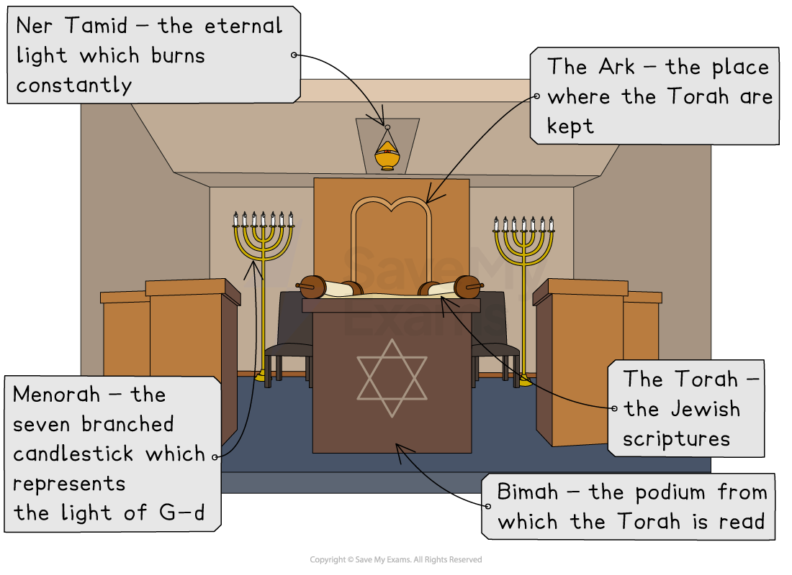
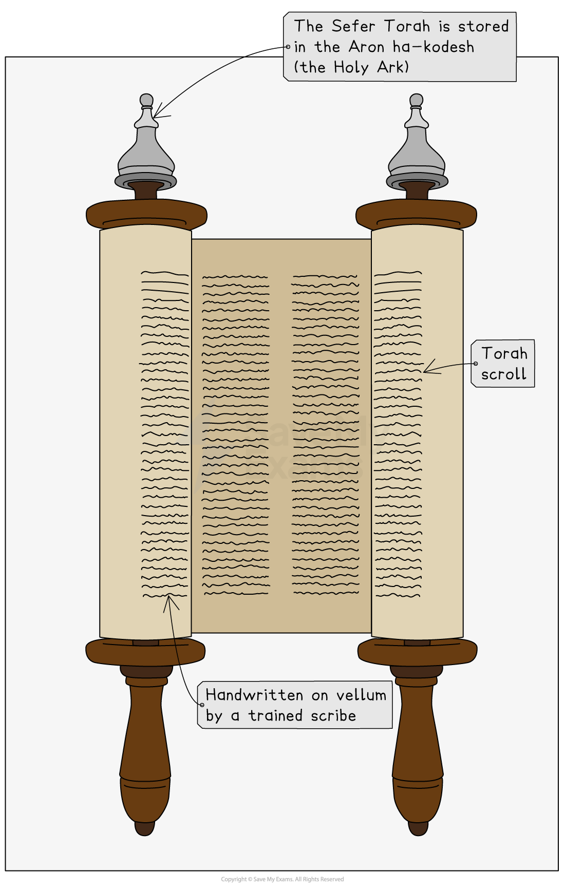
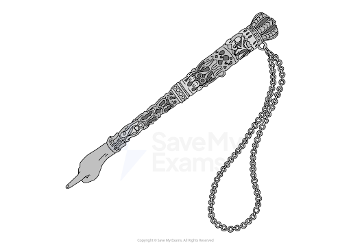
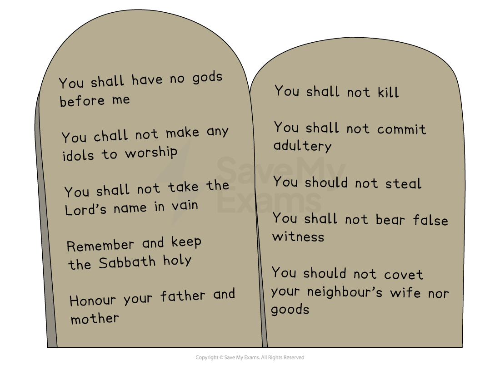
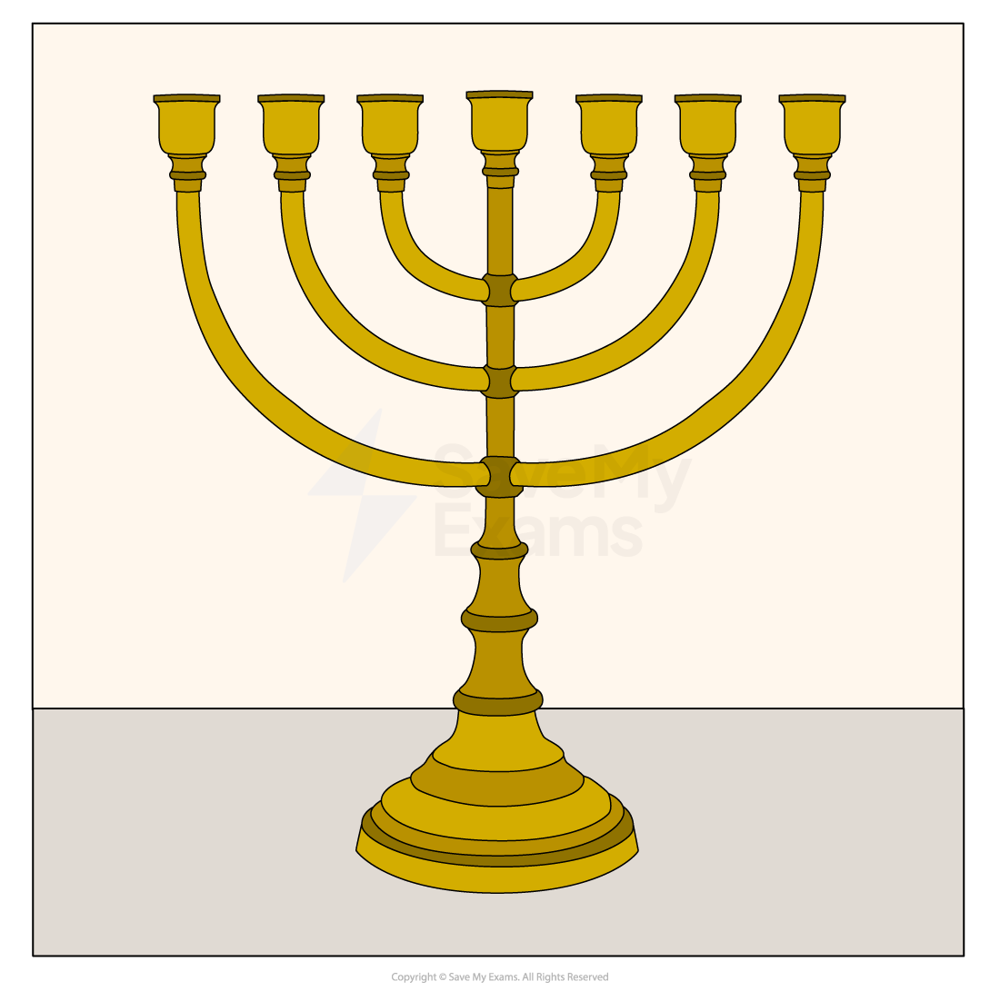
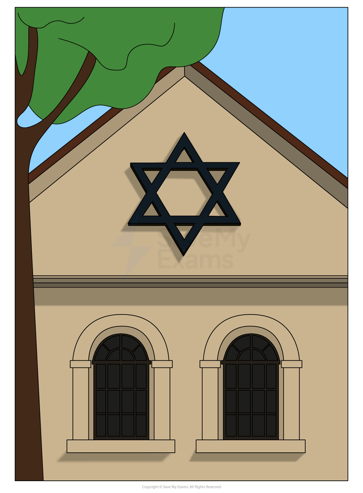

# Key Features of a Synagogue

## What is Aron ha-kodesh?

> **Spec point** — `spcpt_2vBZ5kd3RYxmQ8Jx`

## What is Aron ha-Kodesh?

***Features of a synagogue***

### Aron ha-kodesh

- All synagogues** **have a large **cupboard **facing **Jerusalem **called the **Aron ha-kodesh**
- This is the **holiest **place in the synagogue

  - It is the **centrepiece **of the synagogue** **and holds the **Torah scrolls **that contain the first five books of the **Hebrew Bible**
  - It is usually located on the **eastern wall **of the** **synagogue,** **facing** Jerusalem**
  - It often has a **curtain **or **door **in front of it called the **parochet**, similar to the **curtain **in the ancient **Temple **in **Jerusalem**

### Why is the Aron-ha-kodesh significant?

- The **Aron ha-kodesh** is extremely **significant **within the **Jewish faith**

  - It **symbolises **the **Ark of the Covenant**, which held the **stone tablets** of the **Ten Commandments** in the time of **Moses**
  - It represents the **holiness **of the **Torah **and **G-d’s presence**
  - It reminds Jews** **of the **Temple **in **Jerusalem**
  - Standing and showing **respect **when the **Ark **is **opened **is an important part of many services

## What is the Sefer Torah?

> **Spec point** — `spcpt_fsj8HH3hWSqZvrZy`

## What is the Sefer Torah?

- The **Sefer Torah** is a **scroll **kept inside the Aron ha-kodesh

  - It is written by a **sofer** (scribe) on **parchment** made from animal skin, using a **quill **and **special ink **and covered with a **mantle **or **cloth **that is ornately **decorated**
  - It can take over **a year** to complete a **single scroll** because even a single **mistake **can make it **invalid**

***The Sefer Torah***

### Why is the Sefer Torah important?

- The **Sefer Torah** is considered to be the **word of G-d**, given to **Moses **on **Mount Sinai**
- It is used within **Jewish worship** on **several occasions**

  - The **Sefer Torah** is read **publicly **during **synagogue services** on certain days
  
    - **Shabbat (Saturday)**
    - **Mondays and Thursdays**
    - **Jewish festivals**
- **Jews **show great **respect** to the **Torah**

  - They **stand **when it is **carried**
  - It is dressed in a **mantle** (cloth cover) with decorations such as a **crown (keter)** and a **breastplate**
  - **Readers **of the **Torah **use a ***yad*** because the Torah is never **touched **directly
  - The **yad **is used by the reader to indicate their place during a **reading **of the **Torah**, which happens during **prayer** or on **holy days** such as **Sukkot**

***A yad***

## The Bimah and the Ner Tamid

> **Spec point** — `spcpt_tpsr8Vr3G35ygsB3`

## What is the bimah?

- The **bimah **is a **raised platform** with a** reading desk**

  - From here, the **Sefer Torah** is read
  - The bimah** **represents the **altar **in the **Temple**
  - The bimah is usually located in the **centre **of the synagogue** **in **Orthodox synagogues** and often closer to the **front **in **Reform synagogues**
  - The **Torah scroll** is placed on a **reading desk** on the bimah** **during **public readings** (especially on Shabbat and festivals)

### What is the importance of the bimah?

- The bimah** **raises the Torah** **physically **above **the **congregation**, symbolising the **authority **of **G-d’s word**

  - Reading from the bimah** **allows the **congregation **to **see **and **hear **the Torah being read, reinforcing **communal worship**
  - It reflects the **layout **of the **ancient Temple** in **Jerusalem**, where readings were done from an **elevated place**

### What is the Ner Tamid?

- The **Ner Tamid** is a **light **above the **Aron Hakodesh** that never goes out

  - Ner Tamid** **means “**eternal flame**” in **Hebrew**
  
    - It is never **extinguished**, showing that **G-d’s presence** is **constant**
- It represents the **order **from **scripture, **which reads:

> **blockquote**
> “**And thou shalt command the children of Israel, that they bring thee pure oil olive beaten for the light, to cause the lamp to burn always**” (Exodus 27:20)

### What is the importance of the Ner Tamid?

- The Ner Tamid is a symbol of **G-d’s eternal presence**

- The light reminds Jews that **G-d **is always** present**, watching over them
- It reflects the belief in an **eternal **and **unchanging G-d**

- The Ner Tamid is also a reminder of the **Temple** in **Jerusalem**

  - It represents the ***menorah ***that **burned constantly **in the Temple
  - It keeps the **memory **of the Holy Temple alive in **Jewish worship**
- It also has a **spiritual focus** for **Jewish **people

  - It creates a **holy atmosphere** in the **synagogue**
  - It also encourages **respect**, **reverence** and **reflection** during **prayer**

## The Ten Commandments

> **Spec point** — `spcpt_QPqHhvWqbWXF2zHV`

## What are the Ten Commandments?

- After ***Moses ***led the **Israelites **out of **Egypt**, he took them through the **desert **
- One day, Moses went alone up a **mountain **(Mount Sinai)

  - This is when **G-d **revealed to **Moses **the **613 commandments** that **Jews **are expected to follow, including the **Ten Commandments**
  - **G-d **spoke to Moses** **through a **burning bush**
- Many **Jews **(mainly **Orthodox Jews**) also believe that **Moses **was given the **Oral Torah**, which was passed down by **word of mouth** to help people interpret the **Written Torah**

  - Moses** **was also given the** **Ten Commandments to teach the **children of Israel **about the** most important** **rules **to live by

***The Ten Commandments***

- **Moses **formed a ***covenant ***with G-d that, as **G-d’s chosen people**, the **Israelites **would keep the **commandments**

### What is the significance of the Ten Commandments?

- The Ten Commandments are a central part of the **Torah **and hold deep **religious **and **ethical importance** in **Judaism**

  - Jews believe that the commandments were** given directly** by G-d to Moses on Mount Sinai
  
    - They form part of the **covenant** between G-d** **and the Jewish people
  - The commandments** **are a** key** **foundation **of **Jewish Law**
  
    - They represent the main **principles **and **laws **of **Judaism**
    - They are part of the **613 mitzvot** (commandments) found in the Torah but are seen as especially **significant**
  - They provide Jews** **with **guidance **for **daily living**
  
    - They cover both **duties to G-d** (e.g. not worshipping* ****idols***, keeping **Shabbat**) and **duties to others** (e.g. **honouring parents**, not **stealing **or **lying**)
    - They also promote **moral behaviour, justice **and **respect**

### How are the Ten Commandments used in the Synagogue?

- The Ten Commandments appear in the **books **of **Exodus** and **Deuteronomy**

- They are **read aloud** during **synagogue services**, especially on the festival of **Shavuot**, which celebrates the giving of the **Torah**

- Many synagogues display the Ten Commandments above the **Ark (Aron HaKodesh)** or on **decorative plaques**

  - This reminds **worshippers **of the **central teachings of the Torah**
- **Jewish children** often learn the Ten Commandments in **religious school (cheder)** as part of their **foundational knowledge** of **Judaism**

  - They are used to **teach values **and **responsibility**

## What is the menorah?

> **Spec point** — `spcpt_M6gtZqyrtkZ8CF48`

## What is the menorah?

- The **menorah **in a synagogue** **is a **seven-branched candelabrum** that serves as a **symbol **of **Jewish faith **and** identity**

  - It is one of the **oldest symbols** in **Judaism **and has deep **religious **and **cultural **meaning
- The menorah** **is inspired by the original menorah** **in the ancient **Temple **in **Jerusalem**, described in the **Torah **(Exodus 25:31–40)

***Menorah***

### Why is the menorah significant to Jews?

- The menorah is **significant **to Jews** **for a number of different reasons

  - It acts as a **symbol **of **G-d’s presence** and **light **because the menorah represents **divine light, wisdom **and** guidance**
  - There is also the connection with the **temple **because it recalls the menorah used in the** Temple **in** Jerusalem**, making it a symbol of **Jewish tradition**
  
    - It is also a reminder of the **destruction of the Temple** and the hope for **future restoration**
  - The **seven branches** can represent **the seven days of creation**, showing that **G-d’s light shines** through all time

## What is the Star of David?

> **Spec point** — `spcpt_SNYJhYCT3tKQCM5C`

## What is the Star of David?

- The **Star of David** is a **six-pointed star **made from two overlaid **triangles **and is a widely recognised **symbol **of **Judaism **and **Jewish identity**

  - Some interpretations say the six points represent **G-d’s rule** over the **universe **in all directions: **north, south, east, west, up and down**
  - The overlapping **triangles **may also symbolise the **relationship **between **G-d **and **humanity**
  - On the outside of synagogues, there is a Star of David** **and often a menorah

***Star of David on a synagogue***

### What is the significance of the Star of David appearing on synagogues?

- The Star of David appearing on synagogues** **identifies the building as a **Jewish place of worship**

  - It signals to both Jews and non-Jews that the building is dedicated to **Jewish prayer, learning **and **community life**
- The **symbol **represents **Jewish unity** and **identity**

  - It helps to create a **sense of belonging** for the **Jewish community**
- The Star of David is referred to in **Hebrew **as the “**Magen David**”, meaning “**Shield of David**”

  - Its presence may be seen as a **spiritual symbol** of **divine protection** over the synagogueand those within it

## Representations of G-d

> **Spec point** — `spcpt_NvwWVPqGHBRxFgMp`

## Representations of G-d at the synagogue

- The term “**idolatry**”** **means to **worship **an **image **or a **created object**, and this is considered a major **sin **in **Judaism**

  - One of the **Ten Commandments** says: “**You shall not make for yourself a graven image**” (Exodus 20:4)
  
    - This **commandment forbids **making **images **or **idols **of **G-d **or anything that could be **worshipped**
  - **Jews **believe this helps prevent **idolatry**,** **which is to **worship **a **physical object **instead of the **invisible**, **all-powerful **G-d
  - For this reason, G-d **will not be represented** in any art form, and there are **no images** or **statues **of G-d in any synagogues or Jewish places of worship

## Seating arrangements for men and women

> **Spec point** — `spcpt_tFJV69n55YKq7Nht`

## What are the seating arrangements for men and women at the synagogue?

- Traditionally in **Judaism**, **men **and **women **were not allowed to be **seated together **in the synagogue
- The **separate seating** is still the case today for **Orthodox Jews**

  - This is often done with a **physical divider** called a ***mechitzah ***
  - The aim is to promote **focus **during **prayer **and **spiritual reflection**, without **distraction**
  - It reflects **traditional **interpretations of **Jewish law** (**halakhah**) and **gender roles **in **worship**
- However, **men **and **women **are allowed to sit together in **Reform Jewish synagogues**

  - These branches believe in **gender equality** in **worship**
  - They interpret the Torah** **and Jewish law more **flexibly **in response to **modern values**
  - **Women **can often** lead prayers**, **read **from the Torah and become **rabbis**

> **Worked Example**
> Name two features of a synagogue
> 
> **[2 marks]**
> 
> **Final answer:** **Answer:**
> 
> - The Ner Tamid is a light in the synagogue that never goes out
> - The bimah is a platform where the Torah is read

> **Exam Hint**
> Learn the features of the synagogue and also the significance of the features. Remember that the physical features often have a spiritual meaning. For example:
> 
> - Respect for G-d’s word (Torah)
> - G-d’s eternal presence (Ner Tamid)
> 
> Try to use key terms confidently in your responses
> 
> Be prepared to compare how Orthodox and Reform synagogues differ in:
> 
> - Seating arrangements
> - Role of women
> - Language used in worship
