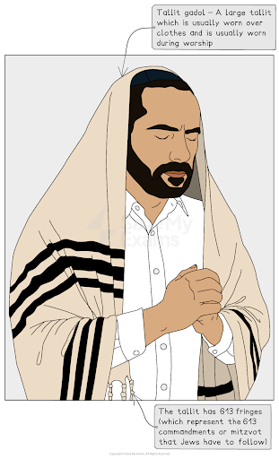
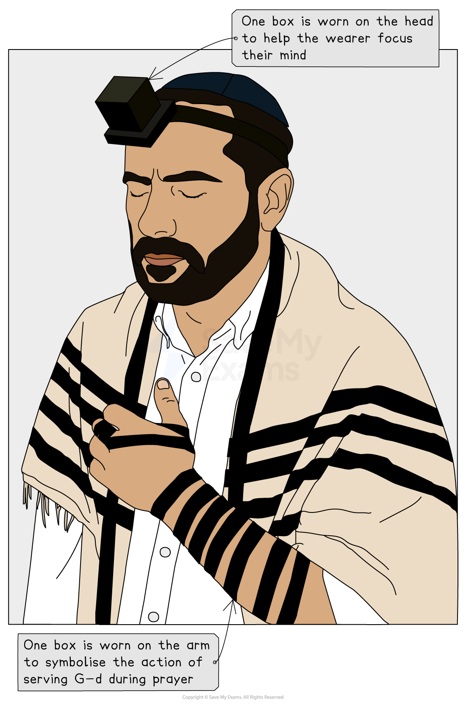
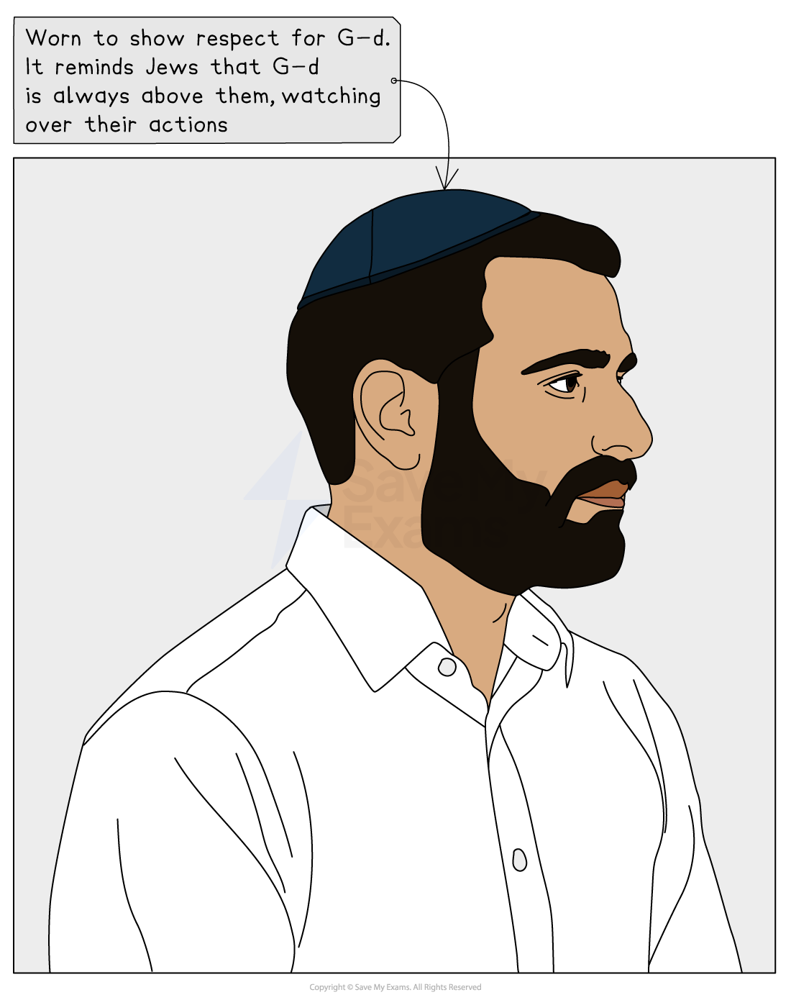

# Ritual Dress in Jewish Worship

## The use and importance of the tallit

> **Spec point** — `spcpt_T5zRYVZjVJMj5HSm`

## What is the tallit, and what is it used for?

- The **tallit** is a **prayer shawl** traditionally worn by **Jewish men** during **morning prayer **services, **festivals **and on the **Sabbath**

  - The tallit** **has **613 fringes** known as **“tzitzits,” **which represent the **613 commandments** or **mitzvot **that **Jews **have to follow

***The tallit***

- There are **two **different types of tallit:

  - **Tallit gadol** — A **large **tallit** **that is usually worn over clothes, rests on the shoulders and is usually worn **during worship**
  - **Tallit katan** — A **smaller **tallit that is worn by many Jews** **as an **undergarment **between their T-shirt and jumper at all times
- Many **Reform **and **Liberal Jewish women** now choose to wear a tallit,** **and this is becoming more **acceptable **in these movements

### Why is the tallit important for Jews?

- The tallit acts as a reminder of the **mitzvot **(commandments)

  - The **fringes **(called tzitzit) on the tallit are **commanded **in the **Torah**
  - Each time a **Jew **wears it, they are reminded to live according to **G-d’s laws**

> **blockquote**
> “The Lord said to Moses as follows: Speak to the Israelite people and instruct them to make for themselves fringes on the corners of their garments throughout the ages; let them attach a cord of blue to the fringe at each corner. That shall be your fringe; look at it and recall all the commandments of the Lord and observe them, so that you do not follow your heart and eyes in your lustful urge” (Numbers 15)

- The tallit** **acts as a **spiritual focus **during **prayer**

  - The tallit** **helps the worshipper enter a **mindset **that helps them to **focus**
- The tallit** **is also an expression of **Jewish identity** and **faith**

  - Wearing the tallit** **shows a commitment to **Jewish tradition** and the **community**
- It also has a **practical use **during important events in **life **and **death**

  - It may be worn at ***bar mitzvahs*** and **weddings** and used to **wrap **a **body **in **burial**,** **which shows its **lifelong significance**

## The importance of the tefillin

> **Spec point** — `spcpt_2XHmrkhxydZ79Skp`

## What are tefillin, and what are they used for?

- **Tefillin **are worn mainly by **Orthodox Jewish** **men **during **morning prayer**

  - Tefillin** **consist of **two leather boxes** that contain words from the ***Shema***
  - **One **of the** **boxes** **is tied onto the **arm **with the leather strap it is attached to, and the second box is tied to the **head**

***The tefillin***

- The reason for wearing tefillin is based on a **biblical law**, which states:

> **blockquote**
> “Love the Lord your G-d with all your heart, all your being, and all your might. These words that I am commanding you today must always be on your minds. Recite them to your children. Talk about them when you are sitting around your house and when you are out and about, when you are lying down and when you are getting up. Tie them on your hand as a sign. They should be on your forehead as a symbol. Write them on your house’s doorframes and on your city’s gates” (Deuteronomy 6:5–9)

- When the **tefillin **have been put on, a **special prayer** is said: “**Blessed are You, Lord our G-d, King of the Universe, who has sanctified us with His commandments as to wear tefillin**”

### Why are tefillin important?

- There are many reasons why **tefillin **are important within **Judaism**

  - They fulfill the **biblical command**, “**Bind them as a sign on your hands and between your eyes**” (Deuteronomy 6:8)
  - They help the wearer **focus **their **mind **(head) and **actions **(arm/hand) on serving **G-d **during **prayer**
  - They are a **symbol **of **devotion **during **weekday morning prayers**

## The importance of the kippah/yarmulke

> **Spec point** — `spcpt_g9ZxnQ5Fk7RX346v`

## What is the kippah/yarmulke?

- The **kippah **(yarmulke), often referred to as a **skullcap**, is worn by Jews** **as a sign of **Jewish identity**

  - In **Orthodox Judaism**, the kippah** **is worn by **Jewish men** at all times, apart from when they are **sleeping **or **washing**
  - In **Liberal **and **Reform Judaism**, some **women **choose to wear the kippah** **if they are doing anything **holy**
  
    - This could be during **ceremonies **at home, in the synagogue, during **holy days** or when they are reading the **Torah**
  - Unlike the wearing of the **tallith **and **tefillin**, there is no **commandment **for **Jews **to wear the **kippah**

**The kippah/yarmulke**

### What is the significance of the kippah/yarmulke?

- One of the main reasons for wearing the skullcap is out of **respect **for **G-d**

  - It reminds Jews that G-d** is always above them**, watching over their **actions**
- It also acts as an **outward sign** of **identity **and **belonging **to the **Jewish faith**

  - It serves as a **visible sign** of Jewish belief in **G-d**
- It is also mentioned in the ***Talmud***,* *which offers **guidance **to all Jews

> **blockquote**
> “**Cover your head so that the fear of heaven may be upon you**” (Talmud – Kiddushin 31a)

## Views of Jewish traditions on ritual dress

> **Spec point** — `spcpt_PQ4Bn5N8FFcXnqG8`

## What is ritual dress?

- **Ritual dress** is specific **clothing **worn for **religious purposes**, often during **prayer**, **festivals** or other **significant occasions**

  - Common items include the **tallit **(prayer shawl), **kippah **(head covering) and **tefillin**

## What are the views from different Jewish traditions on ritual dress?

- Each **Jewish tradition **has a different idea of what ritual dress is **appropriate**

  - There may even be **differences **of **opinion **from within **each tradition**
- In **Orthodox Judaism**, **ritual dress** is worn **regularly**, not just for prayer, but it differs between men and women

  - **Men** will wear:
  
    - **A kippah** (head covering) at all times
    - **A tallit **(prayer shawl) during **morning prayers**
    - **Tefillin** (leather boxes with Torah verses) during **weekday morning prayers**
  - **Women** may cover their **hair **(with a scarf or wig) after **marriage **as a sign of **modesty**
- In **Reform Judaism**, ritual dress is seen as **optional** or ***symbolic***

- Ritual dress is worn mostly during **prayer** or **festivals** but not daily
- Some Reform Jews do not wear** tefillin**, and women are often **encouraged to wear a tallit** if they choose
- Emphasis is on **personal choice**, and there is** less difference **between the **genders**

- In **Conservative Judaism**, there is a **middle ground **between **Orthodox **and **Reform**

  - In this tradition, **ritual dress **is **encouraged **during **prayer**
  - Both **men **and **women **are able to wear:
  
    - **A kippah**
    - **A tallit**
    - **Tefillin** (in some communities)
  - **Conservative Judaism** is more **flexible** than **Orthodox** but still **values tradition**

> **Worked Example**
> Name two items that Jews might wear as part of worship
> 
> **[2 marks]**
> 
> **Final answer:** **Answer:**
> 
> - Kippah
> - Tallit

> **Exam Hint**
> Create a simple table comparing Orthodox, Reform and Conservative views on:
> 
> - What is worn (e.g. kippah, tallit, tefillin)
> - Who wears it (men, women or both)
> - When it is worn (daily, prayer only, optional)
> 
> This helps you spot similarities and differences quickly, which may help with exam questions.
