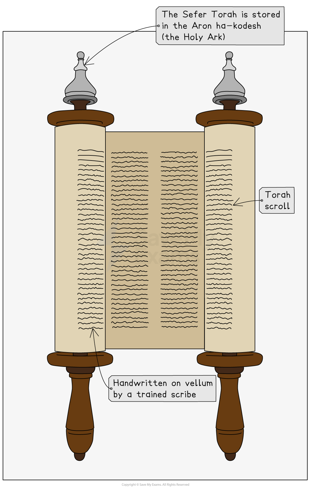

# The Torah & Worship

## Study of the Torah

> **Spec point** — `spcpt_XZj6PkYS63758K4N`

## What is the Torah?

- The **Torah **is the** first five books **of the **Hebrew Bible**, also known as the **Five Books of Moses**

  - These books are:
  
    - **Genesis**
    - **Exodus**
    - **Leviticus**
    - **Numbers**
    - **Deuteronomy**
- The Torah is a crucial text in **Judaism**
- It is considered the **holiest **part of the **Tenakh **(the Jewish Bible), and it provides **guidance **on how **Jews **should **live**
- The **Torah **contains very important **stories **and **events **that influence** Jewish faith** and **practice**,** **including:

  - **Stories **about the **creation **of the **world**
  - The lives of the ***patriarchs***** **(Abraham, Isaac, Jacob)
  - The *Exodus*** **from **Egypt**
  - The giving of the **Ten Commandments **on **Mount Sinai**
  - The establishment of **Jewish laws**

### How is the Torah studied in the synagogue?

- When the **Torah **is read during a **synagogue service**, one of the **congregation members **opens the *ark*, which is also known as the **Aron Hakodesh**
- The **Torah scrolls** are taken out from the **Aron Hakodesh**
- Sections of the Torah are read in the **synagogue three times **each **week**

  - Over the course of the **year**, the whole **scroll **is read in **sequence**
- The **special portions** for the readings are called **parshioth **and are usually **three **to **five chapters **in length

  - The **reading **is conducted using an **ancient tune** and is **sung **rather than **spoken**
- The **Torah scrolls** are not directly **touched **when **unfurled **on the ***bimah ***— instead, a ***yad ***is used to **protect **the **Torah**
- The **reading **or **chanting **is usually performed by a **person **who has been **trained **in this task

  - It may be carried out by the **rabbi**
  - It is a very great **honour **for a member of the **congregation **to be asked to **attend **to a reading during a **synagogue service**
- When the **Torah **has been **read**,** **it is carefully placed back in the **ark**

### How is the Torah studied in the home?

- The **home **is a place where **Jews **often **pray **and **worship **

  - It is a place where **values **and **beliefs **are **learned **and **practiced**
- The **Torah **is used as part of that **worship **in **different ways** and for **different reasons**

  - It can be used for **family learning **and **discussion**,** **with **parents** **reading **and **discussing Torah portions** with their **children**
  
    - This encourages passing down **tradition **and applying **teachings **to **daily life**
  - **Jews **may study the **weekly portion** (parashah) at **home **before or after it is read in **synagogue **on **Shabbat**
  - Study of the **Torah **at home often includes using the **traditional commentaries** by **rabbis **to help understand **deeper meanings**
  - Some people may study **Torah **or **Talmud **daily, **alone **or in **pairs **(also called **chavruta** or partner study)
  - Many people use **Jewish study guides**, **translations** and modern tools, such as **apps **or **online videos**
  - Studying **Torah **is itself a ***mitzvah***, so learning at **home **is seen as an act of **worship **and **devotion**

## Views of different Jewish traditions on the use of the Torah

> **Spec point** — `spcpt_Ydwjtfk73WBg8pMS`

## The use of the Torah in different traditions

- The views around the **Torah **and its uses differ across the **Jewish traditions**

#### Orthodox Judaism and the Torah

- **Orthodox Jews **believe that the **Torah **is the literal word of **G-d**, revealed to **Moses **at **Mount Sinai**

  - The **Torah **is **read **in **Hebrew **during **synagogue services**
  - The entire **Torah **is read aloud over the course of a **year **(weekly **parashot**)
  - The study of the **Torah **is viewed as a **mitzvah **(commandment) to complete **regularly**
  - This is part of the **strict *****adherence*** to all **commandments **and **halakhah **(Jewish law)

#### Reform Judaism and the Torah

- **Reform Jews** believe that the **Torah **is inspired by **G-d **but written by **humans**,** **and so may be open to ***interpretation***

  - When used during **worship**, the **Torah **is often read in both **Hebrew **and the **local language**
  - **Reform Judaism** is less strict about completing the** full yearly cycle **than Orthodox Judaism
  - The **focus **is more on **ethical teachings** and **relevance **to **modern times**
  - **Torah study** is more likely to be open to **wider participation **than in the Orthodox tradition, with **men **and **women **having **equal opportunity**

#### Conservative Jews

- **Conservative Jews** believe that the **Torah **is **divine **but interpreted through **tradition**

  - Their **worship **is similar to **Orthodox **worship, with full but sometimes **adapted** **Hebrew readings**
  - Study of the **Torah **balances **traditional methods** with** modern scholarship**
  - It encourages thoughtful **engagement **with **Jewish law** and **tradition**

## Respectful treatment of the Torah scrolls

> **Spec point** — `spcpt_tQqx5K5RfKsRTTQF`

## How and why are the Torah scrolls treated with respect?

- **Torah scrolls** are treated with great **respect **because they are considered **sacred **and central to** Jewish belief **and **practice**
- The **Torah **is the foundation of **Jewish law, tradition** and **values**

  - Respecting it reflects the importance of **faith**, **history** and **continuity**
- Many **Jews **believe that the **Torah **is the direct word of **G-d**, revealed to **Moses **at **Mount Sinai**

  - Treating the **scrolls **with **respect **shows honour for** G-d** and His **teachings**
- **Torah scrolls** are **handwritten **by a trained **scribe **(**sofer**) on ***kosher *****parchment**,** **using special ink and writing styles

  - Any **damage **makes the **scroll invalid**, showing how **sacred **it is
  - When carried, the **congregation **often **stands**, **bows** and **kisses **the **scroll **with their **prayer book** or **tallit**
- The **scroll **is read using a **pointer **(**yad**) to avoid touching it with **bare hands**, out of **reverence **and **protection**

> **Worked Example**
> Give two ways in which respect is shown to the Torah scrolls, and outline how this happens.
> 
> **[4 marks]**
> 
> **Final answer:** **Answer:**
> 
> The scrolls are treated with respect by being kept in the Aron Hakodesh, which is the holiest part of the synagogue **[2]**
> 
> The scroll is read using a pointer (yad) to avoid touching it with bare hands, out of reverence and protection **[2]**

> **Exam Hint**
> When revising for this section, be confident using key terms and explain not just what Jews do, but why they do it
> 
> Show understanding of different traditions, and always link back to the importance of the Torah in worship
> 
> Remember that although the Torah is extremely important for all Jewish traditions, it is viewed and used differently due to different beliefs and approaches by the various Jewish traditions
