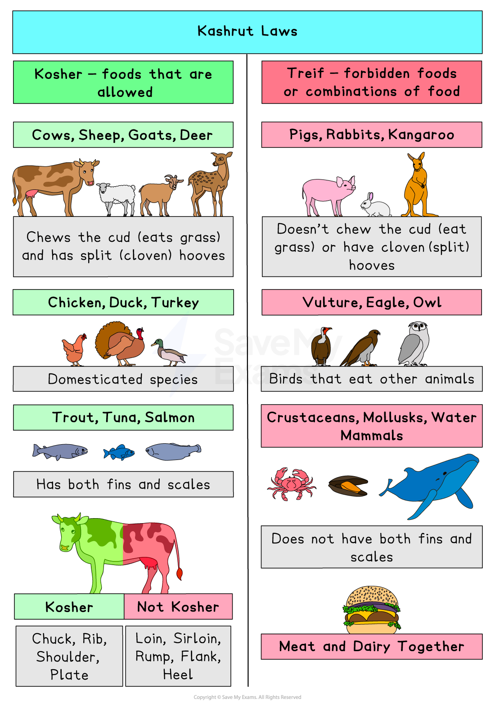

# Kashrut & Treyfah

## The source of kashrut laws in the Torah

> **Spec point** — `spcpt_P6xk5q28nmhwY8Vb`

## What are the kashrut laws?

- Jewish laws regarding food are known as **kashrut**
- The kashrut laws cover all of the rules relating to food, including:

  - The** types of animals** a Jewish person can eat
  - **How the animals are prepared**
  - The foods that are** forbidden**, including:
  
    - Blood, certain forbidden fats and sinew
    - Flies and insects
  - **How the food must be prepared**
- These rules are contained within the **mitzvot**, mainly within the books of **Deuteronomy** and **Leviticus**

  - For example, the book of Leviticus says that only animals that have **cloven hooves** and that **chew the cud **are permitted
  - **Pigs have cloven hooves** but **do not chew the cud**
  
    - This means that the meat of pigs is forbidden

> **blockquote**
> “You may eat any animal that has a split hoof completely divided and that chews the cud” (Leviticus 11:3)

- Following the rules regarding food **shows obedience** and **self-control**
- Food that is allowed is called** kosher** (meaning fitting or correct), and food that is not allowed is called** treif**

  - Examples of treif food include** shellfish**, **pork **and** pork products** and food that has **not been slaughtered in the correct way**
  
    - This method of slaughtering is known as** shechita**

## Kashrut laws and food

> **Spec point** — `spcpt_xYMZvmPY4FPvbZ2T`

## What are the kashrut laws related to food?

- There are strict rules that govern **kosher laws**, which are **based on Scripture**

  - **Land animals** must have **cloven (split) hooves** and **must chew the cud**, meaning that they must eat grass
  - **Seafood** must have **fins and scales**, so** eating shellfish is not allowed**
  - It is **forbidden to eat birds of prey**,** **as they are not considered clean birds
  
    - The term “clean birds” refers to birds that do not eat other animals; however, **poultry (chicken, etc.)** may be eaten
  - **Meat and dairy** **cannot be eaten together**
  
    - Jews who follow these dietary rules cannot, for example, eat cheeseburgers because they mix meat and cheese (which is made from milk)
    - Often, this rule is extended further so that people must wait up to six hours after eating meat before they can eat dairy
    - The Torah says:

> **blockquote**
> “Do not boil a kid in its mother’s milk” (Exodus 23:19)

*Kashrut Laws*

## Kashrut laws and clothing

> **Spec point** — `spcpt_v4kFM6rsC8R3f5pb`

## What are the kashrut laws relating to clothing?

- While kashrut is mainly known for food laws, it **also includes rules on clothing**, especially regarding materials
- Wearing garments made from a **mix of wool** and** linen is forbidden**
- This is known as **shatnez**
- This belief comes from passages in the Torah that forbid certain mixtures of materials

> **blockquote**
> “Do not wear clothing woven of two kinds of material” (Leviticus 19:19)

> **blockquote**
> “Do not wear wool and linen woven together” (Deuteronomy 22:11)

- The prohibition of shatnez is seen as a **chok**, which is a **law with no clear, rational explanation**

  - It is followed because it is **commanded by G-d**
- Some Jews get clothing (especially suits and coats) checked for shatnez by trained testers
- If a garment contains both wool and linen, it must be altered or avoided

## Different Jewish views on kashrut laws

> **Spec point** — `spcpt_vXr48wJnqBR4qm5j`

## What are the different Jewish views on kashrut laws?

- There can be differences between the way that kashrut is observed between **Orthodox** and **Reform Jews**

#### Orthodox Judaism and kashrut

- Orthodox Jews keep all the rules of kashrut **as commanded in the Torah **and interpreted in the** Talmud**

  - They believe that the** laws are divinely given** and unchanging
  - Some people have **separate utensils** and perhaps** fridges** for the preparation and storage of meat and dairy products

- Orthodox Jews only eat **meat **that has been **slaughtered **and **prepared properly** (**shechita**)
- They are unlikely to eat in **non-kosher restaurants**, even **vegetarian **ones, unless **certified**

- Although **Reform Jews **may choose to observe all of the **kashrut**, they believe it is down to **personal choice**

  - Some** Reform Jews** observe a **selection **of the **laws**
  - They are more likely to focus on the **ethical principles** behind the **laws **(for example, health, kindness to animals)
  - Others observe **kashrut **at **home **but not **elsewhere**
  
    - Some may **mix meat **and **dairy **or eat in **non-kosher restaurants**

> **Worked Example**
> Explain how the belief in dietary laws might affect the daily life of Jews
> 
> **[6 marks]**
> 
> **Final answer:** **Answer:**
> 
> There are certain foods that are forbidden within Judaism. For example, land animals that are eaten must have split hooves and chew the cud, so any meat from pigs is forbidden. Some Jews also do not eat any dairy products and meat together because the Torah says not to “boil a kid in its mother’s milk”. Many Jews avoid eating out anywhere that is not a kosher restaurant in case the food or the way it is prepared is prohibited. Some may insist on food that is prepared in a kosher kitchen to ensure that everything is as it should be according to the Torah

> **Exam Hint**
> Make sure you are able to connect practices to beliefs
> 
> **Practice**: no pork or shellfish
> 
> **Belief it reflects**: obedience to G-d’s commands in the Torah
> 
> **Practice**: separate meat and dairy
> 
> **Belief it reflects**: Torah law (Exodus 23:19), promotes spiritual discipline
> **Practice**: shechita (ritual slaughter)
> 
> **Belief it reflects**: humane killing, respect for life
