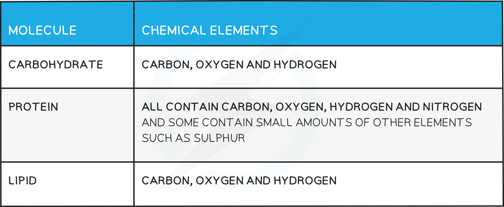
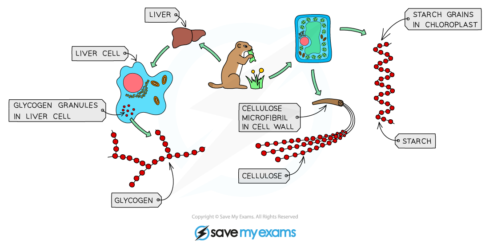
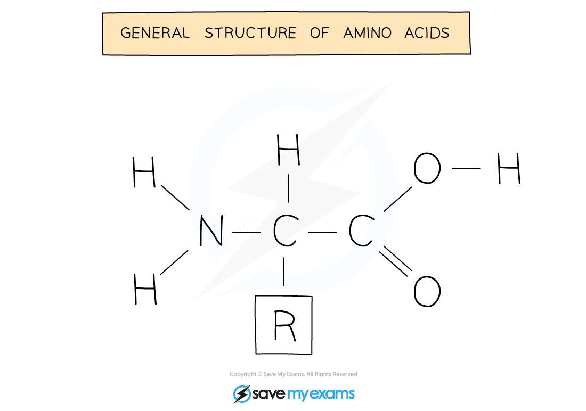
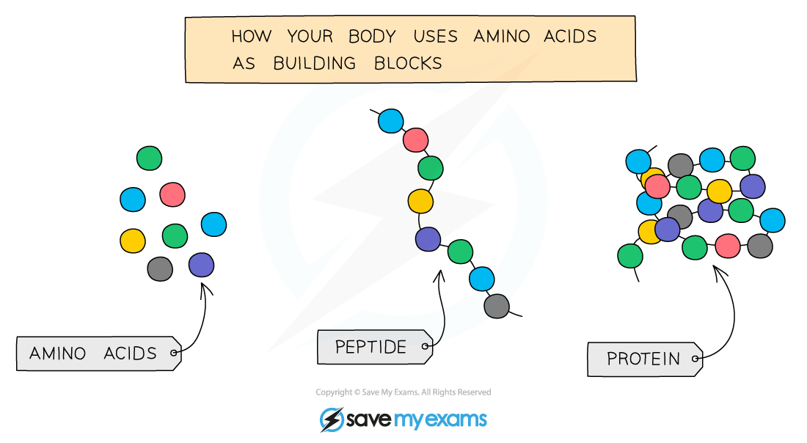

# Chemicals & Life

## Chemical Elements

> **Spec point** — `spcpt_9tSx8sy9SCgs7Hv5`

## Chemical Elements

- Most of the molecules in living organisms fall into three categories: **carbohydrates, proteins and lipids**
- These **all contain carbon** and so are described as organic molecules

**Chemical Elements Table**

## Large Molecules are Made from Smaller Molecules

> **Spec point** — `spcpt_qnYgygh2NDzx4qSS`

## Large Molecules are Made from Smaller Molecules

#### Carbohydrates

- Long chains of **simple sugars**
- **Glucose** is a simple sugar ( a monosaccharide)
- When **2 glucose molecules join together maltose is formed** (a disaccharide)
- When **lots** of glucose molecules join together **starch, glycogen or cellulose** can form (a polysaccharide)

***Glycogen, cellulose and starch are all made from glucose molecules***

#### Fats

- Most fats (lipids) in the body are made up of **triglycerides**
- Their basic unit is **1 glycerol molecule chemically bonded to 3 fatty acid chains**
- The fatty acids vary in size and structure
- Lipids are divided into **fats** (solids at room temperature) and **oils** (liquids at room temperature)

***Structure of a triglyceride***

#### Proteins

- Long chains of **amino acids**
- There are about 20 different amino acids
- They all contain the **same basic structure** but the **‘R’ group is different for each one**
- When amino acids are joined together a protein is formed
- The amino acids can be arranged in any order, resulting in hundreds of thousands of different proteins
- Even a small difference in the order of the amino acids results in a different protein being formed

***General amino acid structure***

***Amino acids join together to form proteins***
