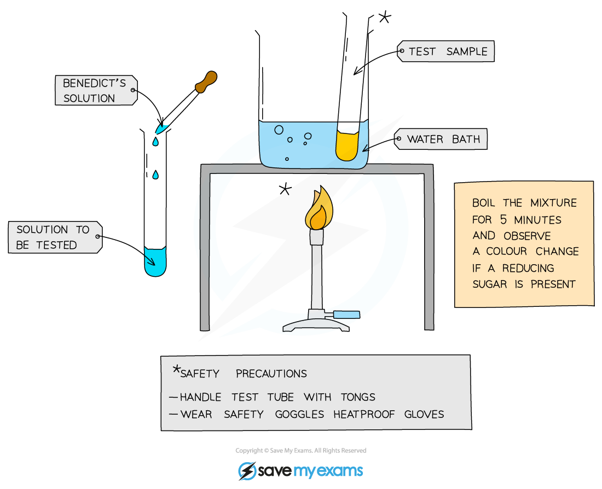
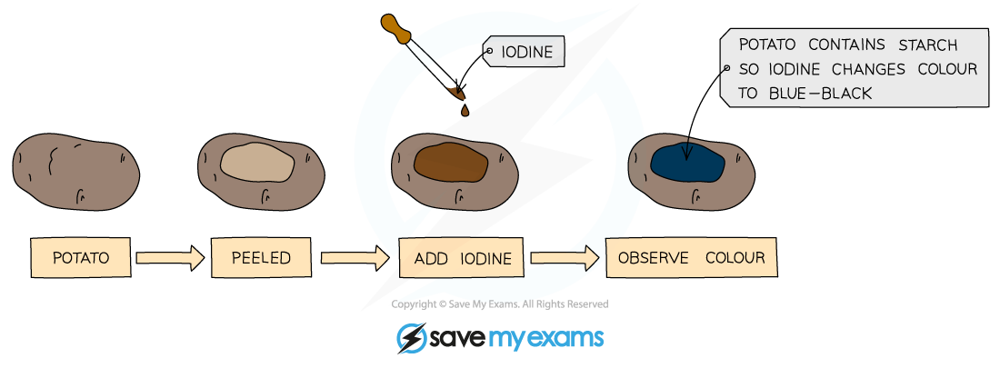
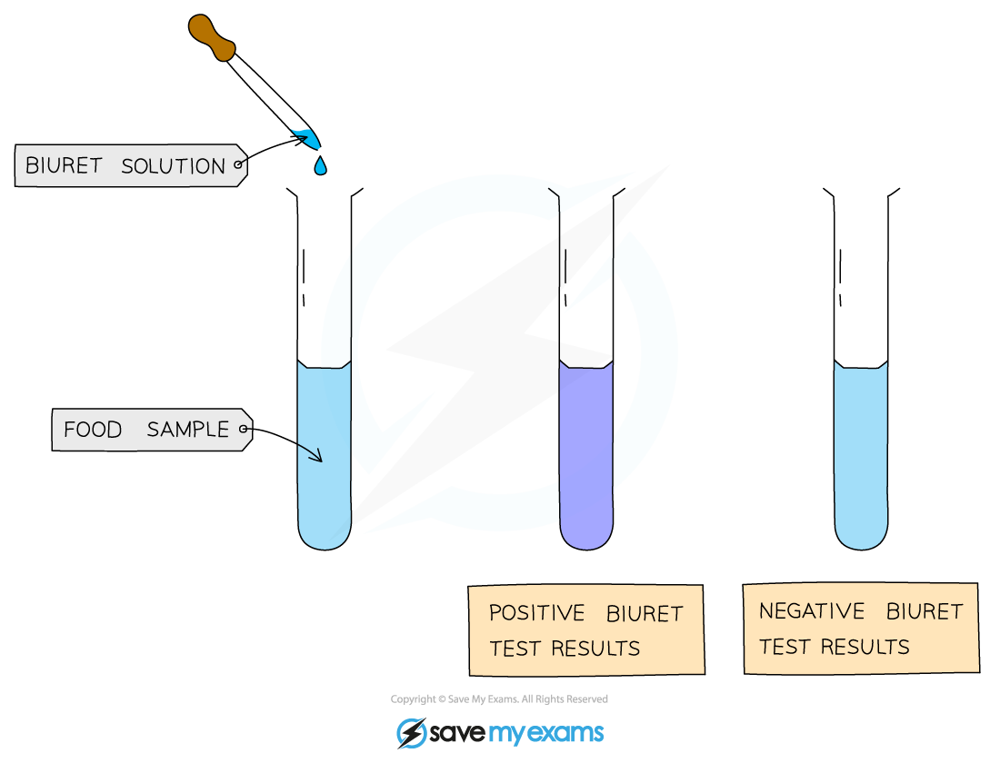
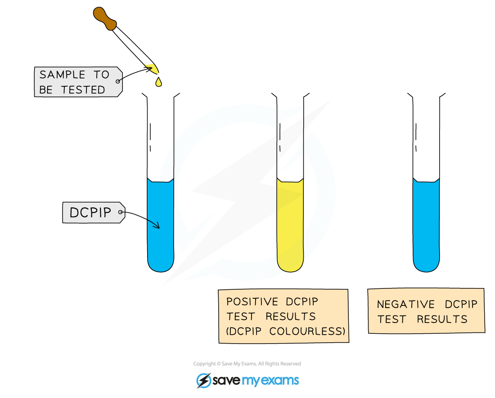

# Food Tests

## Food Tests

> **Spec point** — `spcpt_thMxp5DRS9S4CpNv`

## Food Tests

#### Test for glucose (a reducing sugar)

- Add **Benedict's solution** into sample solution in test tube
- **Heat** at 60 - 70 °c in water bath for **5 minutes**
- Take test tube out of water bath and observe the colour
- A positive test will show a colour change from **blue to orange or brick red**

[<u>Use this image</u>](https://www.savemyexams.com/info/policies/using-our-illustrations-images-fair-use/)

***The Benedict's test for glucose***

#### Test for starch using iodine

- We can use iodine to test for the presence or absence of starch in a food sample.

[<u>Use this image</u>](https://www.savemyexams.com/info/policies/using-our-illustrations-images-fair-use/)

***The iodine test for starch***

- Add drops of **iodine solution** to the food sample
- A positive test will show a colour change from **orange-brown to blue-black**

[<u>Use this image</u>](https://www.savemyexams.com/info/policies/using-our-illustrations-images-fair-use/)

***Testing a potato to prove the presence of starch***

#### Test for protein

- Add drops of **Biuret solution** to the food sample
- A positive test will show a colour change from **blue to violet / purple**

[<u>Use this image</u>](https://www.savemyexams.com/info/policies/using-our-illustrations-images-fair-use/)

***The Biuret test for protein***

#### Test for lipids

- Food sample is mixed with **2cm****3**** of ethanol** and shaken
- The ethanol is added to an equal volume of **cold water**
- A positive test will show a **cloudy emulsion** forming  [<u>Use this image</u>](https://www.savemyexams.co.uk/info/policies/using-our-illustrations-images-fair-use/) ***The ethanol test for lipids***

#### Test for vitamin C

- Add **1cm****3**** of DCPIP solution** to a test tube
- Add a small amount of food sample (as a solution)
- A positive test will show the **blue colour of the dye disappearing**

[<u>Use this image</u>](https://www.savemyexams.com/info/policies/using-our-illustrations-images-fair-use/)

***The DCPIP test for vitamin C***

> **Exam Hint**
> When describing food tests in exam answers, make sure you give the **starting colour** of the solution and **the colour it changes to** for a positive result.
