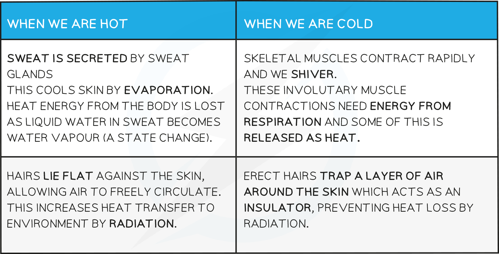

# Homeostasis & Temperature Control

## The Skin & Homeostasis: Extended

> **Spec point** — `spcpt_qczFcMS5gQn5nnFP`

## The Skin & Homeostasis: Extended

### Extended Tier Only

- Control of body temperature is a **homeostatic** mechanism
- Homeostasis is **the maintenance of a constant internal environment**
- This means that **internal conditions within your body** (such as temperature, blood pressure, water concentration, glucose concentration etc) need to be **kept within set limits** in order to ensure that reactions in body cells can function and therefore the organism as a whole can live
- The human body maintains the temperature at which enzymes work best, around **37°C**
- If body temperature increases over this temperature, **enzymes will denature** and become less effective at catalysing reactions such as respiration

#### The Structure of the Skin

***A cross-section of human skin***

#### Temperature Regulation by the Skin

- Regulation is controlled by the **brain** which contains **receptors** sensitive to the temperature of the** blood**
- The **skin** also has **temperature receptors** and sends nervous impulses to the brain via **sensory neurones**
- The brain responds to this information by sending nerve impulses to **effectors** in the skin to **maintain the temperature within a narrow range of the optimum, 37°C**
- **Fatty tissue **under the dermis acts as a layer of **insulation** to prevent too much body heat being lost through the skin

***Homeostatic responses to changes in body temperature***

Responses to changes in temperature:

