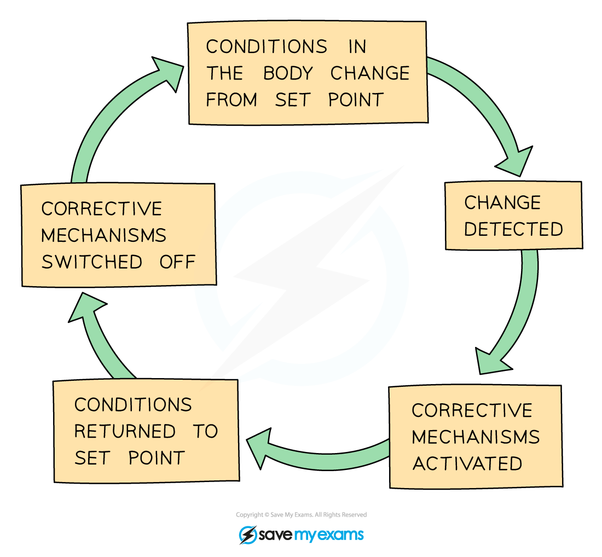
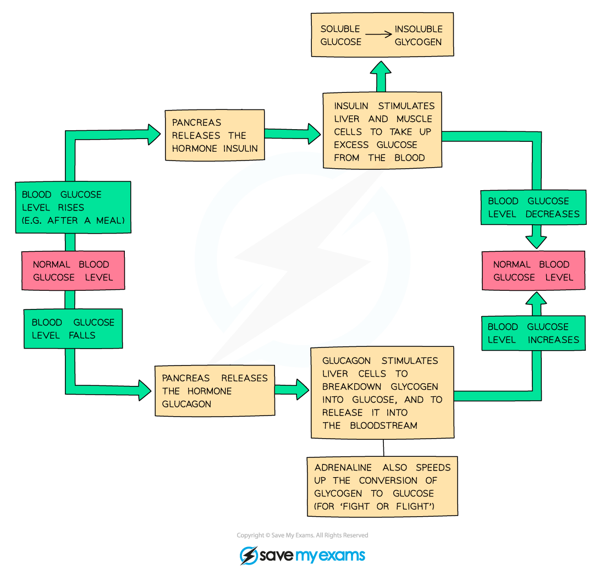

# Homeostasis

## Defining Homeostasis: Extended

> **Spec point** — `spcpt_s3bJCQw9GWTdkSfj`

## Defining Homeostasis: Extended

### Extended Tier Only

- Homeostasis is defined as **the maintenance of a constant internal environment**

## The Concept of Negative Feedback: Extended

> **Spec point** — `spcpt_7wdsBRVc9xWtGyhB`

## The Concept of Negative Feedback: Extended

### Extended Tier Only

- Negative feedback occurs when conditions change from the ideal or **set point** and returns conditions to this set point
- It works in the following way:

  - if the level of something **rises**, control systems are switched on to **reduce it** again
  - if the level of something **falls**, control systems are switched on to **raise it **again
- Negative feedback mechanisms are usually a continuous cycle of bringing levels down and then bringing them back up so that overall, they stay within a **narrow range** of what is considered ‘**normal**’

***The negative feedback cycle***

## Blood Glucose Control: Extended

> **Spec point** — `spcpt_GVj8GGkjsccWFWsk`

## Blood Glucose Control: Extended

### Extended Tier Only

- Blood glucose levels are controlled by a negative feedback mechanism involving the production of two **hormones** - **insulin** and **glucagon**
- Both hormones which control blood glucose concentration are made in the **pancreas**

**If the blood glucose concentration gets too low**

- Cells in the** pancreas** detect the decreased blood glucose levels
- The pancreas produces the hormone **glucagon** and secretes it into the blood
- Glucagon causes the glycogen stored in the liver to be converted into** glucose **and released into the blood
- This** increases** the concentration of glucose in the blood back to **normal levels**, at which point the pancreas stops secreting glucagon

**If the blood glucose concentration gets too high**

- Cells in the **pancreas** detect the increased blood glucose levels
- The pancreas produces the hormone **insulin**, secreting it into the blood
- Insulin stimulates muscles and the liver to take up glucose from the bloodstream and store it as **glycogen** (a polymer of glucose)
- This** reduces **the concentration of glucose in the blood back to **normal levels**, at which point the pancreas stops secreting insulin

***Negative feedback regulation of blood glucose levels***

> **Exam Hint**
> The terms glucagon and glycogen are very often mixed up by students as they sound similar. Remember:
> 
> - Glucagon is the **hormone**
> - Glycogen is the polysaccharide **glucose is stored as**
> 
> Learn the differences between the spellings and what each one does so you do not get confused in the exam!
