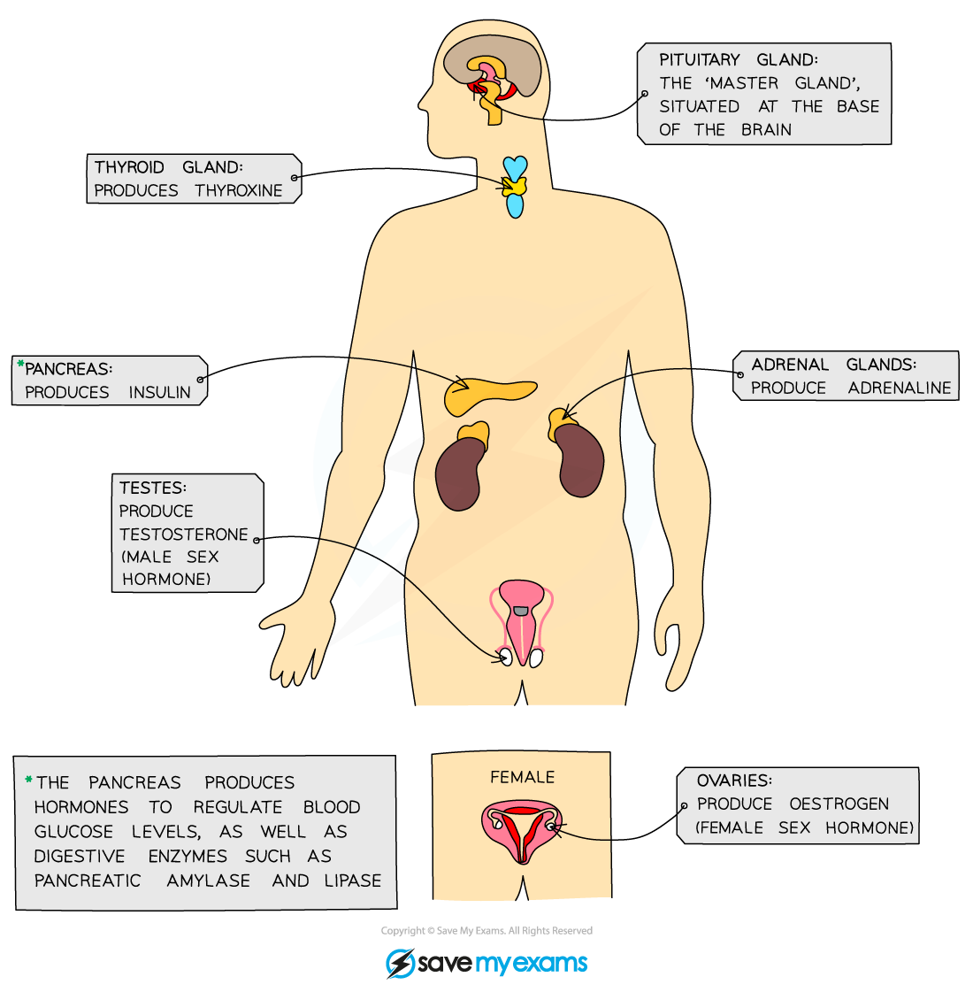
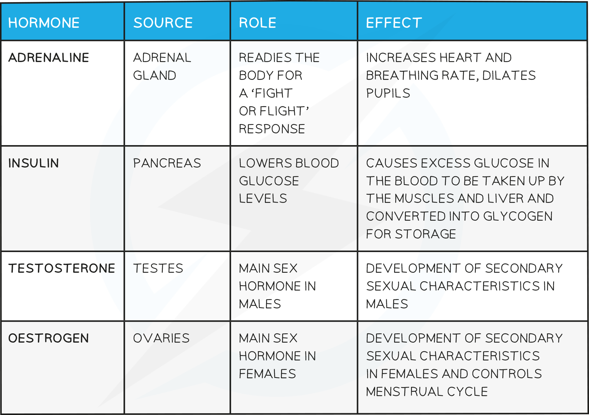

# Hormones in Humans

## Hormones & Their Associated Glands

> **Spec point** — `spcpt_RdRhRPg3KwypwXc9`

## Hormones & Their Associated Glands

#### What is a Hormone?

- A **hormone** is a chemical substance produced by a **gland **and carried by the **blood**
- The hormone alters the activity of one or more specific target organs i.e. they are chemicals which transmit information from one part of the organism to another and bring about a change
- The glands that produce hormones in animals are known collectively as the **endocrine system**

***The major endocrine glands in the body***

**Transport around the body**

- Endocrine glands have a **good blood supply** as when they make hormones they need to get them into the bloodstream (specifically the blood plasma) as soon as possible so they can travel around the body to the target organs to bring about the response
- Hormones only affect cells with target receptors that the hormone can bind to. These are either found on the cell membrane, or inside cells. Receptors have to be complementary to hormones for there to be an effect.
- The liver regulates levels of hormones in the blood; transforming or breaking down any that are in excess.

***How hormones work***

Important hormones in the human body:

## Glucagon: Extended

> **Spec point** — `spcpt_TK3GZvBVQZTcfVbP`

## Glucagon: Extended

### Extended Tier Only

- Blood glucose levels are controlled by a negative feedback mechanism involving the production of two **hormones** - **insulin** and **glucagon**
- Both hormones which control blood glucose concentration are made in the **pancreas**
- **Insulin** is produced when **blood glucose rises **and **stimulates liver and muscle cells to convert excess glucose into glycogen to be stored**
- **Glucagon** is produced when **blood glucose falls** and **stimulates liver and muscle cells to convert stored glycogen into glucose to be released into the blood**

***Negative feedback regulation of blood glucose levels***

> **Exam Hint**
> The terms glucagon and glycogen are very often mixed up by students as they sound similar. Remember:
> 
> - Glucagon is the **hormone**
> - Glycogen is the polysaccharide **glucose is stored as**
> 
> Learn the differences between the spellings and what each one does so you do not get confused in the exam!

## The Hormone Adrenaline

> **Spec point** — `spcpt_rJN5xmCfSvGSNKfk`

## The Hormone Adrenaline

- Adrenaline is known as the '**fight or flight'** hormone as it is **produced in situations where the body may be in danger**

  - Flight = remove oneself rapidly from a dangerous situation eg. run away
  - Fight = if flight is not possible, resort to physical combat to overcome danger
- It causes a range of different things to happen in the body, all designed to prepare it for movement (ie fight or flight).
- These include:
- **Increasing blood glucose concentration** for** increased respiration in muscle cells**
- **Increasing pulse rate** and** breathing rate** so glucose and oxygen can be **delivered to muscle cells**, and carbon dioxide taken away, from muscles cells **more quickly**
- **Diverting blood flow towards muscles** and away from non-essential parts of the body such as the alimentary canal; again to ensure the reactants of respiration are as available as possible
- **Dilating pupils** to allow as much light as possible to reach the retina so **more information can be sent to the brain**

> **Exam Hint**
> It is worth learning this list of effects of adrenaline as it is a fairly common exam question and can be worth several easy marks.
