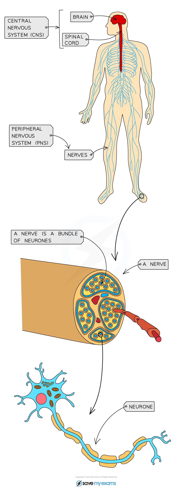

# Mammalian Nervous System

## Structure & Role of the Mammalian Nervous System

> **Spec point** — `spcpt_rPWdJKNmQrB255p8`

## Structure & Role of the Mammalian Nervous System

- The **human nervous system** consists of the:

  - **central nervous system** (CNS) - the brain and the spinal cord
  - **peripheral nervous system** (PNS) - all of the nerves in the body
- It allows us to

  - Make sense of our surroundings and respond to them
  - **Coordinate **and **regulate body functions**
- Information is sent through the nervous system as **nerve impulses** - electrical signals that pass along nerve cells known as **neurones**
- A bundle of neurones is known as a **nerve**

***The human nervous system***
