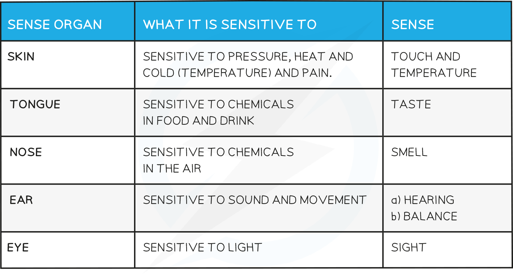

# Sense Organs

## Sense Organs as Receptors

> **Spec point** — `spcpt_VPSHdjVd7myg5Cqb`

## Sense Organs as Receptors

- Receptors are groups of specialised cells
- They **detect a change in the environment and stimulate electrical impulses in response**
- Sense organs contain **groups of receptors** that respond to specific stimuli

- Once the receptor cell in the sense organ has been stimulated, it generates an **electrical impulse**
- This is passed on to a **sensory neurone** which carries the impulse to the **central nervous system**
- Here a response will be decided on and the impulse will be passed to a **motor neurone** (via a relay neurone)
- The motor neurone carries the impulse to the **effector** (muscle or gland)
- The effector **carries out the response**
