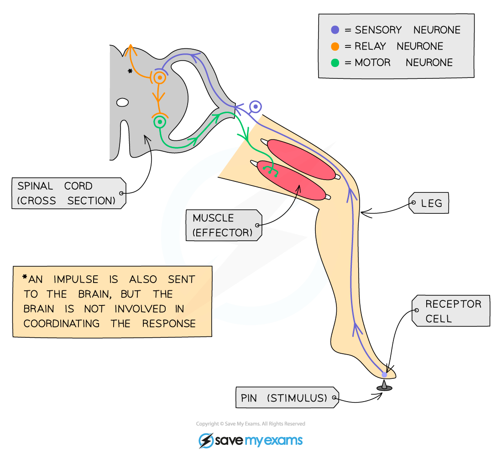

# The Reflex Arc

## The Reflex Arc

> **Spec point** — `spcpt_FwRXZNzMK6ZzdxrT`

## The Reflex Arc

#### Voluntary Responses

- A voluntary response is one where you make a **conscious decision** to carry out a particular action therefore it **starts with your brain**

  - An example is reaching out to pick up a cup of coffee
- An involuntary (or reflex) response does **not involve the brain as the coordinator** of the reaction and you are** not aware** you have completed it until **after** you have carried it out
- Involuntary actions are usually ones which are **essential to basic survival** and are **rapid**, whereas voluntary responses often **take longer** as we consider what the consequences might be before doing it

#### Reflex Responses

- An **involuntary** (or **reflex**) response **does not involve the brain** as the coordinator of the reaction and you are not aware you have completed it until after you have carried it out
- This is an **automatic and rapid response** to a stimulus such as touching something sharp or hot
- As it does not involve the brain, a reflex response is **quicker** than any other type of nervous response
- This helps to **minimise the damage to the body**

***A reflex ***

1. The pin (the stimulus) is detected by a pain/pressure/touch receptor in the skin
2. Sensory neurone sends electrical impulses to the spinal cord (the coordinator)
3. Electrical impulse is passed on to relay neurone in the spinal cord
4. Relay neurone connects to motor neurone and passes the impulse on
5. Motor neurone carries impulse to a muscle in the leg (the effector)
6. The muscle will contract and pull the foot up and away from the sharp object (the response)

***The reflex pathway***

> **Exam Hint**
> Reflex actions are:
> 
> 1. Automatic
> 2. Fast
> 3. Protective
> 
> A common exam question is to be asked to draw arrows on the neurones in the reflex arc diagram to show **the direction of movement of the impulse**. Make sure you read questions carefully – not all questions have a line underneath them to write an answer, so they can be easy to miss!
