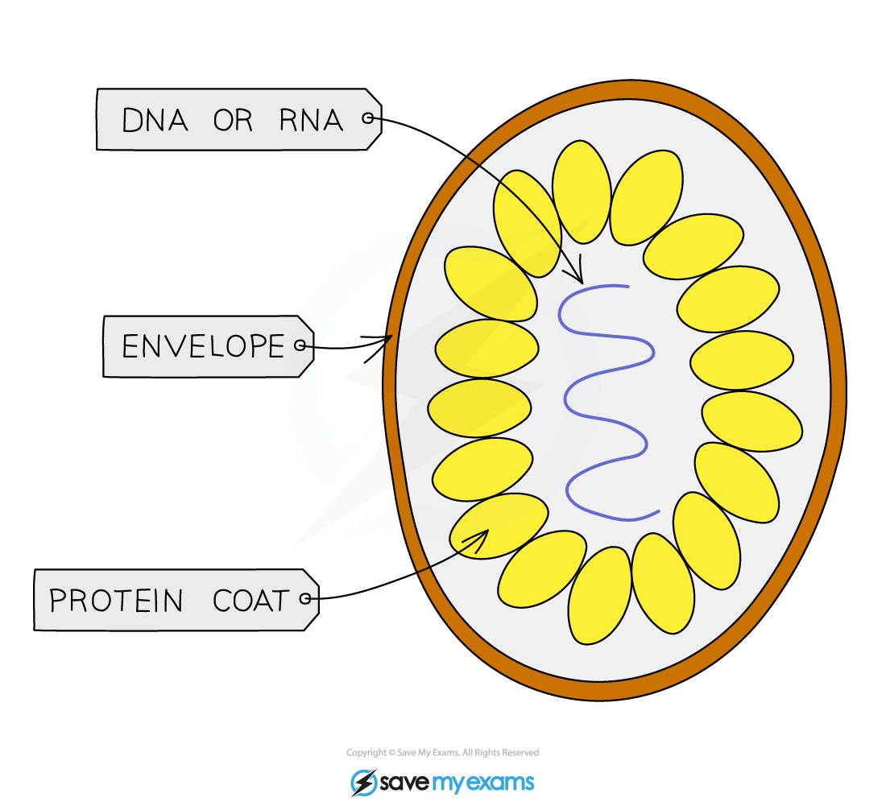

# Pathogens & Barriers

## Pathogens

> **Spec point** — `spcpt_JCM7MMYqgcPM84Tq`

## Pathogens

- A pathogen is a **disease-causing organism**
- Pathogens are passed on from one host to another and therefore the diseases they cause are known as **transmissible diseases**
- Pathogens can be passed on from host to host in different ways, including:

  - **Direct contact** - the pathogen is passed directly from one host to another by transfer of body fluids such as blood or semen (eg HIV, gonorrhoea, hepatitis B & C)
  - **Indirect contact** - the pathogen leaves the host and is carried in some way to another, uninfected individual

**Methods of Transmission Table**

## Viruses: Extended

> **Spec point** — `spcpt_Z2rGFpyKWx9cKpB7`

## Viruses: Extended

### Extended Tier Only

- Viruses are not part of any classification system as they are **not considered living things**
- They **do not carry out the seven life processes** for themselves, instead they **take over a host cell’s metabolic pathways** in order to make multiple copies of themselves
- Virus structure is simply **genetic material** (RNA or DNA) inside a protein coat

***Structure of a typical virus***

## The Body Defences

> **Spec point** — `spcpt_vGSvQhm5VMgH5jNK`

## The Body Defences

There are **3** main ways in which the body defends itself against disease:

1)    **Mechanical barriers** – structures that make it difficult for pathogens to get past them and into the body

a)** Skin** - covers almost all parts of your body to prevent infection from pathogens. If it is cut or grazed, it immediately begins to heal itself, often by forming a scab

b) **Hairs in the nose** - these make it difficult for pathogens to get past them further up the nose so they are not inhaled into the lungs

2) **Chemical barriers** – substances produced by the body cells that trap / kill pathogens before they can get further into the body and cause disease

a) **Mucus** - made in various places in the body, pathogens get trapped in the mucus and can then be removed from the body (by coughing, blowing the nose, swallowing etc)

b) **Stomach acid** - contains hydrochloric acid which is strong enough to kill any pathogens that have been caught in mucus in the airways and then swallowed or have been consumed in food or water

3) **Cells** - different types of white blood cell work to prevent pathogens reaching areas of the body they can replicate in

a) By **phagocytosis** - engulfing and digesting pathogenic cells

b) By producing **antibodies** - which clump pathogenic cells together so they can’t move as easily (known as **agglutination**) and releasing chemicals that signal to other cells that they must be destroyed
