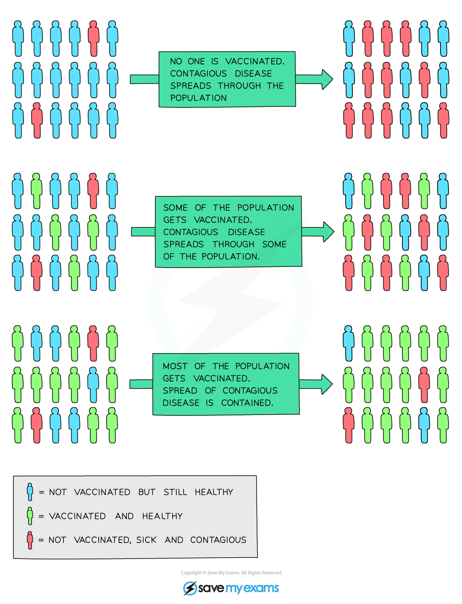

# Preventing the Spread of Disease

## Preventing the Spread of Disease

> **Spec point** — `spcpt_WznM9smQtsNk876x`

## Preventing the Spread of Disease

- **Vaccinations **are available for some pathogens to help **control the spread of diseases**

  - Vaccines are not available for all diseases
- People who are** immune **to a disease due to being vaccinated are **not able to catch and spread the disease**

## Preventing the Spread of Disease: Extended

> **Spec point** — `spcpt_7mqFGKqMNV2FQhWT`

## Preventing the Spread of Disease: Extended

### Extended Tier Only

- If **a large enough percentage** of the population is vaccinated, it **provides protection for the entire population** because there are **very few places for the pathogen to breed** - it can only do so if it enters the body of an unvaccinated person
- This is known as **herd immunity**
- If the number of people vaccinated against a specific disease **drops** in a population, it leaves the rest of the population at risk of **mass infection**, as they are more likely to come across people who are infected and contagious This **increases the number of infections**, as well as the number of people who could die from a specific infectious disease

***Herd immunity***

- **Herd immunity prevents epidemics and pandemics from occurring in populations**
- This is the reason that many vaccinations are given to **children**, as they are regularly seen by medical practitioners and can be vaccinated early to ensure the entire vaccinated population remains at a high level
- In certain instances, vaccination programmes are run with the aim of **eradicating** certain dangerous diseases, as opposed to controlling them at low levels
- An example of a disease which has been eradicated as a result of a successful vaccination programme is **smallpox**, which was officially eradicated in 1980 after a vaccination programme run by the World Health Organisation since the mid-1950s
