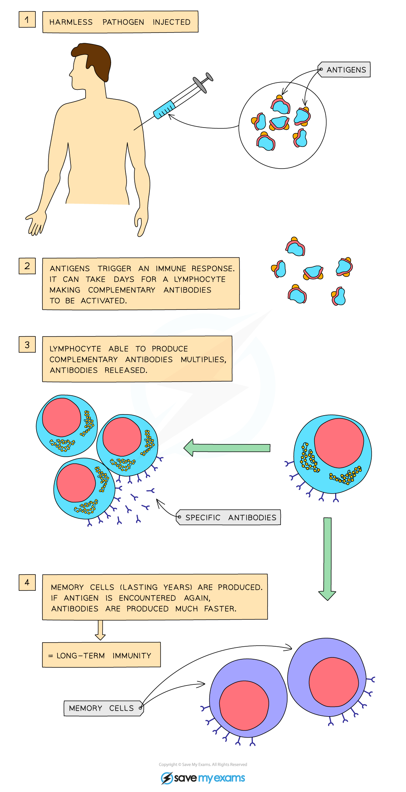

# Vaccination

## Vaccination: Extended

> **Spec point** — `spcpt_ypKfYtsXpPChmvYP`

## Vaccination: Extended

### Extended Tier Only

- Vaccinations give **protection against specific diseases** and **boost the body’s defence against infection** from pathogens without the need to be exposed to dangerous diseases that can lead to death
- The level of protection in a population depends on the **proportion of people vaccinated**
- Vaccines allow a **dead or altered form** of the disease-causing pathogen, which contains specific **antigens**, to be introduced into the body
- In this weakened state, the pathogen **cannot cause illness** but can **provoke an immune response**
- Lymphocytes produce **complementary antibodies** for the antigens
- The antibodies target the antigen and attach themselves to it in order to create **memory cells**
- The memory cells remain in the blood and will **quickly respond** to the antigen if it is encountered again in an infection by a ‘live’ pathogen
- As memory cells have been produced, this immunity is **long-lasting**

***Vaccination***
