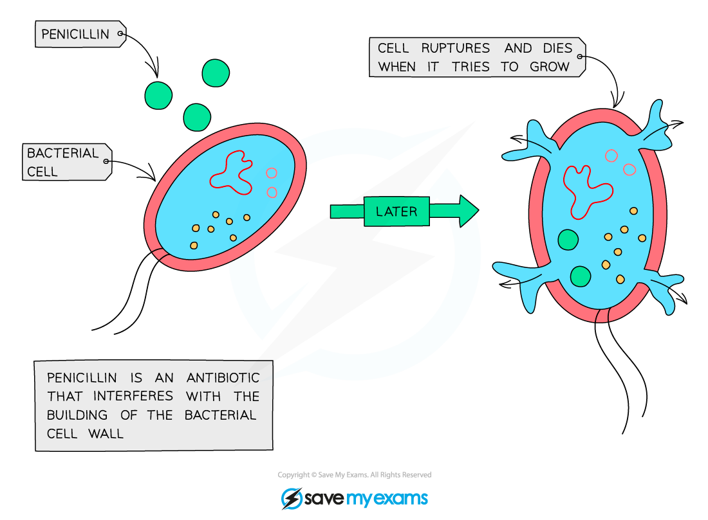

# Drugs for Medicine

## What is a Drug?

> **Spec point** — `spcpt_gjgHMsM6p5yQ7QnN`

## What is a Drug?

- A drug can be defined as:

**A substance taken into the body that modifies or affects chemical reactions in the body**

- Some drugs are **medicinal drugs** that are used to treat the symptoms or causes of a disease, e.g.

  - Painkillers
  - Antibiotics

## Antibiotics

> **Spec point** — `spcpt_tpkxWq3xZWTrrwC5`

## Antibiotics

- Antibiotics are **chemical substances** that can kill bacterial cells, meaning that they are useful in the treatment of bacterial infections

  - Antibiotics target processes and structures that are specific to bacterial cells so they do not harm animal cells
- Antibiotics kill bacteria but have **no effect on viruses**, so they are never used in the treatment of viral infections
- It is possible for bacteria to develop **antibiotic** **resistance**, meaning that exposure to an antibiotic will not kill the resistant bacteria

***Antibiotics kill bacterial cells, e.g. by damaging bacterial cell walls***

## Antibiotic Resistance & Use: Extended

> **Spec point** — `spcpt_x3RVPVdsBsxVHphB`

## Antibiotic Resistance & Use: Extended

### Extended Tier Only

- Antibiotic resistance only becomes widespread among bacterial populations when bacteria come into contact with an antibiotic

  - This is because contact causes non-resistant bacteria to be killed while the resistant individuals will survive and reproduce
- This means that **reducing antibiotic use** can reduce the spread of resistance in bacteria

  - Doctors will** only prescribe antibiotics when they are essential**
  - Antibiotics are never prescribed for viral infections
- Reducing antibiotic use is one strategy in the fight against antibiotic resistant strains of bacteria such as **MRSA**

  - MRSA = methicillin resistant *Staphylococcus aureus*

#### Development of antibiotic resistance diagram

***Exposure to antibiotics increases the likelihood that resistance will become widespread in a bacterial population; this means that decreasing antibiotic use will limit the development of resistant strains such as MRSA***
