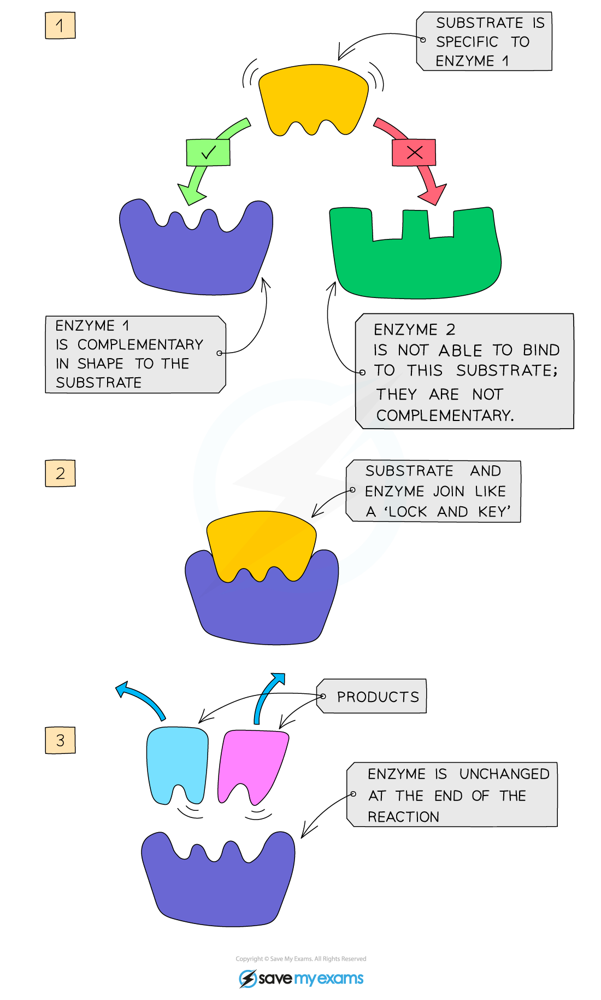

# Enzyme Action & Specificity

## Enzyme Action & Specificity: Extended

> **Spec point** — `spcpt_63nvfjHzNwNXtM7v`

## Enzyme Action & Specificity: Extended

### Extended Tier Only

- Enzymes are **specific** to one particular substrate(s) as the **active site** of the enzyme, where the substrate attaches, is a complementary shape to the substrate
- This is because the enzyme is a protein and has a **specific 3-D shape**
- This is known as the **lock and key hypothesis**
- When the substrate moves into the enzyme’s active site they become known as the **enzyme-substrate complex**
- After the reaction has occurred, the **products** leave the enzyme’s active site as they no longer fit it and it is free to take up another substrate

***How enzymes work***

1. Enzymes and substrates **randomly** move about in solution

2. When an enzyme and its complementary substrate randomly **collide** - with the substrate fitting into the active site of the enzyme - an **enzyme-substrate complex** forms, and the reaction occurs

3. A product (or products) forms from the substrate(s) which are then released from the active site. The enzyme is unchanged and will go on to catalyse further reactions
