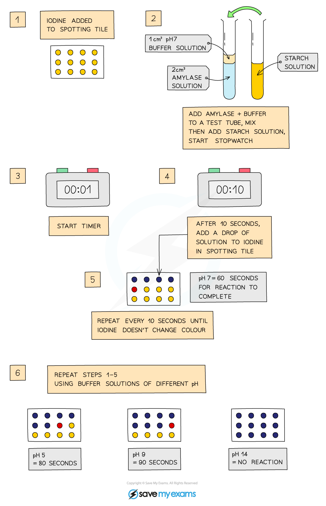

# Enzyme Investigations

## Investigating the Effect of Temperature on Amylase

> **Spec point** — `spcpt_8gkFy3mw29ZnwRqg`

## Investigating the Effect of Temperature on Amylase

- **Starch solution** is heated to a set temperature
- **Iodine** is added to wells of a spotting tile
- **Amylase** is added to the starch solution and mixed well
- Every minute, droplets of solution are added to a new well of iodine solution
- This is continued until the iodine **stops turning blue-black** (this means there is **no more starch** left in the solution as the amylase has broken it all down)
- Time taken for the reaction to be completed is recorded
- Experiment is repeated at different temperatures
- The quicker the reaction is completed, the faster the enzyme is working

***Investigating the effect of temperature on enzyme activity***

## Investigating the Effect of pH on Amylase

> **Spec point** — `spcpt_6PwGnQXnymYmBShg`

## Investigating the Effect of pH on Amylase

- Place single drops of **iodine** solution in rows on the tile
- Label a test tube with the pH to be tested
- Use the syringe to place 2cm3 of **amylase** in the test tube
- Add 1cm3 of **buffer solution** to the test tube using a syringe
- Use another test tube to add 2cm3 of **starch solution** to the amylase and buffer solution, start the stopwatch whilst mixing using a pipette
- After 10 seconds, use a pipette to place one drop of mixture on the first drop of iodine, which should turn blue-black
- Wait another 10 seconds and place another drop of mixture  on the second drop of iodine
- Repeat every 10 seconds **until iodine solution remains orange-brown**
- Repeat experiment at different pH values - the less time the iodine solution takes to remain orange-brown, the quicker all the starch has been digested and so the better the enzyme works at that pH

***Investigating the effect of pH on enzyme activity***

> **Exam Hint**
> Describing and explaining experimental results for enzyme experiments is a common type of exam question so make sure you understand what is happening and, for a 7, 8 or 9, can relate this to changes in the active site of the enzyme when it has denatured, or if it is a **low temperature**, relate it to the amount of kinetic energy the molecules have.
