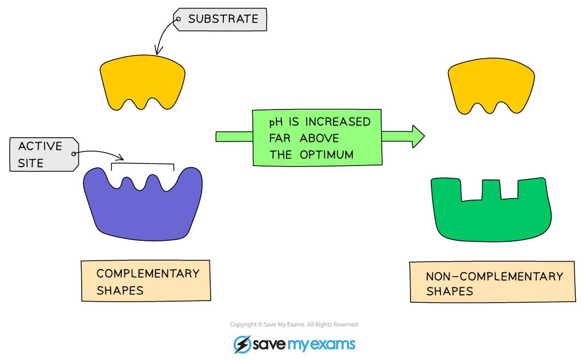

# Enzymes & pH

## Enzymes & pH: Extended

> **Spec point** — `spcpt_sGTvKmZpTSd9qKGK`

## Enzymes & pH: Extended

### Extended Tier Only

- The **optimum** pH for most enzymes is 7
- Some are produced in **acidic **conditions, such as the stomach; these have a lower optimum pH (pH 2)
- Some are produced in **alkaline **conditions, such as the duodenum, and have a higher optimum pH (pH 8 or 9)
- If the pH is too high or too low, the bonds that hold the amino acid chain together to make up the protein can be destroyed
- This will **change the shape of the active site**, so the substrate can no longer fit into it, reducing the rate of activity
- Moving too far away from the optimum pH will cause the enzyme to **denature** and activity will stop

***Effect of pH on enzyme activity***

***Graph showing the effect of pH on rate of activity for an enzyme from the duodenum***
