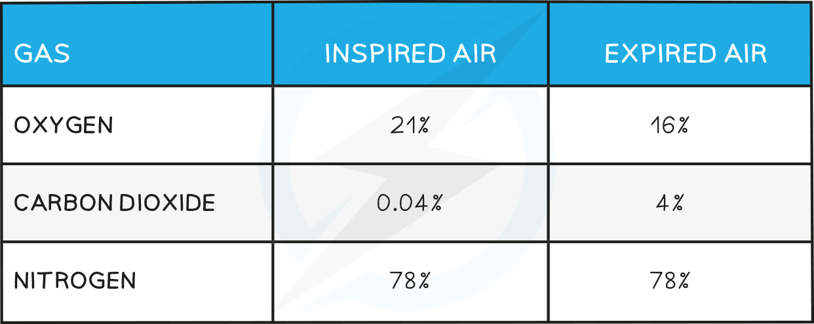

# Differences in Inspired & Expired Air

## Differences in Inspired & Expired Air

> **Spec point** — `spcpt_z2tZFXhyWkQ7J93c`

## Differences in Inspired & Expired Air

- Air that is breathed in and air that is breathed out has **different amounts of gases** in it due to exchanges that take place in the **alveoli**
- Atmospheric air contains around **20 – 21% oxygen**, of which we only absorb around 4 – 5%, expired air contains around **16% oxygen**
- Normal **carbon dioxide content of air is around 0.04%** and, as carbon dioxide diffuses into the alveoli from the blood, we expire air containing around **4% carbon dioxide**
- The air we breathe out contains **more water vapour** (around 1%) than when we breathe it in which is variable
- The **temperature of exhaled air is higher** than inhaled air due to heat energy released from respiration

**Composition of Air Table**

> **Exam Hint**
> For those of you studying the extended syllabus you can read the explanation as to why inspired and expired differ [here](https://www.savemyexams.com/igcse/biology_co-ordinated-sciences-double-award/cie/23/revision-notes/11-gas-exchange-in-humans/gas-exchange-in-humans/differences-in-inspired-and-expired-air-extended/).
