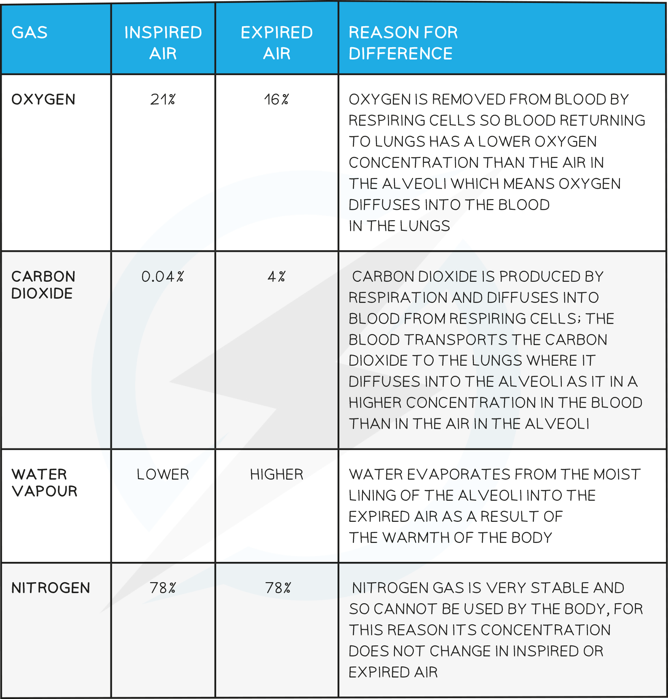

# Explaining differences in Inspired &  Expired Air

## Differences in Inspired & Expired Air: Extended

> **Spec point** — `spcpt_XCKPFKnNP6ysVnnR`

## Differences in Inspired & Expired Air: Extended

### Extended Tier Only

**Reason for Differences Between Inspired & Expired Air Table**

