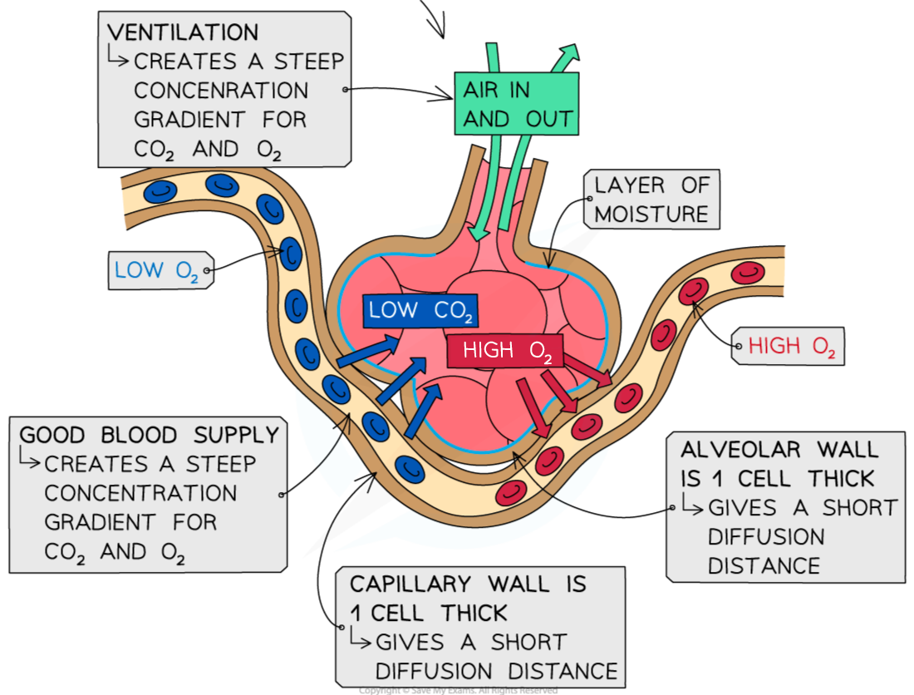

# Features of Gas Exchange Surfaces

## Features of Gas Exchange Surfaces: Extended

> **Spec point** — `spcpt_gDB2kgBJN6XxWRkv`

## Features of Gas Exchange Surfaces: Extended

### Extended Tier Only

- The surfaces where gas exchange occurs in an organism are very different and different organisms have evolved different mechanisms for getting the gases to the gas exchange surface depending on size, where they live etc.
- All gas exchange surfaces have features in common
- These features allow the maximum amount of gases to be exchanged across the surface in the smallest amount of time
- They include:

  - **Large surface area** to allow faster diffusion of gases across the surface
  - **Thin walls** to ensure diffusion distances remain short
  - **Good ventilation with air** so that diffusion gradients can be maintained
  - **Good blood supply** to maintain a high concentration gradient so diffusion occurs faster

***The alveolus is the gas exchange surface in humans***

> **Exam Hint**
> You may notice that several of the features of alveoli that make them suited to their function are the same as those that make root hair cells suited to their function – the reason for this is that all of these structures are involved in transporting substances across their surfaces – by **diffusion**, **active transport**, **osmosis** or a combination. So if you learn the features of one, you also know many of the features of the other!
