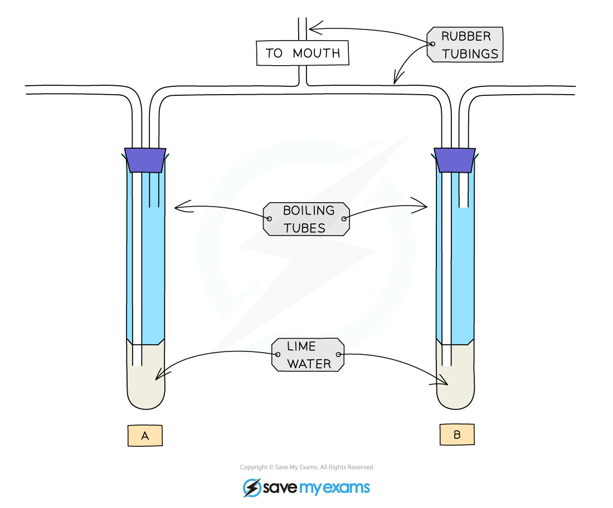

# Investigating the Differences in Inspired & Expired Air

## Investigating the Differences in Inspired & Expired Air

> **Spec point** — `spcpt_tKkWNBVwqgHMC5jr`

## Investigating the Differences in Inspired & Expired Air

- A simple experimental setup can be used to investigate the differences between inspired and expired air

***The limewater test***

- When we **breathe in**, the air is drawn through **boiling tube A**
- When we **breathe out**, the air is blown into** boiling tube B**
- **Lime water** is **clear** but becomes **cloudy** (or milky) when carbon dioxide is bubbled through it
- The lime water in **boiling tube A will remain clear**, but the limewater in **boiling tube B will become cloudy**
- This shows us that the **percentage of carbon dioxide in exhaled air is higher than in inhaled air**

> **Exam Hint**
> Inspired and expired air means the same as inhaled and exhaled air, you can use either term.
