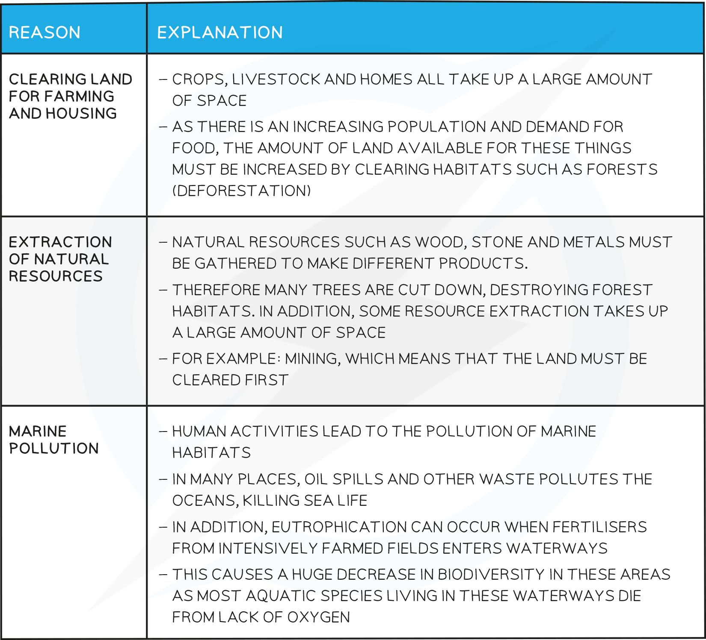

# The Importance of Biodiversity

## What is an Ecosystem?

> **Spec point** — `spcpt_bddxHmKFcWTFWb98`

## What is an Ecosystem?

- An ecosystem is defined as **a unit containing the community of organisms and their environment, interacting together **(e.g. a decomposing log, a lake)

## Human Pressures on Other Species

> **Spec point** — `spcpt_2cyJ6x7txWtwYB9Y`

## Human Pressures on Other Species

#### Biodiversity

- Is defined as the **number of different species** that live in a particular area
- Human activities have tended to **force biodiversity downwards**, whereas, high biodiversity is needed for stable ecosystems
- **Habitat destruction** by humans is a major downward pressure on biodiversity

#### Reasons for Habitat Destruction

- The increasing human population of the planet is causing destruction of many habitats from rainforest to woodland to marine
- Many habitats are destroyed by humans to make space for other economic activities, or by pollution from these activities, and this reduces the biodiversity of these areas
- This interrupts food chains and webs, meaning that more species may die because their prey is gone
- The main reasons for habitat destruction include:

#### Deforestation

- Deforestation is the **clearing of trees** (usually on a large scale)
- If trees are replaced by replanting it can be a **sustainable** practise
- Generally the trees are being cleared for the **land to be used in a different way** (for building, grazing for cattle, planting of monocultures such as palm oil plantations etc) and therefore it is not sustainable
- As the amount of the Earth’s surface covered by trees decreases, it causes increasingly negative effects on the environment and is a **particularly severe example of habitat destruction**
- Undesirable effects of deforestation include:

  - **Extinction** of species
  - Loss of **soil**
  - **Flooding**
  - Increase of **carbon dioxide** in the atmosphere

## Undesirable Effects of Deforestation: Extended

> **Spec point** — `spcpt_FDWRdK7RcZjjYPyz`

## Undesirable Effects of Deforestation: Extended

### Extended Tier Only

#### An explanation of the undesirable effects of deforestation table

