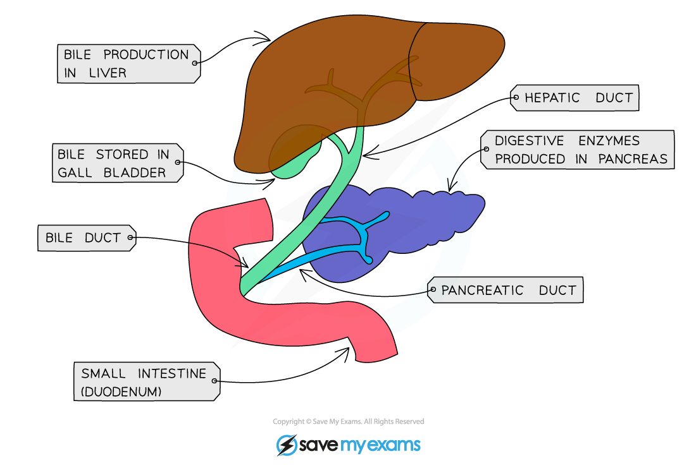

# Bile & Emulsification

## Bile & Emulsification: Extended

> **Spec point** — `spcpt_Xd2d6bkxsj9c7Qm9`

## Bile & Emulsification: Extended

### Extended Tier Only

- Cells in the liver produce bile which is then stored in the **gall bladder**

***Bile production and secretion***

**Bile has two main roles:**

- It is **alkaline** to **neutralise the hydrochloric acid** entering the duodenum from the stomach
- The enzymes in the small intestine have a higher (more alkaline) optimum pH than those in the stomach
- It **breaks down large drops of fat into smaller ones**. This is known as **emulsification**. The larger surface area allows lipase to chemically break down the lipid into glycerol and fatty acids faster

> **Exam Hint**
> Emulsification is the equivalent of tearing a large piece of paper into smaller pieces of paper. This is an example of **mechanical digestion**, not chemical digestion – breaking something into smaller pieces does not break bonds or change the chemical structure of the molecules which make it up, which is the definition of chemical digestion.
