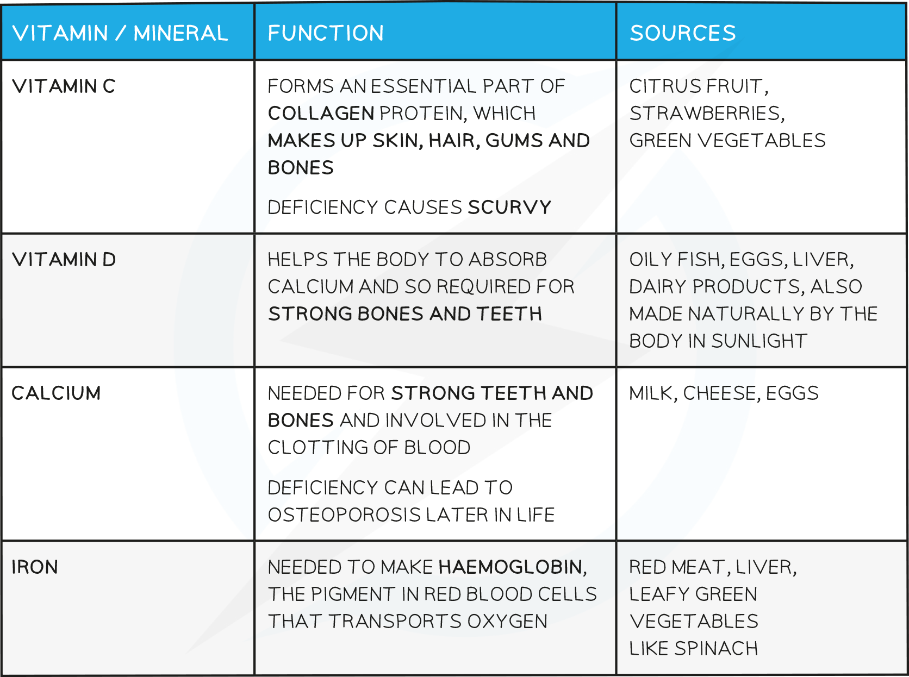

# Diet & Deficiencies

## Balanced Diet

> **Spec point** — `spcpt_4SvkvwVwfb3Hx3tV`

## Balanced Diet

- A balanced diet consists of all of the food groups in the correct proportions
- The necessary food groups are:

  - **Carbohydrates**
  - **Proteins**
  - **Lipids**
  - **Vitamins**
  - **Minerals**
  - **Dietary Fibre**
  - **Water**

**Food Groups Table**

**Vitamin and Mineral Requirements Table**

**Varying Dietary Needs of Individuals Table**

## Scurvy & Rickets

> **Spec point** — `spcpt_xGn998wnHxNcBcVD`

## Scurvy & Rickets

#### Scurvy

- Scurvy is the name for a severe **vitamin C deficiency**

  - It is caused by a lack of vitamin C in the diet for over 3 months
- Its symptoms include:

  - Anemia
  - Exhaustion
  - Spontaneous bleeding
  - Pain in the limbs
  - Swelling
  - Gum ulcerations
  - Tooth loss
- It is a condition that was commonly seen in sailors between the 15th to 18th centuries

  - Long sea voyages made it very hard to access a ready supply of fresh produce
- Scurvy can be treated with **oral or intravenous vitamin C supplements**

#### Rickets

- Rickets is a condition in children characterised by **poor bone development**
- Symptoms include:

  - Bone pain
  - Lack of bone growth
  - Soft, weak bones (sometimes causing deformities)
- Rickets is caused by a severe **lack of vitamin D**

  - Vitamin D is required for the absorption of calcium into the body
  
    - Calcium is a key component of bones and teeth
- Vitamin D mostly comes from exposure to sunlight but it can also be found in some foods (fish, eggs and butter)
- The treatment for rickets is to increase consumption of **foods containing calcium and vitamin D**

  - Alternatively vitamin D **supplements** can be prescribed
