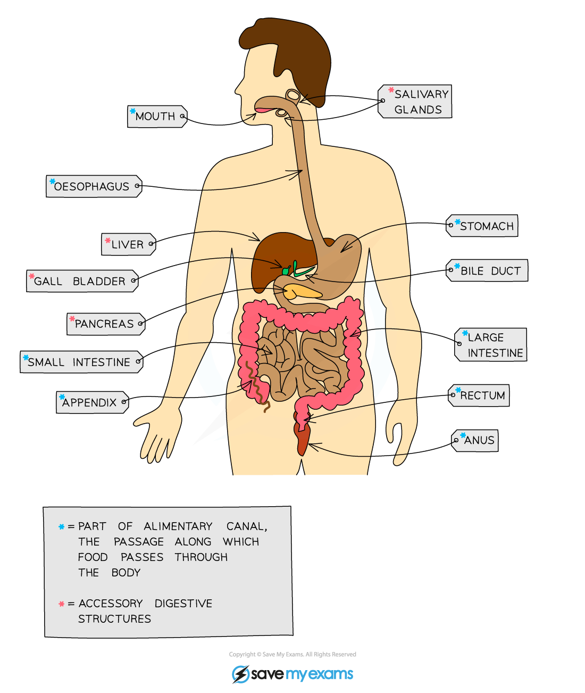
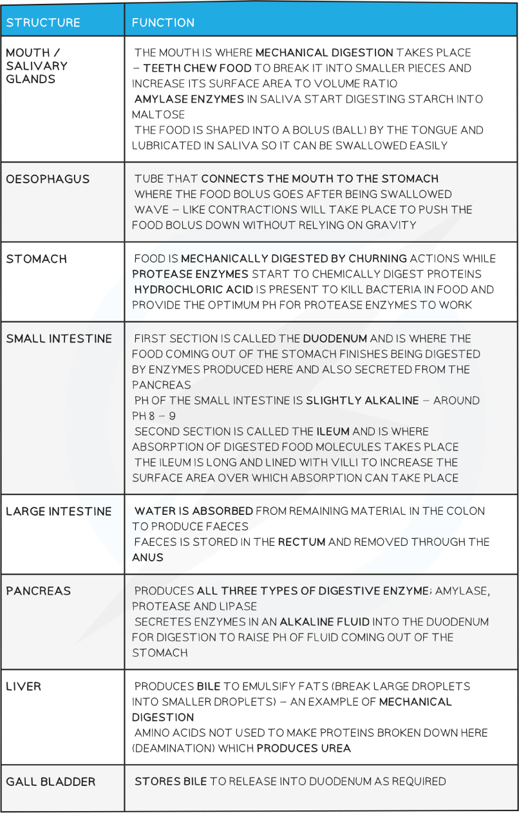

# Digestive System

## Identifying Organs of the Digestive System

> **Spec point** — `spcpt_cvnSpMbNfy2xRs7x`

## Identifying Organs of the Digestive System

***The human digestive system***

## Organs of the Digestive System: Function

> **Spec point** — `spcpt_tNs7zJVHyTqhk92r`

## Organs of the Digestive System: Function

#### Stages of food breakdown

- Food taken into the body goes through 5 different stages during its passage through the alimentary canal (the gut):

  - **Ingestion** - the taking of substances, e.g. food and drink, into the body through the mouth
  - **Mechanical digestion** - the breakdown of food into smaller pieces without chemical change to the food molecules
  - **Chemical digestion** - the breakdown of large, insoluble molecules into small, soluble molecules
  - **Absorption** - the movement of small food molecules and ions through the wall of the intestine into the blood
  - **Assimilation** - the movement of digested food molecules into the cells of the body where they are used, becoming part of the cells
  - **Egestion** - the passing out of food that has not been digested or absorbed, as faeces, through the anus

**Functions of the Digestive Organs Table**

