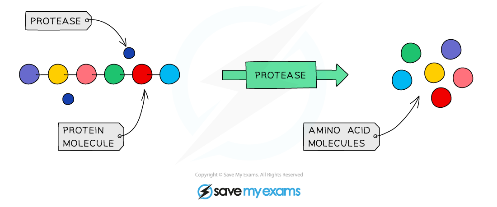

# Enzymes in Digestion

## Enzymes in Digestion: Extended

> **Spec point** — `spcpt_XN7Wc6KVz69nDSBy`

## Enzymes in Digestion: Extended

### Extended Tier Only

#### Amylases

- **Amylases** are produced in the **mouth** and the **pancreas** (secreted into the **duodenum**)
- Amylases digest **starch into smaller sugars**

***The digestion of starch***

#### Proteases

- Proteases are a group of **enzymes that break down proteins into amino acids** in the stomach and small intestine (with the enzymes in the small intestine having been produced in the pancreas)

***The digestion of proteins***

#### Lipases

- **Lipase** enzymes are produced in the **pancreas** and secreted into the **duodenum**
- They digest **lipids into fatty acids and glycerol**

***The digestion of lipids***
