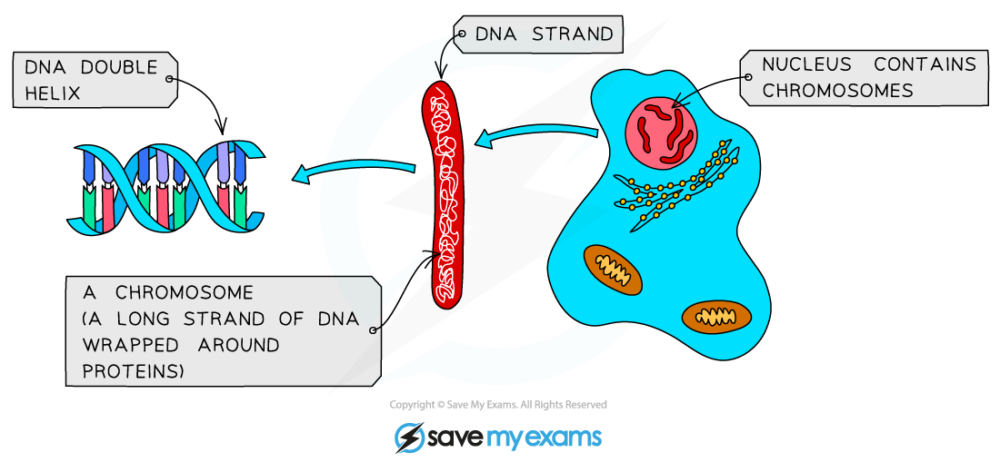

# Chromosomes, Genes & Proteins

## The Structure of Genes

> **Spec point** — `spcpt_xWKDNTvfQyBRrhxv`

## The Structure of Genes

- **Chromosomes** are located in the **nucleus** of cells
- They are **thread-like structures made of DNA, carrying genetic information in the form of genes**
- A **gene** is a short length of **DNA** found on a chromosome that **codes for a specific protein**

  - This could be a structural protein such as collagen found in skin cells, an enzyme or a hormone
- Genes can exist in **alternative forms** and these are known as **alleles**

  - Alleles give all organisms their characteristics
  - For example we have a gene for eye colour and the different alleles might be blue, green and brown

*** Genes are short lengths of DNA that code for a protein. They are found on chromosomes***

> **Exam Hint**
> The Zoom model is always useful when trying to visualise where you are in a cell, and what molecules are doing what. Imagine a zoom lens that has the power to zoom right out to look at a whole organism, but also to zoom right into individual molecules. This helps in recognising the structures in cell nuclei visible as chromosomes, then zooming in to picture the individual genes and then, the bases that make up the DNA
