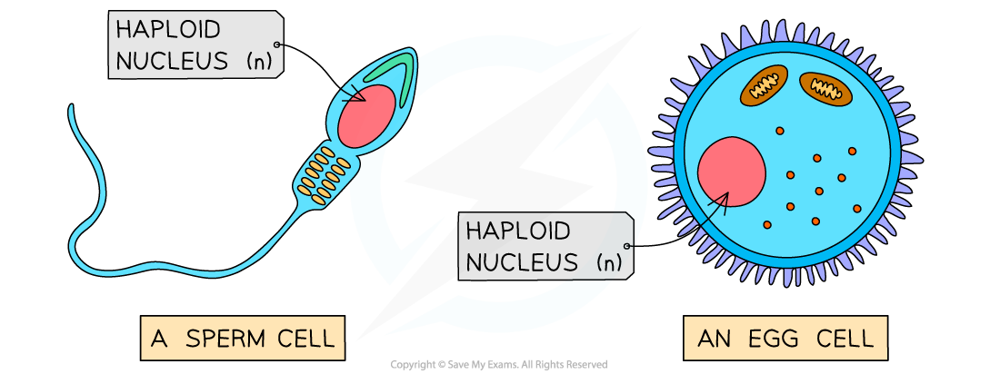

# Control of Gene Expression

## Control of Gene Expression: Extended

> **Spec point** — `spcpt_jKqSfgBvPzhFFh5x`

## Control of Gene Expression: Extended

### Extended Tier Only

#### Haploid and Diploid Cells

- All **humans **have **23 different chromosomes** in each cell
- In most body cells, not including the gametes (sex cells), we have 2 copies of each chromosome, leading to a total of **46 chromosomes**

  - Nuclei with **two sets of chromosomes** are known as **diploid nuclei**
- The **gametes** (egg and sperm cells) only have one copy of each chromosome, meaning they have a** total of 23 chromosomes** in each cell

  - Nuclei with **one set of unpaired chromosomes** are known as **haploid nuclei**

***Human gametes (sperm and egg cells) are haploid***

> **Exam Hint**
> An easy way to remember the difference between haploid and diploid is to remember:
> 
> <u>**Ha**</u>ploid = <u>**Ha**</u>lf the normal number of chromosomes
> 
> It’s worth noting that the human diploid chromosome number is 46. In an exam, you may be given information about a different species, with a different number of chromosomes. Make sure you read exam questions carefully.
