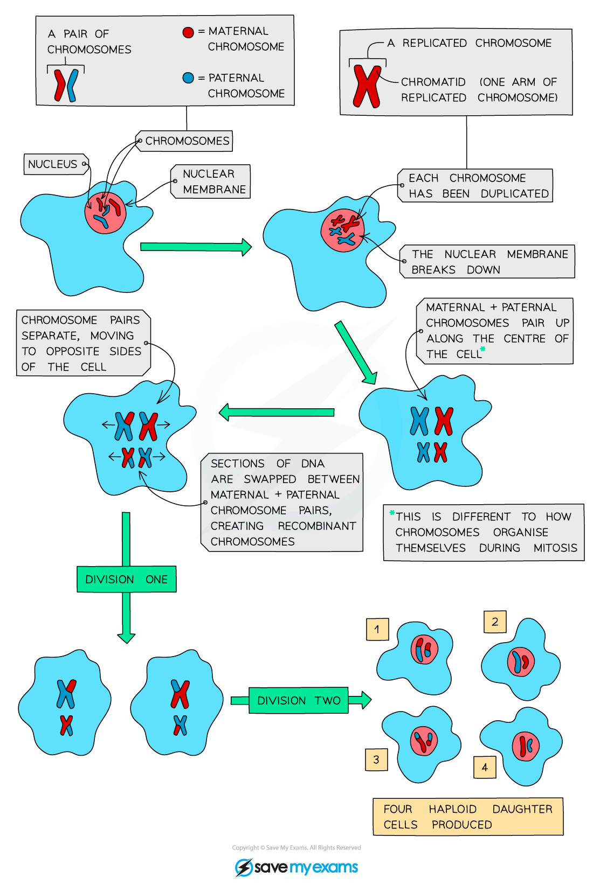
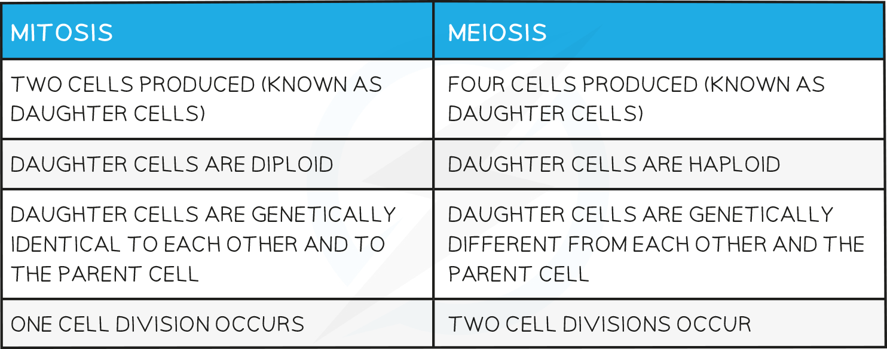

# Meiosis

## Meiosis: Extended

> **Spec point** — `spcpt_VGFTvfbJZKYQPjn5`

## Meiosis: Extended

### Extended Tier Only

- **Meiosis** is a type of nuclear division that gives rise to cells that are** genetically different**
- It is used to produce the **gametes** (sex cells)
- The number of chromosomes must be** halved** when the **gametes **(sex cells) are formed, it is therefore known as **reduction division**
- Halving the number of chromosomes ensures there is **not double the number of chromosomes** after gametes join at fertilisation
- The **chromosome number **is therefore halved from **diploid to haploid**,
- Meiosis results in four **genetically different cells**

***The process of cell division by meiosis to produce haploid gamete cells***

#### Differences between Mitosis & Meiosis

> **Exam Hint**
> You do not need to know the stages involved in meiosis.
> 
> Questions on cell division often ask for differences between mitosis and meiosis. Learn two or three and remember to BE SPECIFIC when giving your answer.
> 
> You should also know the reasons for a specific type of cell division taking place and the types of cells where each happen.
