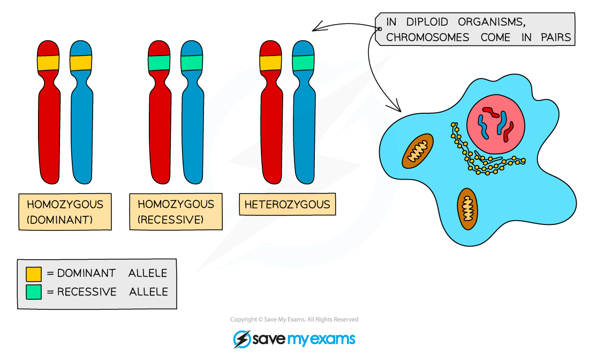
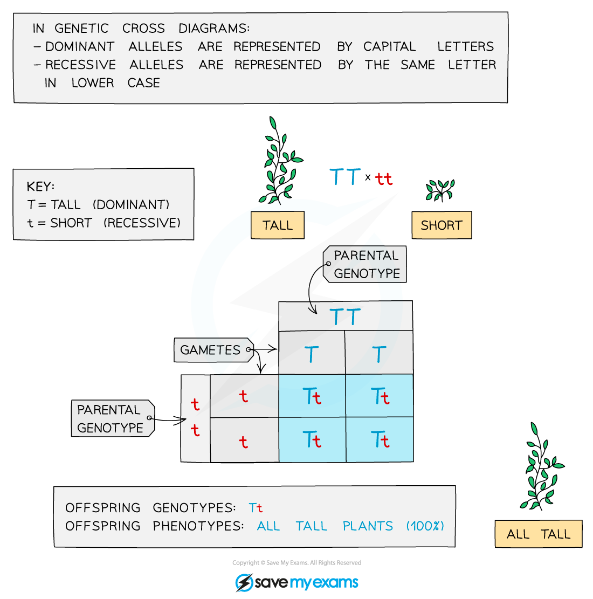
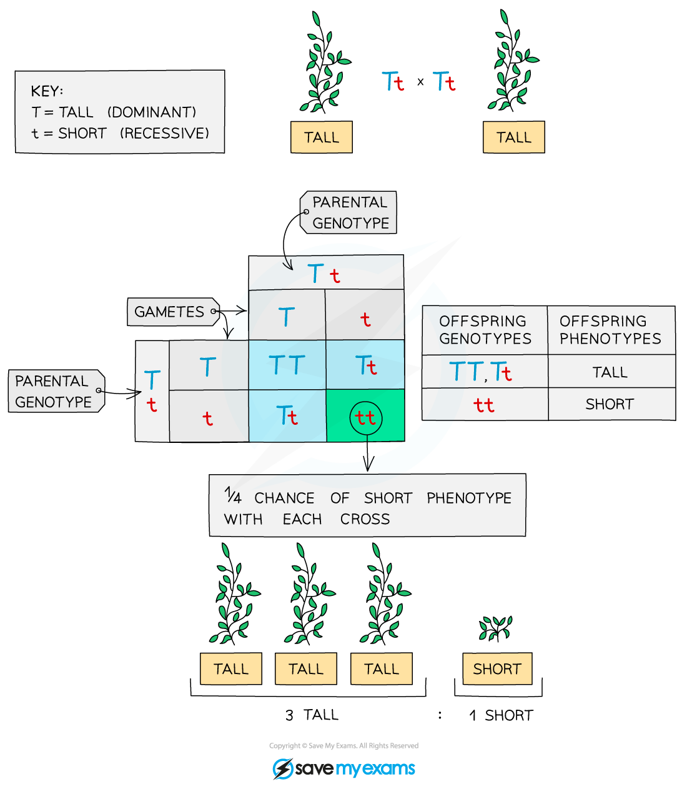
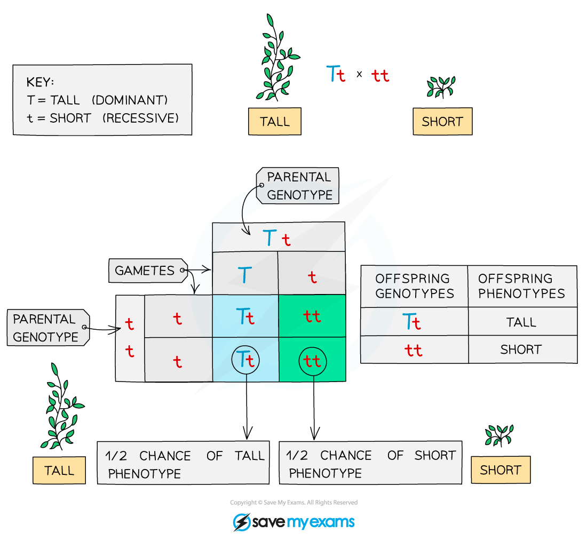

# Monohybrid Inheritance

## Inheritance: Definitions

> **Spec point** — `spcpt_JMYbfjydfVnfpRTZ`

## Inheritance: Definitions

- **Inheritance** is the transmission of genetic information from one generation to the next generation
- A **gene** is a short length of DNA found on a chromosome that codes for a particular **characteristic** (expressed by the formation of different proteins)
- **Alleles** are variations of the same gene

  - As we have two copies of each chromosome, we have two copies of each gene and therefore two alleles for each gene
  - One of the alleles is inherited from the mother and the other from the father
  - This means that the alleles do not have to ‘say’ the same thing
  - For example, an individual has two copies of the gene for eye colour but **one allele could code for brown eyes and one allele could code for blue eyes**
- The observable characteristics of an organism (seen just by looking - like eye colour, or found – like blood type) is called the **phenotype**
- The **combination of alleles that control each characteristic** is called the **genotype**
- Alleles can be **dominant** or **recessive**

  - A dominant allele **only needs to be inherited from one parent** in order for the characteristic to show up in the phenotype
  - A recessive allele needs to be **inherited from both parents** in order for the characteristic to show up in the phenotype.
  - If there is only one recessive allele, it will remain hidden and the dominant characteristic will show
- If the two alleles of a gene are the same, we describe the individual as being **homozygous** (homo = same)
- An individual could be **homozygous dominant** (having two copies of the dominant allele), or **homozygous recessive** (having two copies of the recessive allele)
- If the two alleles of a gene are different, we describe the individual as being **heterozygous** (hetero = different)
- When completing genetic diagrams, alleles are abbreviated to single letters
- The dominant allele is given a **capital letter** and the recessive allele is given the same letter, but **lower case**

***Alleles of a gene can carry the same instructions or different instructions. You can only inherit two alleles for each gene, and they can be the same or different***

## Genetic Diagrams

> **Spec point** — `spcpt_gV9wcbtkYbb6z6Mm`

## Genetic Diagrams

#### What is monohybrid inheritance?

- Monohybrid inheritance is the inheritance of characteristics **controlled by a single gene** (mono = one)
- This can be determined using a genetic diagram known as a **Punnett square**
- A Punnett square diagram shows the **possible combinations of alleles** that could be produced in the offspring
- From this the **ratio** of these combinations can be worked out
- Remember the **dominant allele** is shown using a capital letter and the **recessive allele** is shown using the same letter but lowercase

### Punnett Squares

#### Monohybrid Inheritance Example

- The height of pea plants is c**ontrolled by a single gen**e that has **two alleles:** tall and short
- The tall allele is dominant and is shown as **T**
- The small allele is recessive and is shown as **t**

**‘Show the possible allele combinations of the offspring produced when a pure breeding short plant is bred with a pure breeding tall plant’**

- The term ‘**pure breeding**’ indicates that the individual is **homozygous **for that characteristic

***A pure-breeding genetic cross in pea plants***

- This shows that there is a **100% chance that all the offspring will be tall**

**‘Show the possible allele combinations of the offspring produced when two of the offspring from the first cross are bred together’**

***A genetic cross diagram (F2 Generation)***

- All of the offspring of the **first cross have the same genotype**, **Tt** (heterozygous), so the possible combinations of offspring bred from these are:

  - There is more variation in this cross, with a **3:1** ratio of tall:short, meaning each offspring has a 75% chance of being tall and a 25% chance of being short
- The F2 generation is produced when the offspring of the F1 generation (pure-breeding parents) are allowed to **interbreed**

**‘Show the results of crossing a heterozygous plant with a short plant’**

- The **heterozygous** plant will be tall with the genotype **Tt**
- The short plant is showing the recessive phenotype and so must be **homozygous recessive** - **tt**
- The results of this cross are as follows:

***A cross between a heterozygous plant with a short plant***

- In this cross, there is a **1:1 ratio of tall to short**, meaning a **50% **chance of the offspring being tall and a **50%** chance of the offspring being short

#### How to construct Punnett squares

- The steps involved are:

1. Determine the **parental genotypes**
2. Select a **letter** that has a clearly different lowercase, for example: Aa, Bb, Dd
3. **Split the alleles for each parent** and add them to the Punnett square around the outside
4. **Fill in the middle four squares** of the Punnett square to work out the **possible genetic combinations** in the offspring

- You may be asked to comment on the **ratio **of different allele combinations in the offspring, calculate a **percentage** chances of offspring showing a specific characteristic or just **determine the phenotypes** of the offspring
- Completing a Punnett square allows you to predict the probability of different outcomes from monohybrid crosses

> **Exam Hint**
> You should always write the **dominant allele first**, followed by the recessive allele.
> 
> If you are asked to use your own letters to represent the alleles in a Punnett square, try to choose a letter that is obviously different as a capital than the lower case so the examiner is not left in any doubt as to which is dominant and which is recessive.
> 
> For example, C and c are not very different from each other, whereas A and a are!

### Pedigree Charts

- Family pedigree diagrams are usually used to trace the **pattern of inheritance** of a specific characteristic (usually a disease) **through generations of a family**
- This can be used to work out the **probability **that someone in the family will **inherit the genetic disorder**

***A family pedigree chart***

- Males are indicated by the **square shape** and females are represented by **circles**
- Affected individuals are **red** and unaffected are **blue** (in this example)
- Horizontal lines between males and females show that they have produced children (which are shown underneath each couple)
- The family pedigree above shows:

  - both males and females are affected
  - every generation has affected individuals
  - that there is one family group that has no affected parents or children
  - the other two families have one affected parent and affected children as well
