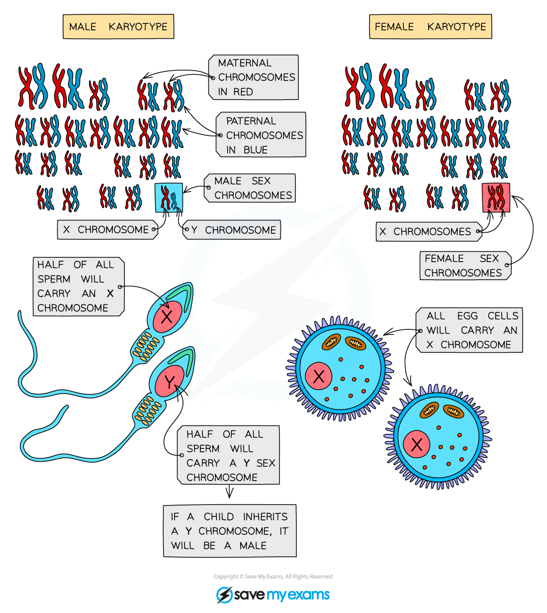

# The Inheritance of Sex

## XX & XY Chromosomes

> **Spec point** — `spcpt_24bKbpMK5tSdRPJY`

## XX & XY Chromosomes

- Sex (male or female) is determined by an **entire chromosome pair** (as opposed to most other characteristics that are just determined by one or several genes)
- Biological **females** have the sex chromosomes **XX**
- Biological** males** have the sex chromosomes **XY**
- Only a biological **male** **can pass on a Y chromosome**, he is therefore responsible for **determining the sex of the child**
- He does this because

  - He produces (during ejaculation) around 250 million sperm cells during sexual intercourse
  - Of those, half (125 million sperm) will be carrying his **X chromosome**
  
    - If one of these sperm fertilises the egg (also an X chromosome), the fetus will be female (XX)
  - The other 125 million of his sperm will be carrying his **Y chromosome**
  
    - If one of these fertilises the egg (X chromosome) this will result in a male (XY) fetus

***Sperm cells determine the sex of offspring***

#### Inheritance of sex

- The inheritance of sex can be shown using a **genetic diagram** (known as a **Punnett square**), with the X and Y chromosomes taking the place of the alleles usually written in the boxes

***Punnett square shows the inheritance of sex***
