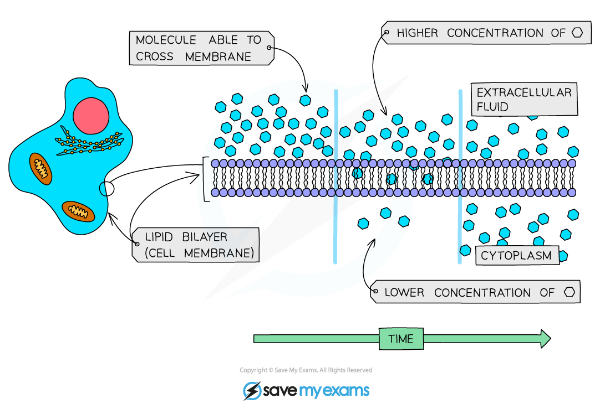

# Diffusion

## Diffusion

> **Spec point** — `spcpt_tWGDNbtgKPsqTd5d`

## Diffusion

### What is Diffusion in Biology?

- Diffusion is the **net movement of molecules** from a region of its **higher** concentration to a region of its **lower** concentration
- Molecules **move down a concentration gradient**, as a result of their **random movement**

***Diffusion across the cell membrane***

- For **living cells**, the principle of the movement down a concentration gradient is the same, but the cell is surrounded by a **cell membrane** which can **restrict the free movement of the molecules**
- The cell membrane is a **partially permeable membrane** - this means it allows some molecules to cross easily, but others with difficulty or not at all
- The simplest sort of selection is based on the size of the molecules
- Diffusion helps living organisms to:

  - obtain many of their **requirements**
  - get rid of many of their **waste products**
  - carry out **gas exchange for respiration**

#### Examples of diffusion in living organisms

- You will need to learn examples of substances that organisms obtain by diffusion
- Don’t forget that **plants require oxygen for respiration at all times**, as well as **carbon dioxide for photosynthesis** when conditions for photosynthesis are right (e.g. enough light and a suitable temperature)

**Examples of Diffusion Table**

#### Where does the energy for diffusion come from?

- All particles** move randomly** at all times
- This is known as Brownian motion
- The energy for diffusion comes from the **kinetic energy** of this random movement of molecules and ions

#### Brownian motion diagram

***Brownian motion being demonstrated by particles in a beaker***
