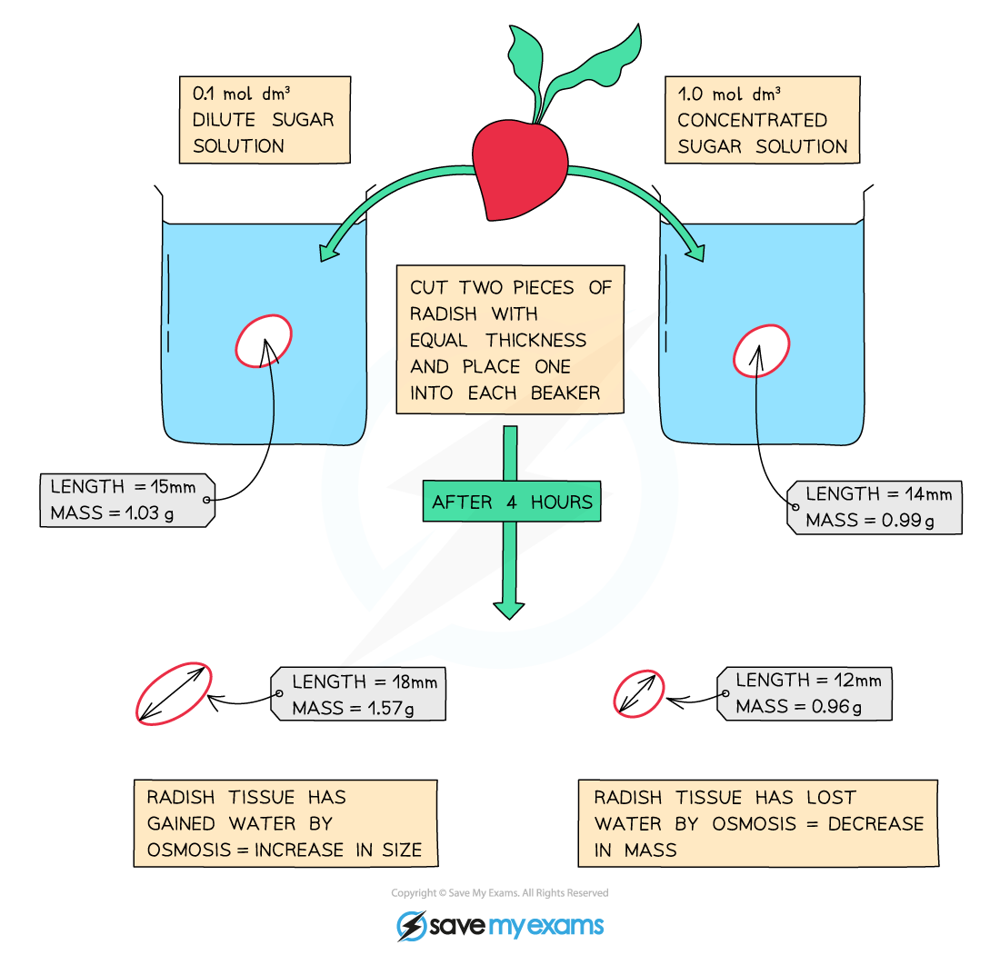

# Osmosis Experiments

## Osmosis Experiments

> **Spec point** — `spcpt_F4y3SqDTrZdxZ8bQ`

## Osmosis Experiments

#### Immersing plant cells in solutions of different concentrations

- The most common osmosis practical involves cutting **cylinders of root vegetables **such as potato or radish and placing them into **distilled water** and **sucrose solutions** of increasing concentration
- The cylinders are weighed before placing into the solutions
- They are left in the solutions for 20 - 30 minutes and then removed, dried to remove excess liquid and reweighed

***Potatoes are usually used in osmosis experiments to show how the concentration of a solution affects the movement of water, but radishes can be used too***

- If the plant tissue gains mass:

  - Water must have moved into the plant tissue from the solution surrounding it by osmosis
  - The solution surrounding the tissue is more dilute than the plant tissue (which is more concentrated)
- If plant tissue loses mass:

  - Water must have moved out of the plant tissue into the solution surrounding it by osmosis
  - The solution surrounding the tissue is more concentrated than the plant tissue (which is more dilute)
- If there is no overall change in mass:

  - There has been no **net** movement of water as the concentration in both the plant tissue and the solution surrounding it must be equal
  - Remember that water will still be moving into and out of the plant tissue, but there wouldn’t be any net movement in this case
