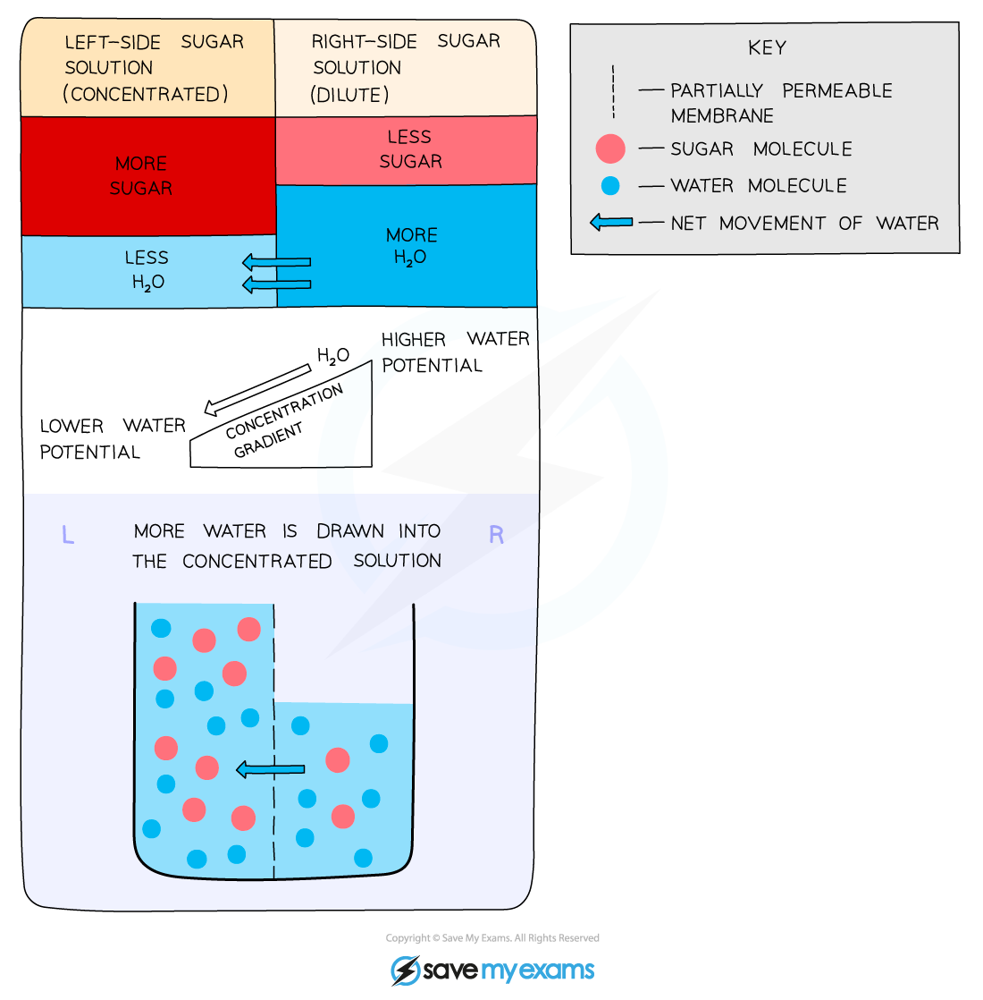
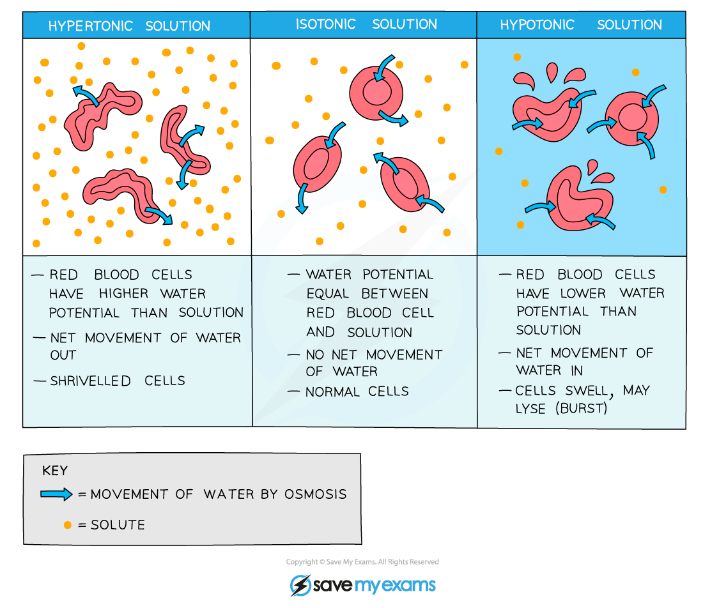

# Osmosis in Animals & Plants

## Osmosis: Extended

> **Spec point** — `spcpt_JHvFpKgNnDgdYY2b`

## Osmosis: Extended

### Extended Tier Only

- Osmosis is the net movement of water molecules from a region of **higher water potential** (dilute solution) to a region of **lower water potential** (concentrated solution), through a **partially permeable membrane**
- It can get a little confusing to talk about the 'concentration of water' when we also talk about solutions being ‘concentrated’ (having a lot of solute in them), so instead we can say that a **dilute solution** has a **high water potential** (the right-hand side of the diagram below) and a **concentrated solution** has a **low water potential** (the left-hand side of the diagram below)

***How osmosis works***

> **Exam Hint**
> The best explanations to do with osmosis will refer to **water potential**, so if you are aiming for a 7, 8 or 9 you will need to understand the concept and use it in your explanations.

## Osmosis in Animals & Plants: Extended

> **Spec point** — `spcpt_pqcfRtFQvZTqWy9n`

## Osmosis in Animals & Plants: Extended

### Extended Tier Only

#### Plant cells in solutions of different concentrations

- When plant cells are placed in a solution that has a **higher water potential **(dilute solution) than inside the cells (e.g. distilled water) then water moves into the plant cells via osmosis
- These water molecules push the cell membrane against the cell wall, increasing the **turgor pressure** in the cells which makes them **turgid**

***A turgid plant cell***

- When plant cells are placed in a **concentrated** solution (with a lower water potential than inside the cells) water molecules will move **out of the plant cells by osmosis**, making them **flaccid **

  - If plant cells become flaccid it can negatively affect the plant's ability to support itself
- If looked at underneath the microscope, the plant cells might be **plasmolysed**, meaning the cell membrane has pulled away from the cell wall

***A plasmolysed plant cell***

#### Animal cells in solutions of different concentrations

- **Animal cells** also lose and gain water as a result of osmosis
- As animal cells **do not have a supporting cell wall**, the results on the cell are more severe
- If an animal cell is placed into a **strong sugar solution** (with a lower water potential than the cell), it will lose water by osmosis and become **crenated** (shrivelled up)
- If an animal cell is placed into **distilled water** (with a higher water potential than the cell), it will gain water by osmosis and, as it has **no cell wall to create turgor pressure**, will continue to do so until the cell membrane is stretched too far and **it bursts**

***Effect of osmosis on animal cells***
