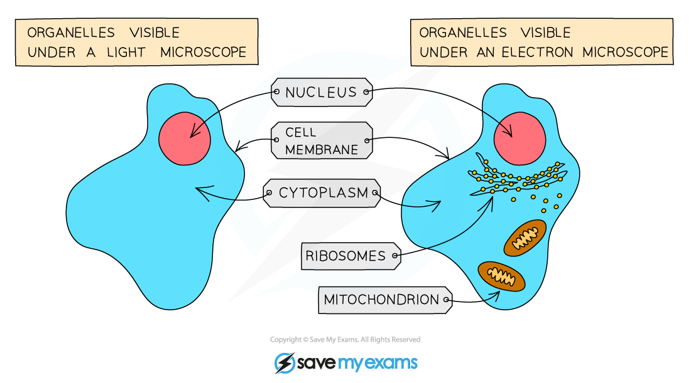
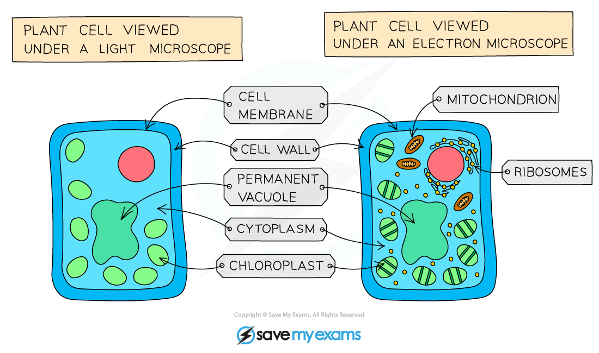

# Cell Structure

## Animal & Plant Cells

> **Spec point** — `spcpt_yJQZ5jXv3CZknwpQ`

## Animal & Plant Cells

### Animal cells

- Animal cells have the following structural features:

  - A **cell membrane** that separates them from their surroundings
  - A gel-like liquid known as **cytoplasm**
  - A **nucleus**
  - **Mitochondria** (singular mitochondrion)
  - Many tiny **ribosomes**

***Animal cells have a cell membrane, cytoplasm, nucleus, mitochondria and ribosomes***

### Plant cells

- Plant cells share the features of animal cells, so they contain:

  - Cell membrane
  - Cytoplasm
  - Nucleus
  - Mitochondria
  - Ribosomes
- Plant cells also have some structural features that are not present in animal cells:

  - A **cell wall** made of cellulose
  - Large structures called **chloroplasts** that contain the green pigment chlorophyll
  - A permanent** vacuole**

***Plant cells have all of the features found in animal cells, as well as a cellulose cell wall, chloroplasts and a permanent vacuole***

### Comparing animal and plant cell structures

| **Structure** | **Animal / plant cells** |
|---|---|
| Cell membrane | Both |
| Cytoplasm | Both |
| Nucleus | Both |
| Mitochondria | Both |
| Ribosomes | Both |
| Cellulose cell wall | Plant only |
| Chloroplasts | Plant only |
| Permanent vacuole | Plant only |

#### Comparing animal and plant cell structure diagram

***Animal and plant cells have some features in common, while other features are found only in plant cells***

## Bacteria Cells

> **Spec point** — `spcpt_7T8xT94wKnqfx6hp`

## Bacteria Cells

- Bacteria are microscopic, **single-celled organisms**
- They have a cell structure that is distinct from that of animals and plants:
- Features of bacterial cells include:

  - Bacterial cells contain a **cell membrane**, and have **cytoplasm** and **ribosomes**
  - Bacterial cells have **cell walls** made of a chemical called **peptidoglycan**; this is different to the cellulose cell walls of plants
  - The **DNA** of bacteria is** circular**
  - Some bacteria have small loops of DNA known as **plasmids**
- Bacteria lack some features that are present in animal and plant cells:

  - They **do not contain internal membranes**, so they lack:
  
    - A nucleus
    - Mitochondria
    - Chloroplasts

***Bacteria have a cell wall, cell membrane, cytoplasm, ribosomes, circular DNA and, in some cases, plasmids***

## Identifying Cell Structures & Function

> **Spec point** — `spcpt_Xz8HFk73jWRBfSn3`

## Identifying Cell Structures & Function

### Identifying cellular structures

- It is possible to identify cellular features in **diagrams **and when looking at **microscope images**
- The structures that are visible depend on the magnification at which a cell is being viewed, e.g.

  - Under a** light microscope** structures are viewed at a relatively low magnification, so it is possible to view:
  
    - Nucleus
    - Chloroplasts
    - The position of the cytoplasm, cell membrane and cell walls, but no details of these structures
  - Under an **electron microscope** much higher magnification can be achieved, so it is possible to view:
  
    - Mitochondria
    - Ribosomes
    - Details of structures, e.g. cell walls and chloroplasts

***The structures visible in animal and plant cells will differ depending on the type of microscope used***

### Functions of cellular structures

| **Structure** | **Cell type** | **Function** |
|---|---|---|
| Cell membrane | Animal  Plant  Bacteria | Separates the cell contents from the external environment  Controls passage of substances into and out of the cell |
| Cytoplasm | Animal  Plant  Bacteria | Gel-like liquid within which the chemical reactions of the cell occur  Provides some structural support to the cell |
| Nucleus | Animal  Plant | Contains the genetic material of the cell in the form of DNA |
| Mitochondria | Animal  Plant | Site of aerobic respiration, releasing energy for cell activities |
| Ribosomes | Animal  Plant  Bacteria | Site of protein production, also known as protein synthesis |
| Cellulose cell wall | Plant | Provides structural support to the cell, giving plant cells a rigid shape |
| Chloroplasts | Plant | Contain chlorophyll and absorb light energy for photosynthesis |
| Permanent vacuole | Plant | Storage of cell sap; this is a solution that contains sugars and salts dissolved in water  When full of cell sap the vacuole provides additional support to the cell |
| Circular DNA | Bacteria | Contains the genetic material of the cell |
| Plasmids | Bacteria | Carry a small number of genes  Can be passed from one cell to another easily |
| Peptidoglycan cell wall | Bacteria | Provides structural support to the cell, giving bacterial cells their shape |
