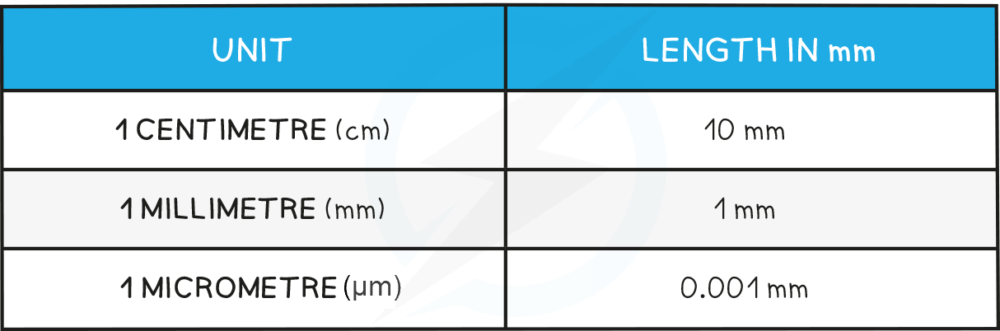

# Converting Between Units

## Converting Between Units: Extended

> **Spec point** — `spcpt_YDfKhrVnq4ryvkC6`

## Converting Between Units: Extended

### Extended Tier Only

- The size of cellular structures is often given in **micrometres** (**μm**), while rulers are usually used to measure the size of objects in **millimetres** (**mm**)
- The conversion between µm and mm is:

**1 mm = 1000 µm**

- The discrepancy between cellular size and the measurements that can be gained using a ruler means that calculations will sometimes require **conversion between μm and mm**, or vice versa

#### Unit conversions table

#### Converting mm to μm diagram

> **Worked Example**
> 
> 
> **Answer:**
> 
> **Step 1: convert the units so that they match**
> 
> 1 mm = 1000 µm
> 
> The actual thickness of the leaf is given as 2000 µm
> 
> To convert 2000 µm into mm we divide this number by 1000
> 
> 2000 ÷ 1000 = 2
> 
> The actual thickness of the leaf in mm is **2 mm**
> 
> **Step 2: enter numbers into the magnification equation**
> 
> magnification = image size ÷ actual size
> 
> 50 ÷ 2 = 25
> 
> So the magnification is** x25**

> **Exam Hint**
> Unit conversion is the most common source of error in questions that include magnification calculations, so **don't forget **to do this, and **make sure that you are confident** converting µm into mm or mm into µm.
